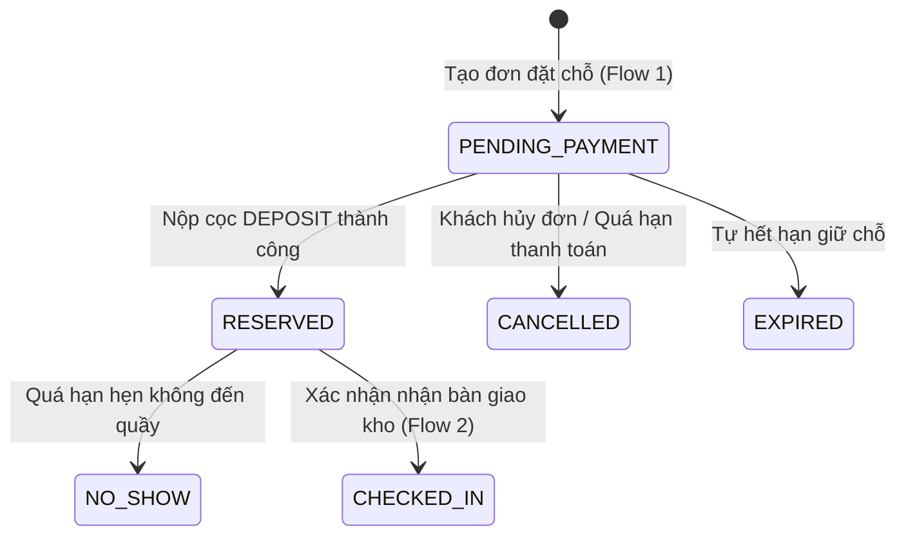

# BỘ TÀI LIỆU ĐẶC TẢ CHI TIẾT FLOW CÁC ACTOR & HỆ THỐNG DỊCH VỤ (SYSTEM & ACTOR SPECIFICATION)
## DỰ ÁN HỆ THỐNG CHO THUÊ KHO TỰ QUẢN (SELF-STORAGE MANAGEMENT SYSTEM)

- **Mã dự án:** SWP391 - Storage Rental Management
- **Phiên bản tài liệu:** 2.0 (Toàn diện cho 5 Actors, 10 Services và 7 Core Flows)
- **Công nghệ nền tảng:** Spring Boot 3.3.4 (Java 21) + React 19 (Vite) + PostgreSQL / Supabase & H2 Database
- **Đối chiếu thiết kế:** Figma UI Baseline (12 màn hình cốt lõi SCR-C01 $\rightarrow$ C06, SCR-S01 $\rightarrow$ S06 và Backoffice)

---

## MỤC LỤC
1. [Kiến trúc tổng quan & Danh mục 10 Service](#1-kiến-trúc-tổng-quan--danh-mục-10-service)
2. [Chi tiết Flow thao tác của 5 Actors](#2-chi-tiết-flow-thao-tác-của-5-actors)
   - 2.1. Storage Customer (Khách hàng thuê kho)
   - 2.2. Facility Staff (Nhân viên vận hành cơ sở)
   - 2.3. Facility Manager (Quản lý chi nhánh cơ sở)
   - 2.4. Business Operations Manager (Ban Vận hành & Kinh doanh toàn chuỗi)
   - 2.5. System Administrator (Quản trị viên hệ thống)
3. [Chi tiết 7 Quy trình nghiệp vụ cốt lõi (Core Business Flows)](#3-chi-tiết-7-quy-trình-nghiệp-vụ-cốt-lõi)
4. [Ma trận vòng đời & Chuyển đổi trạng thái (State Transitions)](#4-ma-trận-vòng-đời--chuyển-đổi-trạng-thái)
5. [Bảng tra cứu Route Frontend và Endpoint Backend](#5-bảng-tra-cứu-route-frontend-và-endpoint-backend)

---

## 1. Kiến trúc tổng quan & Danh mục 10 Service

Hệ thống được thiết kế theo kiến trúc Module Monolith hướng Domain-Driven Design (DDD), phân chia ranh giới rõ ràng thành 10 dịch vụ (module backend) tương ứng với các phân hệ giao diện frontend:

| Mã | Tên Service | Module Backend | Nhiệm vụ chính | Giao diện Frontend tương ứng |
|---|---|---|---|---|
| **S1** | **Identity & Access** | `modules.identity` | Đăng ký, gửi OTP, đăng nhập JWT, quản lý phiên, xác thực đa vai trò. | `AuthPage`, `session.js` |
| **S2** | **Facility & Storage** | `modules.facility` | Quản lý cơ sở, khoang kho (S/M/L/CLIMATE), ảnh 3D, mặt bằng, trạng thái kho. | `CatalogPage`, `ManageFacilitiesPage`, `ManageUnitsPage`, `UnitStatusPage` |
| **S3** | **Reservation** | `modules.reservation` | Báo giá tự động, giữ chỗ, lịch hẹn tiếp đón, khóa chống tranh chấp kho trống. | `CreateReservationPage`, `MyReservationsPage`, `ReservationDetailPage`, `CheckinPassPage` |
| **S4** | **Billing & Payment** | `modules.billing` | Phát hành hóa đơn (DEPOSIT, RENT, RENEW), thanh toán VietQR / VNPay, quản lý hoàn cọc. | `InvoicePaymentPage`, `PaymentResultPage`, `PaymentHistoryPage`, `Refund*` |
| **S5** | **Rental & Access** | `modules.rental` | Quản lý hợp đồng điện tử, bàn giao, kiểm soát mã PIN mở cửa, gia hạn, trả kho. | `MyRentalsPage`, `RentalContractDetailPage`, `CustomerAccessPage`, `HandoverPage`, `ReturnInspectionPage` |
| **S6** | **Workforce** | `modules.workforce` | Quản lý công việc hàng ngày của Staff (Check-in, Nghiệm thu, Vệ sinh, Bảo trì), phân công ca. | `StaffTaskBoardPage`, `StaffAssignmentPage` |
| **S7** | **Support & Incidents** | `modules.support` | Tiếp nhận và xử lý sự cố (kẹt cửa, mất chìa, quên PIN), đính kèm ảnh, đánh giá 1-5 sao. | `CustomerSupportPage`, `IncidentDeskPage` |
| **S8** | **Policy & Pricing** | `modules.policy` | Khung giá chuẩn, biên độ giá Min/Max, phụ phí phát sinh, chiết khấu kỳ hạn, trần phạt quá hạn. | `PricingPolicyPage`, `RentalPolicyPage`, `FacilityOverdueCapPage` |
| **S9** | **Reporting & Analytics** | `modules.reporting` | Thống kê lấp đầy, doanh thu cọc/thuê, công nợ, xuất báo cáo quản trị CSV / Excel (XLSX). | `FacilityDashboardPage`, `FacilityReportPage`, `ChainDashboardPage`, `BusinessOperationsPage` |
| **S10** | **Audit & Logging** | `modules.audit` | Ghi vết nhật ký nghiệp vụ tự động từ Principal, lưu vết đăng nhập và kiểm toán hệ thống. | `AuditAndLoginHistoryPage` |

---

## 2. Chi tiết Flow thao tác của 5 Actors

### 2.1. Storage Customer (Khách hàng thuê kho)

```
[Khách truy cập] ──> [Đăng ký & Xác thực OTP] ──> [Đăng nhập]
         │
         ▼
[Khám phá Catalog & Tìm kho] ──> [Đặt giữ chỗ kho trực tuyến] ──> [Thanh toán cọc VietQR/VNPay]
         │
         ▼
[Hẹn lịch tiếp đón] ──> [Chấp thuận điều khoản HĐ] ──> [Thanh toán tiền thuê tháng đầu]
         │
         ▼
[Nhận Thẻ Check-in Boarding Pass] ──> [Đến quầy, kiểm tra kho & Ký nhận bàn giao trên App]
         │
         ▼
[Quản lý kho đang thuê: Tra cứu PIN, Đổi PIN, Mở khóa vào kho]
         │
         ├───> [Gia hạn hợp đồng (Renew) khi sắp hết hạn]
         ├───> [Gửi yêu cầu hỗ trợ sự cố (Ticket) & Đánh giá]
         └───> [Yêu cầu trả kho khi hết nhu cầu ──> Nhận hoàn tiền cọc]
```

- **Bước 1: Đăng ký & Xác minh tài khoản (`/register`, `/verify-otp`)**
  - Khách điền thông tin: Họ tên, Email, Số điện thoại (10 chữ số), Số CCCD (12 chữ số), Tên đăng nhập và Mật khẩu.
  - Hệ thống gửi mã OTP 6 số qua Email. Khách nhập mã để kích hoạt tài khoản `CUSTOMER`.
- **Bước 2: Đăng nhập (`/login`)**
  - Đăng nhập bằng tài khoản vừa tạo. Hệ thống cấp JWT Token và điều hướng vào Trang chủ.
- **Bước 3: Khám phá Catalog & Tìm phòng kho (`/`, `/storage`, `/storage/:unitCode`)**
  - Khách chọn cơ sở (ví dụ: *Hà Nội - Cầu Giấy*).
  - Chọn phân loại kho: Kho nhỏ S ($1-3m^2$), Kho vừa M ($4-8m^2$), Kho lớn L ($>9m^2$), Kho mát CLIMATE.
  - Xem thông số chi tiết: Dài $\times$ Rộng $\times$ Cao, thể tích $m^3$, sức chứa minh họa 3D, tiện ích an ninh và số lượng kho trống khả dụng (`Available Units`).
- **Bước 4: Đặt giữ chỗ trực tuyến (`/reservations/new`)**
  - Chọn ngày bắt đầu thuê và thời hạn thuê (1 tháng, 3 tháng giảm 5%, 6 tháng giảm 10%, 12 tháng giảm 15%).
  - Hệ thống gọi API báo giá tức thì (`POST /reservations/calculate`).
  - Khách bấm **Xác nhận đặt giữ chỗ** $\rightarrow$ Hệ thống tạo đơn đặt chỗ `RSV-...` ở trạng thái `PENDING_PAYMENT` và phát hành hóa đơn cọc `DEPOSIT`.
- **Bước 5: Thanh toán tiền đặt cọc giữ phòng (`/invoices/:id/pay`)**
  - Màn hình hiển thị mã QR VietQR động (chứa số tài khoản, số tiền và nội dung chuyển khoản tự động) hoặc cổng thanh toán VNPay Sandbox.
  - Sau khi giao dịch hoàn tất $\rightarrow$ Đơn chuyển sang `RESERVED` (phòng được khóa giữ chỗ an toàn trong thời hạn quy định).
- **Bước 6: Đặt lịch hẹn tiếp đón & Chấp thuận hợp đồng**
  - Khách chọn khung giờ hẹn đến nhận kho tại `/reservations/:id/appointment` (ví dụ: `14:00 - 15:00`).
  - Đọc dự thảo hợp đồng điện tử tại `/reservations/:id/contract-offer`, tick chọn đồng ý điều khoản $\rightarrow$ Hệ thống phát hành hóa đơn cước thuê kỳ đầu (`RENT`).
- **Bước 7: Thanh toán tiền thuê kỳ đầu & Nhận Thẻ Check-in (`/reservations/:id/pass`)**
  - Khách thanh toán hóa đơn `RENT` $\rightarrow$ Hợp đồng chuyển sang `PENDING_HANDOVER`.
  - Khách nhận **Thẻ tiếp đón Check-in điện tử (Digital Boarding Pass)** có mã QR check-in, số phòng chỉ định chính thức (ví dụ: `UNIT A-102`), tên nhân viên đón tiếp và bản đồ chỉ dẫn.
- **Bước 8: Xác nhận biên bản bàn giao**
  - Khi đến cơ sở, sau khi nhân viên dẫn đi kiểm tra kho thực tế và lập biên bản, khách mở App kiểm tra danh mục bàn giao (ổ khóa, chìa khóa, thẻ từ, mã PIN).
  - Khách bấm **Xác nhận bàn giao** $\rightarrow$ Hợp đồng chính thức kích hoạt `ACTIVE`, kho chuyển sang `occupied`.
- **Bước 9: Quản lý kho đang thuê (`/rentals`, `/rentals/:contractId`)**
  - Xem danh sách kho đang thuê, thời hạn hợp đồng, ngày hết hạn.
  - Bàn phím điện tử PIN: Bấm xem mã PIN 6 số cá nhân mở cửa kho, sao chép PIN hoặc đổi mã PIN mới trực tiếp trên giao diện.
  - Thử nghiệm mô phỏng mở khóa cửa kho tại `/rentals/access`.
- **Bước 10: Gia hạn, Trả kho & Hỗ trợ sự cố**
  - **Gia hạn (`/rentals/renew`):** Chọn số tháng gia hạn $\rightarrow$ sinh hóa đơn `RENEW` $\rightarrow$ thanh toán để tự động nối dài hợp đồng.
  - **Yêu cầu trả kho (`/rentals/return`):** Chọn ngày dự kiến dọn đồ và hẹn nhân viên nghiệm thu.
  - **Theo dõi hoàn tiền cọc (`/refunds`):** Theo dõi tiến độ hoàn trả tiền cọc về tài khoản ngân hàng sau khi nghiệm thu trả kho.
  - **Gửi Ticket hỗ trợ (`/support`):** Tạo yêu cầu hỗ trợ khi gặp sự cố (quên PIN, kẹt khóa, rò rỉ ẩm, hóa đơn), đính kèm ảnh và đánh giá 1-5 sao sau khi nhân viên xử lý xong.

---

### 2.2. Facility Staff (Nhân viên vận hành cơ sở)

```
[Đăng nhập Staff] ──> [Dashboard ca trực /facility/tasks/my]
         │
         ├───> [Tiếp đón Check-in: Tra cứu đơn -> Xem PIN tạm -> Kiểm tra thực địa -> Lập biên bản bàn giao]
         ├───> [Nghiệm thu Check-out: Kiểm tra vệ sinh/ổ khóa -> Tính cấn trừ -> Đóng HĐ -> Chuyển kho cleaning]
         ├───> [Xử lý dọn dẹp vệ sinh kho: Thực hiện task CLEANING -> Gửi duyệt ready cho Manager]
         ├───> [Xử lý sự cố tại quầy: Tiếp nhận ticket -> Khắc phục thực tế -> Chụp ảnh/Ghi chú -> Đóng sự cố]
         └───> [Giải ngân hoàn tiền cọc: Chuyển khoản ngân hàng -> Tải ảnh ủy nhiệm chi lên hệ thống]
```

- **Bước 1: Đăng nhập ca trực (`/login`):** Dùng tài khoản nhân viên được gán theo cơ sở (ví dụ: `staff` tại cơ sở `HN-CG`).
- **Bước 2: Quản lý hàng đợi công việc ca trực (`/facility/tasks/my`):**
  - Xem danh sách công việc được Manager phân công trong ngày: Hàng đợi Check-in khách đến, Hàng đợi Nghiệm thu trả kho, Task Vệ sinh dọn dẹp, Task Bảo trì kỹ thuật.
- **Bước 3: Quy trình Check-in & Bàn giao kho:**
  - **Tra cứu đơn (`/facility/reservations/lookup`):** Nhập mã đơn/CCCD/SĐT hoặc quét mã QR trên thẻ hẹn của khách khi khách đến quầy, bấm xác nhận khách **Đã đến quầy** (`arrived`).
  - **Mở hồ sơ bàn giao (`/facility/handovers/:reservationId`):**
    - Hệ thống mở thông tin kiểm tra: Họ tên, CCCD, mã PIN tạm thời (`unitPin`) và mã PIN cổng cơ sở (`facilityPin`) để dẫn khách vào kho.
    - Dẫn khách kiểm tra hiện trường: Sàn kho sạch sẽ, cửa cuốn trơn tru, đèn cảm biến hoạt động tốt, ổ khóa an toàn.
    - Cấp 01 ổ khóa cơ + 02 chìa, cấp 01 thẻ từ ra vào cổng 24/7.
    - Điền biên bản bàn giao điện tử, tải ảnh chụp thực tế và bấm **Lập biên bản bàn giao** gửi khách ký duyệt.
- **Bước 4: Quy trình Nghiệm thu trả kho (Return Inspection):**
  - Mở hồ sơ nghiệm thu (`/facility/inspections/:contractId`):
    - Kiểm tra hiện trạng: Khách đã dọn sạch đồ đạc cá nhân, sàn kho sạch không bám dầu mỡ/hóa chất, vách ngăn và cửa cuốn nguyên vẹn.
    - Thu hồi đầy đủ 02 chìa khóa cơ và 01 thẻ từ.
    - Ghi nhận vi phạm (nếu có): Tích chọn nếu hỏng khóa (`newLockFee`) hoặc sàn kho bẩn (`cleaningFee`). Hệ thống tự động tính cấn trừ vào tiền cọc đang giữ.
    - Bấm **Xác nhận Nghiệm thu & Hoàn tất Check-out** $\rightarrow$ Hợp đồng kết thúc `TERMINATED`, xóa mã PIN của khách, trạng thái phòng kho chuyển sang `cleaning` và hệ thống tự động sinh task dọn dẹp mới.
- **Bước 5: Thực hiện task vệ sinh phòng kho:**
  - Nhận task `CLEANING` trên bàn công việc, tiến hành quét dọn, khử khuẩn phòng kho.
  - Hoàn tất công việc, bấm gửi yêu cầu kho sẵn sàng (`ready`) lên Manager phê duyệt.
- **Bước 6: Thực hiện chi trả hoàn cọc (`/facility/refunds/evidence`):**
  - Sau khi Manager duyệt lệnh hoàn cọc, Staff thực hiện lệnh chuyển khoản ngân hàng số tiền cọc hoàn lại cho khách.
  - Chụp ảnh biên lai giao dịch / ủy nhiệm chi ngân hàng và tải lên hệ thống để lưu trữ bằng chứng.
- **Bước 7: Xử lý sự cố tại quầy (`/facility/incidents`):**
  - Tiếp nhận các ticket hỗ trợ từ khách gửi đến cơ sở.
  - Chuyển trạng thái sang `IN_PROGRESS`, ghi chú hướng xử lý (cắt khóa hỏng, reset PIN, bảo dưỡng cửa cuốn) và bấm hoàn tất (`RESOLVED`).

---

### 2.3. Facility Manager (Quản lý chi nhánh cơ sở)

```
[Đăng nhập Manager] ──> [Tổng quan cơ sở /facility/overview]
         │
         ├───> [Quản lý phòng kho & Cập nhật giá /facility/units]
         ├───> [Gán phòng kho cho các đơn đã nộp cọc /facility/reservations/assign]
         ├───> [Phân công ca trực & Task cho nhân viên Staff /facility/tasks/assign]
         ├───> [Theo dõi danh sách Hợp đồng & Hóa đơn cơ sở /facility/contracts, /facility/invoices]
         ├───> [Kiểm tra & Duyệt kho sẵn sàng cho thuê lại /facility/units/ready]
         ├───> [Phê duyệt & Xác nhận hoàn cọc 2 bước /facility/refunds/approve, confirm]
         ├───> [Xử lý đơn quá hạn không đến NO_SHOW /facility/no-show]
         ├───> [Cài đặt trần phạt quá hạn chi nhánh /facility/overdue-cap]
         └───> [Báo cáo doanh thu & Lấp đầy cơ sở, Xuất Excel /facility/reports]
```

- **Bước 1: Đăng nhập (`/login`):** Dùng tài khoản Quản lý cơ sở (ví dụ: `manager` tại chi nhánh `HN-CG`).
- **Bước 2: Bảng điều khiển tổng quan cơ sở (`/facility/overview`):**
  - Nắm bắt tức thì các chỉ số trọng yếu: Tỷ lệ lấp đầy kho, số lượng kho trống, kho đang sử dụng, kho đang bảo trì/vệ sinh.
  - Xem dòng tiền cọc và cước thuê trong tháng.
  - Thực hiện cấp và xoay vòng mã PIN check-in của cơ sở (`checkinPin`).
- **Bước 3: Quản lý mặt bằng & Phòng kho (`/facility/units`, `/facility/storage-types`):**
  - Khởi tạo phòng kho mới: Mã kho (vd: `HN-CG-105`), phân loại kho (S/M/L/CLIMATE), diện tích $m^2$, giá thuê tháng, tầng, link ảnh phòng kho.
  - Điều chỉnh giá thuê phòng kho: Hệ thống tự động chặn nếu giá sửa vượt ngoài khung Min/Max mà Ban điều hành toàn chuỗi cho phép.
- **Bước 4: Gán phòng kho cho đơn đặt chỗ (`/facility/reservations/assign`):**
  - Xem danh sách các đơn khách hàng đã thanh toán cọc thành công (`RESERVED`).
  - Lựa chọn phòng kho vật lý đang trống thích hợp để gán vào đơn đặt chỗ.
- **Bước 5: Phân công công việc nhân sự (`/facility/tasks/assign`):**
  - Xem danh sách nhân viên Staff trực ca.
  - Phân bổ nhân sự thực hiện các đầu việc: Check-in đón khách, Nghiệm thu trả kho, Vệ sinh khử khuẩn, hoặc Bảo trì sửa chữa.
- **Bước 6: Duyệt phòng kho sẵn sàng cho thuê (`/facility/units/ready`):**
  - Sau khi nhân viên Staff dọn dẹp vệ sinh kho xong, Manager vào kiểm tra chất lượng thực tế.
  - Bấm **Duyệt kho sẵn sàng** $\rightarrow$ Phòng kho chuyển từ trạng thái `cleaning`/`maintenance` sang `available`, sẵn sàng mở lại trên Catalog cho khách mới thuê.
- **Bước 7: Quy trình duyệt hoàn tiền cọc 2 bước:**
  - **Bước 1 - Duyệt lệnh hoàn tiền (`/facility/refunds/approve`):** Xem xét đơn xin hoàn cọc sau nghiệm thu, phê duyệt số tiền cọc hoàn lại (`APPROVE`).
  - **Bước 2 - Xác nhận hoàn tất giải ngân (`/facility/refunds/confirm`):** Sau khi Staff chuyển khoản và tải biên lai lên, Manager đối soát chứng từ và xác nhận đóng hồ sơ hoàn tiền (`CONFIRM`).
- **Bước 8: Xử lý đơn quá hạn không đến NO_SHOW (`/facility/no-show`):**
  - Lọc các đơn đặt chỗ quá hạn hẹn mà khách không đến, kích hoạt quy trình NO_SHOW để giải phóng phòng kho về trạng thái trống và xử lý cọc theo chính sách.
- **Bước 9: Quản lý trần phạt quá hạn (`/facility/overdue-cap`):**
  - Thiết lập tỷ lệ trần phạt tối đa đối với khách nợ cước quá hạn tại chi nhánh (mặc định tối đa 50% tiền thuê tháng).
- **Bước 10: Báo cáo cơ sở & Xuất file quản trị (`/facility/reports`):**
  - Xem thống kê chi tiết theo khoảng ngày: Doanh thu tiền thuê, tiền cọc, phụ phí, tiền hoàn trả, tỷ lệ sử dụng kho.
  - Bấm **Export CSV** hoặc **Export XLSX** để tải báo cáo tài chính về máy tính.

---

### 2.4. Business Operations Manager (Ban Vận hành & Kinh doanh toàn chuỗi)

```
[Đăng nhập BOM] ──> [Tổng quan chuỗi toàn quốc /operations/overview]
         │
         ├───> [Quản lý mạng lưới chi nhánh /operations/facilities]
         ├───> [Quản lý khung giá trần/sàn & Biểu phí phạt /operations/pricing]
         ├───> [Cấu hình chính sách cho thuê chung /operations/policies]
         ├───> [Giám sát quyết toán vận hành chuỗi /operations/settlement]
         └───> [Báo cáo tổng hợp kinh doanh toàn chuỗi & Xuất file /operations/reports]
```

- **Bước 1: Đăng nhập (`/login`):** Dùng tài khoản Ban điều hành chuỗi (ví dụ: `business` với vai trò `OPS_MGR`).
- **Bước 2: Bảng điều khiển kinh doanh toàn chuỗi (`/operations/overview`):**
  - Giám sát toàn bộ các chi nhánh trên cả nước: Tổng số cơ sở, tổng số phòng kho, tỷ lệ lấp đầy bình quân toàn hệ thống, tổng dòng tiền thu vào và hoàn ra.
- **Bước 3: Mở rộng & Quản lý mạng lưới chi nhánh (`/operations/facilities`):**
  - Xem danh mục mạng lưới các cơ sở lưu trữ tại các tỉnh/thành phố.
  - Khởi tạo chi nhánh cơ sở mới: Mã chi nhánh (vd: `HCM-TB`), tên cơ sở, địa chỉ chi tiết, tỉnh/thành phố, hotline liên hệ.
- **Bước 4: Quản lý chính sách giá & Biểu phí chuỗi (`/operations/pricing`):**
  - **Giá chuẩn các loại kho:** Cấu hình đơn giá niêm yết chuẩn cho kho loại S, M, L, CLIMATE (`price.S`, `price.M`, `price.L`, `price.CLIMATE`).
  - **Biên độ giá Min/Max:** Quy định giá sàn và giá trần cho từng loại kho (`price.min.S`, `price.max.S`...). Các Manager chi nhánh chỉ được định giá kho trong biên độ này.
  - **Biểu phụ phí:** Thiết lập mức thu phí vệ sinh kho (`cleaningFee`), phí thay ổ khóa cơ mới (`newLockFee`), mức phạt nợ cước trễ hạn mỗi ngày (`overdueDailyFee`).
  - **Chính sách chiết khấu kỳ hạn:** Cấu hình tỷ lệ giảm giá khi khách thuê dài hạn: 3 tháng (`discount.3` = 5%), 6 tháng (`discount.6` = 10%), 12 tháng (`discount.12` = 15%).
- **Bước 5: Cấu hình chính sách cho thuê chung (`/operations/policies`):**
  - Thiết lập số tháng cọc bắt buộc (`depositMonths = 1`).
  - Thiết lập số ngày ân hạn trước khi khóa kho (`gracePeriodDays = 3`).
  - Cấu hình thời hạn giữ chỗ của đơn đặt.
- **Bước 6: Quyết toán vận hành & Báo cáo chuỗi (`/operations/settlement`, `/operations/reports`):**
  - Xem bảng so sánh hiệu suất và doanh thu giữa tất cả các chi nhánh.
  - Xuất báo cáo tài chính hợp nhất toàn quốc định dạng CSV hoặc Excel (XLSX).

---

### 2.5. System Administrator (Quản trị viên hệ thống)

```
[Đăng nhập Admin] ──> [Tổng quan quản trị hệ thống /admin/overview]
         │
         ├───> [Quản trị người dùng & Khóa/Mở tài khoản /admin/users]
         ├───> [Phân quyền vai trò & Ma trận RBAC Matrix /admin/roles]
         ├───> [Gán cơ sở làm việc cho nhân viên /admin/staff-assignments]
         └───> [Giám sát Nhật ký kiểm toán & Lịch sử Login /admin/activity]
```

- **Bước 1: Đăng nhập (`/login`):** Dùng tài khoản quản trị hệ thống tối cao (ví dụ: `admin` với vai trò `ADMIN`).
- **Bước 2: Bảng điều khiển quản trị (`/admin/overview`):**
  - Giám sát tổng số lượng tài khoản theo từng nhóm vai trò (`CUSTOMER`, `STAFF`, `FMANAGER`, `OPS_MGR`, `ADMIN`), số chi nhánh cơ sở và trạng thái dịch vụ hệ thống.
- **Bước 3: Quản trị tài khoản người dùng (`/admin/users`):**
  - Xem danh sách toàn bộ tài khoản người dùng trên hệ thống.
  - Tạo mới tài khoản nội bộ cho nhân sự (Staff, Manager, Ban điều hành).
  - Quản lý trạng thái tài khoản: Kích hoạt (`ACTIVE`), Tạm khóa (`LOCKED`), hoặc Vô hiệu hóa (`DISABLED`).
  - Tra cứu tài khoản theo Họ tên, Email, Số CCCD hoặc Số điện thoại.
- **Bước 4: Phân quyền vai trò & Ma trận RBAC (`/admin/roles`):**
  - Tra cứu ma trận phân quyền bảo mật (RBAC Matrix): Xem xét quyền gọi API và quyền truy cập nghiệp vụ của từng vai trò.
  - Thay đổi vai trò (Role) của người dùng khi có sự thay đổi vị trí công tác.
- **Bước 5: Gán cơ sở cho nhân sự (`/admin/staff-assignments`):**
  - Phân bổ nhân viên Staff và Facility Manager vào đúng cơ sở chi nhánh (`facilityCode`).
  - Đảm bảo an toàn phân vùng dữ liệu: Nhân sự chi nhánh nào chỉ được phép xem và xử lý dữ liệu của chi nhánh đó.
- **Bước 6: Nhật ký kiểm toán & Lịch sử đăng nhập (`/admin/activity`):**
  - **Lịch sử đăng nhập (`login-history`):** Giám sát tất cả các phiên đăng nhập vào hệ thống: Tên người dùng, thời gian, IP truy cập, thiết bị trình duyệt, đăng nhập thành công hay thất bại.
  - **Nhật ký kiểm toán nghiệp vụ (`audit-logs`):** Giám sát chi tiết mọi hành vi thay đổi dữ liệu quan trọng: Thời gian, người thực hiện, hành động (`CREATE_RESERVATION`, `ASSIGN_UNIT`, `UPDATE_PRICE`, `UPDATE_PIN`, `CONFIRM_HANDOVER`, `COMPLETE_RETURN`...).

---

## 3. Chi tiết 7 Quy trình nghiệp vụ cốt lõi

### Flow 1: Đặt phòng kho & Giữ chỗ (Storage Unit Reservation Flow)
- **Mục tiêu:** Khách hàng tìm kiếm, nhận báo giá minh bạch, đặt giữ phòng và thanh toán tiền đặt cọc cam kết giữ chỗ.
- **Cơ chế chống race condition:** Khi khách tạo đơn, hệ thống áp dụng khóa đồng thời (pessimistic lock) trên cơ sở và kiểm tra sức chứa khả dụng thông qua `ReservationHoldPolicy`. Đơn giữ chỗ giữ kho trong 5 phút; nếu thanh toán cọc thành công, trạng thái chuyển sang `RESERVED`. Manager cơ sở tiến hành gán mã phòng cụ thể.

### Flow 2: Check-in & Bàn giao kho (Check-in and Handover Flow)
- **Mục tiêu:** Tiếp đón khách hàng theo lịch hẹn, xác minh giấy tờ CCCD, đối chiếu phòng kho, cấp phương tiện truy cập (khóa cơ, thẻ từ, mã PIN) và ký biên bản bàn giao điện tử.
- **Cơ chế:** Khách thanh toán hóa đơn `RENT` trước khi bàn giao. Nhân viên Staff sử dụng mã PIN tạm thời (`unitPin`) để dẫn khách vào phòng kiểm tra hiện trường. Sau khi Staff lập biên bản kèm ảnh, khách hàng xác nhận trên App để chính thức kích hoạt hợp đồng sang `ACTIVE` và phòng kho chuyển sang `occupied`.

### Flow 3: Quản lý kho thuê & Hoàn cọc (Rented Unit Management Flow)
- **Mục tiêu:** Khách hàng tra cứu mã PIN mở cửa, đổi mã PIN cá nhân, yêu cầu trả kho; nhân viên nghiệm thu thực địa, tính khấu trừ và hoàn trả tiền cọc bảo đảm.
- **Cơ chế:** Khi trả kho, Staff kiểm tra độ sạch và tính nguyên vẹn của ổ khóa/vách ngăn. Hệ thống tự động khấu trừ tiền phạt vệ sinh, tiền thay ổ khóa và tiền trễ hạn (nếu có) vào tiền cọc. Manager duyệt hoàn cọc 2 bước; Staff chuyển khoản và tải biên lai ủy nhiệm chi lên hệ thống.

### Flow 4: Biểu phí, Giá & Quyết toán chuỗi (Business Rules & Fee Management Flow)
- **Mục tiêu:** Ban Vận hành chuỗi (BOM) thiết lập chính sách giá sàn/giá trần, phụ phí, tỷ lệ chiết khấu kỳ hạn và theo dõi doanh thu toàn quốc.
- **Cơ chế:** Quản lý cơ sở chỉ được cập nhật giá phòng kho trong khung Min/Max của BOM. Doanh thu được phân tách minh bạch giữa tiền cọc đang tạm giữ, tiền thuê thực nhận và phụ phí bồi thường. Báo cáo hỗ trợ xuất định dạng CSV và Excel.

### Flow 5: Quản trị cơ sở, Kho & Phân công nhân sự (Facility Storage & Staff Management Flow)
- **Mục tiêu:** Vận hành phòng kho và điều phối nhân sự trực ca tại từng chi nhánh.
- **Cơ chế:** Manager tạo mới kho, phân công nhân viên xử lý các đầu việc (Check-in, Check-out, Dọn dẹp, Bảo trì). Sau khi nhân viên dọn dẹp xong, Manager kiểm tra thực tế và bấm duyệt kho sẵn sàng (`ready`) để đưa kho từ `cleaning` trở lại `available`.

### Flow 6: Gia hạn hợp đồng & Xử lý quá hạn (Storage Renewal & Overdue Handling Flow)
- **Mục tiêu:** Tự động theo dõi hạn thuê, hỗ trợ gia hạn hợp đồng và xử lý các trường hợp quá hạn nợ cước.
- **Cơ chế:** Trước khi hết hạn 7 ngày, hệ thống tự động sinh hóa đơn `RENEW`. Khách có thể thanh toán để tiếp tục sử dụng. Nếu quá hạn kết thúc hợp đồng + 3 ngày ân hạn (`gracePeriodDays`), hệ thống tự động khóa mã PIN, chuyển hợp đồng sang `OVERDUE` và thu hồi quyền ra vào kho.

### Flow 7: Xử lý sự cố & Hỗ trợ kỹ thuật (Support Request & Issue Handling Flow)
- **Mục tiêu:** Tiếp nhận và xử lý nhanh chóng các sự cố phát sinh tại chỗ (quên mã PIN, kẹt khóa cơ, hỏng cửa, thấm ẩm).
- **Cơ chế:** Khách hàng tạo ticket hỗ trợ trên ứng dụng kèm ảnh hiện trường. Nhân viên cơ sở tiếp nhận ticket, tiến hành xử lý thực địa, ghi chú biện pháp khắc phục, tải ảnh hiện trường sau khi giải quyết và đóng ticket để khách đánh giá chất lượng phục vụ.

---

## 4. Ma trận vòng đời & Chuyển đổi trạng thái



| Thực thể | Các trạng thái (States) | Ý nghĩa nghiệp vụ |
|---|---|---|
| **Reservation (Đơn đặt chỗ)** | `PENDING_PAYMENT` | Đơn mới tạo, đang chờ khách thanh toán tiền cọc trong thời hạn giữ chỗ. |
| | `RESERVED` | Đã thanh toán cọc thành công, phòng kho được giữ an toàn, chờ Manager gán phòng. |
| | `CHECKED_IN` | Khách đã đến cơ sở, hoàn tất thủ tục bàn giao và nhận phòng kho. |
| | `CANCELLED` | Đơn bị hủy theo yêu cầu của khách hoặc do sự cố. |
| | `EXPIRED` | Hết thời gian giữ chỗ mà khách không thanh toán cọc. |
| | `NO_SHOW` | Khách đã cọc nhưng quá thời gian hẹn không đến nhận kho. |
| **Contract (Hợp đồng thuê)** | `PENDING_PAYMENT` | Hợp đồng đã tạo dự thảo, đang chờ khách thanh toán cước thuê kỳ đầu (`RENT`). |
| | `PENDING_HANDOVER` | Đã thanh toán tiền thuê, đang chờ Staff lập biên bản và bàn giao kho thực tế. |
| | `ACTIVE` | Hợp đồng đang có hiệu lực sử dụng, mã PIN điện tử đang mở. |
| | `EXPIRING_SOON` | Còn 7 ngày trước khi hết hạn thuê, hệ thống đã phát hành hóa đơn gia hạn `RENEW`. |
| | `OVERDUE` | Quá hạn hợp đồng và hết thời gian ân hạn 3 ngày; mã PIN bị thu hồi tạm thời. |
| | `TERMINATED` | Hợp đồng đã thanh lý hoàn tất sau khi nghiệm thu trả kho. |
| **Unit (Phòng kho)** | `available` | Kho trống, sẵn sàng cho khách hàng tìm kiếm và đặt thuê trên Catalog. |
| | `reserved` | Kho đã được gán cho đơn đặt chỗ đang chờ khách đến nhận. |
| | `occupied` | Kho đang có khách thuê sử dụng thực tế. |
| | `cleaning` | Khách vừa trả kho; kho đang trong quá trình dọn dẹp vệ sinh, khử khuẩn. |
| | `maintenance` | Kho đang tạm khóa để sửa chữa, bảo dưỡng kỹ thuật. |
| **Invoice (Hóa đơn)** | `PENDING` | Hóa đơn đang chờ khách thanh toán. |
| | `PAID` | Hóa đơn đã được thanh toán thành công (qua VietQR hoặc VNPay). |
| | `CANCELLED` | Hóa đơn bị hủy do đơn đặt bị hủy hoặc điều chỉnh. |
| **DailyTask (Công việc Staff)** | `PENDING` | Task đã tạo, đang chờ nhân viên tiếp nhận thực hiện. |
| | `IN_PROGRESS` | Nhân viên đang trực tiếp xử lý công việc tại cơ sở. |
| | `COMPLETED` | Công việc đã hoàn tất và được ghi nhận vào lịch sử ca trực. |
| **SupportTicket (Yêu cầu hỗ trợ)** | `OPEN` | Khách vừa gửi yêu cầu hỗ trợ mới. |
| | `IN_PROGRESS` | Nhân viên cơ sở đã tiếp nhận và đang tiến hành xử lý thực tế. |
| | `RESOLVED` | Đã khắc phục xong sự cố tại quầy hoặc tại phòng kho. |
| | `CLOSED` | Khách hàng đã kiểm tra và đóng ticket, đánh giá sao chất lượng phục vụ. |

---

## 5. Bảng tra cứu Route Frontend và Endpoint Backend

| Vai trò (Actor) | Tên màn hình | Đường dẫn Route (Frontend) | Endpoint Backend chính |
|---|---|---|---|
| **Public / Customer** | Trang chủ | `/` | `GET /api/facilities`, `GET /api/services` |
| | Danh mục kho | `/storage`, `/storage/:unitCode` | `GET /api/facilities/units` |
| | Đặt giữ chỗ kho | `/reservations/new` | `POST /api/reservations/calculate`, `POST /api/reservations` |
| | Đơn đặt của tôi | `/reservations`, `/reservations/:id` | `GET /api/reservations`, `POST /api/reservations/{id}/cancel` |
| | Thanh toán hóa đơn | `/invoices/:id/pay`, `/payment/result` | `POST /api/payments/simulate`, `POST /api/payments/vnpay/*` |
| | Thẻ hẹn tiếp đón | `/reservations/:id/appointment` | `POST /api/reservations/{id}/schedule` |
| | Xác nhận hợp đồng | `/reservations/:id/contract-offer` | `GET /contract-offer`, `POST /contract-terms/accept` |
| | Thẻ Check-in Pass | `/reservations/:id/pass` | `GET /checkin-task`, `POST /{id}/handover/confirm` |
| | Kho đang thuê | `/rentals`, `/rentals/:contractId` | `GET /api/contracts`, `PATCH /api/contracts/{unitCode}/pin` |
| | Xác thực mã PIN | `/rentals/access` | `POST /api/contracts/verify-pin` |
| | Báo giá gia hạn | `/rentals/renew` | `GET /renewal-quote`, `POST /renewal-invoice` |
| | Yêu cầu trả kho | `/rentals/return` | `POST /api/contracts/checkout-request` |
| | Hồ sơ hoàn tiền | `/refunds` | `GET /api/refunds`, `POST /api/refunds` |
| | Hỗ trợ sự cố | `/support` | `GET/POST /api/tickets`, `POST /api/tickets/upload` |
| **Facility Staff** | Hàng đợi ca trực | `/facility/tasks/my` | `GET /api/tasks/daily`, `PATCH /api/tasks/{id}/status` |
| | Tra cứu đơn đặt | `/facility/reservations/lookup` | `GET /api/reservations`, `POST /{id}/arrived` |
| | Thủ tục Bàn giao | `/facility/handovers/:reservationId` | `GET /tasks/{id}/checkin/credentials`, `POST /contracts/handover` |
| | Nghiệm thu trả kho | `/facility/inspections/:contractId` | `POST /api/contracts/return-inspection` |
| | Ma trận phòng kho | `/facility/units/status` | `GET /api/facilities/units/manage`, `POST /{code}/ready` |
| | Bàn xử lý sự cố | `/facility/incidents` | `GET/PATCH /api/tickets/{id}` |
| | Tải bằng chứng hoàn cọc | `/facility/refunds/evidence` | `POST /api/refunds/{id}/evidence` |
| | Mô phỏng PIN cửa | `/facility/access-simulator` | `POST /api/contracts/verify-pin` |
| **Facility Manager** | Tổng quan cơ sở | `/facility/overview` | `GET /api/reports/facility`, `PUT /facilities/{code}/checkin-pin` |
| | Quản lý phòng kho | `/facility/units` | `GET/POST /api/facilities/units`, `PUT /units/{code}` |
| | Gán phòng kho | `/facility/reservations/assign` | `PATCH /api/reservations/{id}/assign-unit` |
| | Phân công nhân viên | `/facility/tasks/assign` | `GET /api/tasks/staff-options`, `POST /tasks/dispatch` |
| | Duyệt kho sẵn sàng | `/facility/units/ready` | `POST /api/facilities/units/{code}/ready/approve` |
| | Phê duyệt hoàn tiền | `/facility/refunds/approve`, `/confirm` | `POST /api/refunds/{id}/decision`, `POST /{id}/confirm` |
| | Xử lý NO_SHOW | `/facility/no-show` | `POST /api/reservations/{id}/no-show` |
| | Trần phạt quá hạn | `/facility/overdue-cap` | `PATCH /api/policies/facility-cap` |
| | Báo cáo cơ sở | `/facility/reports` | `GET /api/reports/facility`, `GET /api/reports/export` |
| **Business Ops** | Tổng quan toàn chuỗi | `/operations/overview` | `GET /api/reports/system` |
| | Quản lý mạng lưới cơ sở | `/operations/facilities` | `GET/POST /api/facilities` |
| | Quản lý giá & phụ phí | `/operations/pricing` | `GET/PATCH /api/policies` |
| | Chính sách cho thuê | `/operations/policies` | `GET/PATCH /api/policies` |
| | Quyết toán chuỗi | `/operations/settlement` | `GET /api/reports/system` |
| | Báo cáo chuỗi | `/operations/reports` | `GET /api/reports/system`, `GET /api/reports/export` |
| **System Admin** | Tổng quan quản trị | `/admin/overview` | `GET /api/reports/system` |
| | Quản lý người dùng | `/admin/users` | `GET/POST/PATCH /api/auth/users` |
| | Phân quyền vai trò | `/admin/roles` | `GET /api/auth/rbac-matrix` |
| | Gán cơ sở nhân viên | `/admin/staff-assignments` | `PATCH /api/auth/users/{id}` |
| | Audit & Login History | `/admin/activity` | `GET /api/auth/login-history`, `GET /api/audit-logs` |

---
*Tài liệu này được biên soạn và lưu trữ chính thức tại kho tài liệu dự án để phục vụ báo cáo thuyết trình và nghiệm thu đồ án SWP391.*

