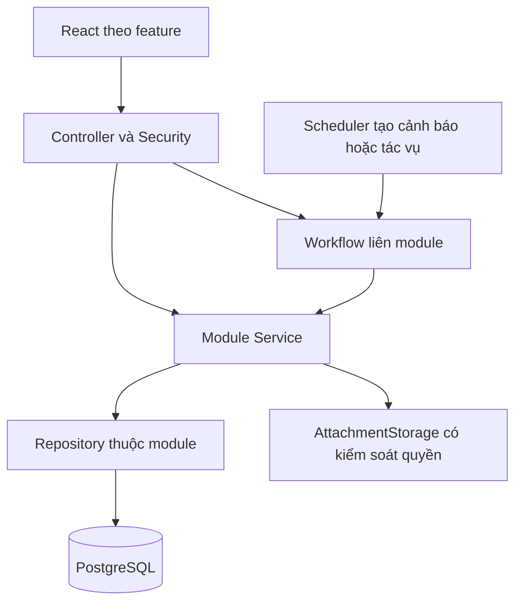

> Bản thiết kế trước triển khai. Xem implementation-structure.md và refactoring-status.md cho cấu trúc đã thực hiện và kết quả kiểm chứng.

# Thiết kế cấu trúc toàn bộ dự án Storage Rental

Cấu trúc đề xuất phục vụ triển khai các yêu cầu đã chốt bằng React + Vite và một backend Spring Boot. Mục tiêu là mỗi module có trách nhiệm rõ, giao dịch liên module được kiểm soát, tài liệu có nguồn chuẩn và nhóm chia việc được theo nghiệp vụ.

Đầu ra lần này là thiết kế kiến trúc thư mục và kế hoạch di chuyển toàn bộ source. Các đường dẫn đích là dự kiến; chưa di chuyển hoặc ghi đè ứng dụng hiện có.

## 1. Nguồn và kết quả kiểm kê

- Mã nguồn chuẩn: ZIP người dùng đã xác nhận, giải nén riêng tại D:/SWP/.tmp/project-review-20261017/demo-repository-main.
- 116 file, trong đó backend có 49 file Java; 31 panel HTML bao gồm phần xác thực và 30 panel theo vai trò.
- app.js: 1.769 dòng, 81.619 byte; index.html: 3.437 dòng, 182.691 byte; style.css: 2.698 dòng, 49.822 byte.
- backend có 9 controller và 8 service chia theo lớp toàn cục; một số service ghép nhiều nghiệp vụ.
- Database chuẩn là schema 15 bảng người dùng gửi riêng. SQL 10 bảng trong ZIP là tài liệu cũ.
- Công nghệ người dùng đã chốt: frontend React + Vite, backend Java Spring Boot. Figma ZI2wVoTC5MsWXC07Y7rpsB là chuẩn giao diện tối thiểu.
- Bản D:/SWP/demo-repository khác ZIP; không dùng những thay đổi đó để đánh giá source chuẩn đã hoàn thành.
- Phân bố file: .github: 2, backend: 51, design: 38, docs: 9, frontend: 10, root: 5, scripts: 1.

Điểm cần sửa về cấu trúc là logic frontend dùng chung một file, biên module backend chưa rõ, DTO và entity bị dùng lẫn vai trò, tài liệu có nhiều bản trùng hoặc viewer, ảnh thiết kế/generator/runtime chưa phân loại rõ. Đổi tên thư mục đơn thuần không giải quyết các lỗi nghiệp vụ đã ghi trong bản hiện trạng.

## 2. Quyết định kiến trúc

1. Giữ hai thư mục backend và frontend ở root để giảm thay đổi đường dẫn và giúp nhóm dễ tiếp cận.
2. Backend là một ứng dụng Spring Boot, một database, chia package theo nghiệp vụ. Chưa có nhu cầu tách microservice.
3. Frontend là một ứng dụng React + Vite. Dùng layout và menu theo role, feature theo nghiệp vụ; không nhân bản thành năm frontend riêng.
4. TypeScript là lựa chọn kỹ thuật đề xuất cho frontend để định nghĩa DTO và trạng thái rõ; React + Vite đã được người dùng chọn.
5. Mỗi bảng/entity có một module sở hữu. Reporting đọc dữ liệu qua query/read model; không tạo lại entity User/Payment/Contract ở mỗi module.
6. Quy tắc đã chốt đặt tại docs/requirements; hợp đồng HTTP đặt tại contracts. Source và contract phải cùng được cập nhật khi hành vi API thay đổi.
7. Luồng đi qua nhiều module đặt trong application/workflow để có ranh giới transaction rõ và tránh service phụ thuộc vòng.

## 3. Cấu trúc root

```text
storage-rental/
├── backend/           Spring Boot, migration runtime, unit/integration test
├── frontend/          React + Vite, component test, assets runtime
├── contracts/         Hợp đồng API và ví dụ request/response
├── database/          Schema tham chiếu, seed dev và hướng dẫn dữ liệu
├── docs/              Yêu cầu, kiến trúc, quyết định, hướng dẫn
├── design/            Figma, ảnh tham chiếu và prototype cũ
├── scripts/           Công cụ dev, kiểm tra, tạo ảnh thiết kế
├── tests/e2e/         Kịch bản UI xuyên frontend/API
├── artifacts/         Đầu ra sinh ra: ảnh, báo cáo test, log; được ignore
├── var/               Dữ liệu local runtime như file đính kèm; được ignore
├── .github/workflows/ CI backend/frontend/contract/docs
├── package.json       Lệnh điều phối npm workspace frontend
├── package-lock.json  Lockfile npm duy nhất tại root
└── README.md          Điểm bắt đầu và liên kết tới tài liệu chi tiết
```

Maven vẫn dùng backend/pom.xml và dependency riêng. Không đưa thư viện Java vào npm, không đặt source vào scripts hoặc docs. Chỉ tạo thư mục khi có nội dung thực; cây đầy đủ là danh sách vị trí dự kiến, không yêu cầu tạo hàng trăm file rỗng.

## 4. Mười module nghiệp vụ

| Module | Trách nhiệm | Dữ liệu sở hữu | Ranh giới |
| --- | --- | --- | --- |
| identity | Tài khoản và xác thực | User, LoginHistory | Đăng nhập/OTP mô phỏng, nhân sự, role, gán chi nhánh; Admin quản lý nhân sự. |
| facility | Chi nhánh và kho | Facility, Unit, UnitType | Danh mục công khai, tồn kho, sơ đồ, Unit và duyệt sẵn sàng; Manager chỉ tại chi nhánh được gán. |
| reservation | Đặt chỗ và NO_SHOW | Reservation, lịch hẹn, giữ chỗ, ngoại lệ | Giữ giá 24 giờ, gán phòng, hủy, khách đã đến, gia hạn chờ và lịch mới được Manager phê duyệt. |
| rental | Vòng đời thuê | Contract, HandoverRecord, InspectionRecord | Bàn giao, PIN mô phỏng, trả kho, nghiệm thu, vệ sinh, gia hạn và tính phí trễ. |
| billing | Hóa đơn và hoàn tiền | Invoice, Payment, RefundRequest, RefundTransaction | Khoản phải thu, từng giao dịch, hạn mức hoàn, bằng chứng và phân tách Staff/Manager; không có ví thanh toán. |
| workforce | Phân công | DailyTask | Manager phân công theo staff_id; Staff chỉ đọc/cập nhật việc được giao, đúng cơ sở. |
| support | Hỗ trợ sự cố | SupportTicket | Ticket, ảnh, tiếp nhận, tiến độ, đánh giá và đóng phiếu; thao tác PIN đi qua rental. |
| policy | Chính sách và giá | BusinessPolicy, các cấu hình theo phạm vi | Ops quản lý chính sách/khung giá; Manager chỉnh trong giới hạn và cấu hình trần phí 50% theo quyết định hiện hành. |
| reporting | Báo cáo | DTO/read model, không nhân bản entity | Tổng hợp thu/hoàn/cọc/lấp đầy theo quyền và chi nhánh; không giữ số thống kê cố định làm nguồn nghiệp vụ. |
| audit | Nhật ký nghiệp vụ | AuditLog | Ghi tác nhân từ principal, trạng thái, đối tượng, lý do và dấu thời gian; Admin tra cứu. |

LoginHistory thuộc identity vì được tạo khi xác thực; audit chỉ sử dụng API/query được cấp quyền để hiển thị lịch sử đăng nhập. Không ánh xạ cùng bảng ở hai module. staff_tasks chỉ được giữ như dữ liệu legacy để rà soát; daily_tasks là mapping Java hiện có. Không xóa bảng đang dùng chỉ vì đổi cấu trúc.

## 5. Backend theo feature và workflow

```text
backend/src/main/java/com/swp391/selfstorage/
├── SelfStorageApplication.java
├── config/                  Cấu hình và khởi tạo dev
├── security/                JWT filter, token, Spring Security
├── common/
│   ├── web/                 ApiResponse và cơ chế HTTP dùng chung
│   ├── exception/           Error mapping
│   ├── security/            ActorContext lấy từ principal
│   ├── storage/             Lưu attachment, không chứa file người dùng
│   └── idempotency/         Hạ tầng chống xử lý trùng
├── application/workflow/    Luồng liên module và transaction
└── modules/
    ├── identity/
    ├── facility/
    ├── reservation/
    ├── rental/
    ├── billing/
    ├── workforce/
    ├── support/
    ├── policy/
    ├── reporting/
    └── audit/
```

Trong một module, dùng controller/, dto/, service/, entity/, repository/; chỉ thêm job/ khi có scheduler và query/ khi có truy vấn báo cáo. Controller nhận/validate DTO, kiểm tra quyền đầu vào và gọi service/workflow; repository chỉ xử lý persistence. Không đưa nghiệp vụ cọc, NO_SHOW hay báo giá vào common/utils.

Luồng đơn giản: Controller → ModuleService → Repository. Luồng liên module: Controller → Workflow → các ModuleService → Repository. Các module service không gọi ngược workflow và không gọi controller. Khi hai service cần gọi nhau theo vòng, đưa điều phối lên workflow.



| Workflow | Các bước cần đồng bộ |
| --- | --- |
| CreateReservationWorkflow | Kiểm tra khả dụng/giữ số lượng, lưu giá chụp, Reservation và Invoice cọc |
| PayReservationWorkflow | Kiểm tra khoản phải thu và số tiền, ghi Payment, cập nhật Invoice và Reservation |
| HandoverWorkflow | Kiểm tra cọc và thuê kỳ đầu, gán phòng, xác nhận khách; ghi Contract, HandoverRecord, trạng thái Unit/Reservation và task |
| ConfirmNoShowWorkflow | Đọc lại trạng thái/khách đã đến/ngoại lệ/lịch hẹn; Staff xác nhận, giải phóng đúng phần giữ chỗ và ghi audit |
| RequestCheckoutWorkflow | Ghi yêu cầu và task; chưa ngừng tính tiền hoặc tự khóa PIN chỉ vì gửi yêu cầu |
| CompleteReturnWorkflow | Staff nghiệm thu; kết thúc thuê, khóa PIN, ghi InspectionRecord và quy trình hoàn riêng; Unit chưa AVAILABLE |
| MarkUnitReadyWorkflow | Staff báo vệ sinh xong; Manager duyệt chuyển AVAILABLE khi kiểm tra đạt |
| RefundWorkflow | Giữ hạn mức theo giao dịch gốc, tạo/hủy/duyệt/từ chối; Staff tải chứng từ, Manager xác nhận; chống hoàn trùng |
| RenewRentalWorkflow | Khách xác nhận giá mới, thanh toán theo contract; cập nhật hiệu lực và lịch thuê đồng bộ |

Một transaction DB không bảo đảm giao dịch ngân hàng thủ công đã diễn ra. Manager phê duyệt, Staff thực hiện/tải bằng chứng và Manager xác nhận kết quả là các bước riêng; không giữ DB transaction mở trong lúc chờ thao tác ngoài hệ thống.

Scheduler chỉ gọi các tác vụ ứng dụng được kiểm soát. NoShowAlertJob tạo cảnh báo sau hạn chờ; không tự biến cảnh báo thành xác nhận của Staff. Lỗi/sự cố phải tôn trọng hạn giữ hoặc lịch mới do Manager phê duyệt. Mọi thao tác tiền và trạng thái có actor, audit và kiểm soát xử lý lặp ngay trong P1.

## 6. Frontend React theo feature

```text
frontend/src/
├── main.tsx
├── app/
│   ├── App.tsx
│   ├── router.tsx
│   ├── providers.tsx
│   ├── layouts/       Public/Auth/Customer/Facility/Operations/Admin
│   ├── guards/        Điều hướng theo đăng nhập và role
│   └── navigation/    Cấu hình menu, không chứa logic thanh toán
├── features/          Cùng 10 module nghiệp vụ
├── shared/
│   ├── api/           HTTP client, lỗi, Bearer token
│   ├── ui/            Button, table, dialog, status badge
│   ├── types/         Envelope API, pagination
│   └── lib/           Format tiền/ngày, không tự tính lại quyết định nghiệp vụ
├── assets/images/     Ảnh sản phẩm thực sự dùng trong UI
├── styles/            tokens.css, globals.css
└── test/              Setup test frontend
```

Một feature gồm api/, pages/, components/, hooks/ và types/ khi thực sự cần. Không tạo đủ năm thư mục cho feature chỉ có một file. Export những phần cần tái sử dụng qua index.ts, tránh import sâu vào implementation của feature khác.

| Nhóm hàm hiện tại trong app.js | Vị trí mới |
| --- | --- |
| executeLogin, submitOtpVerification, session | identity/api, identity/hooks; router/guard ở app |
| confirmReservation, calculateCost | reservation/pages và hooks gọi API quote; backend quyết định giá |
| simulatePaymentSuccess, setPaymentType | billing/pages, billing/api; chỉ hiển thị thành công sau response đúng |
| completeHandoverProtocol, completeReturnInspection | rental/pages và API workflow; không sửa mảng mock |
| submitSupportTicket, emergency actions | support UI và rental/access API theo chức năng |
| assignUnitToReservation, dispatchStaffTask | reservation và workforce |
| savePricingPolicy, exportFinancialReport | policy và reporting |
| submitCreateUserByAdmin, toggleLockUser, audit | identity và audit với API thực |

Phần cứng và thanh toán đều mô phỏng theo scope. UI không được hiển thị đã gửi SMS thật, mở khóa thật hoặc chuyển tiền thật nếu chỉ hoàn tất mô phỏng/ghi nhận. Không xây feature wallet để nạp/rút/chi tiêu.

Các trang Customer và Staff/Manager có thể dùng chung component Invoice/RefundDetail, nhưng action vẫn theo role và trạng thái từ API. Route guard chỉ giúp UI; backend vẫn phải chặn quyền và lọc user_id/facility_code. Không dùng role hay branch gửi từ client làm nguồn xác thực quyền.

Không giữ mockUsers/mockUnits làm fallback cho các luồng nghiệm thu. Dữ liệu fixture chỉ dùng test/dev có cấu hình rõ. Frontend format tiền và hiển thị quote; backend là nơi xác định tiền cọc, ngày trễ, hạn mức và trần phí.

## 7. Database và hợp đồng API

- database/reference/current-schema-as-is.sql là bản xuất 15 bảng người dùng cung cấp, chỉ để tham chiếu. Không chạy trực tiếp file có cảnh báo thứ tự/constraint chưa chuẩn.
- backend/src/main/resources/db/migration là nguồn duy nhất của migration thực thi dự kiến. Chọn/cấu hình công cụ migration khi triển khai; không giữ thêm một bản migration thủ công ở root database.
- database/seeds/dev chỉ chứa seed có chủ đích cho môi trường dev. Test fixture ở backend/src/test/resources/db/fixtures; không dùng DB đang vận hành để chạy test phá dữ liệu.
- Số 15 là hiện trạng, không phải giới hạn số bảng tương lai. Invoice và lịch sử thực hiện hoàn cần được thiết kế theo quyết định mới; UnitType có trong SRS nhưng chưa có trong schema hiện tại.
- Giữ tên bảng hiện tại khi chỉ chuyển package; mọi thay đổi bảng/cột phải qua migration và data mapping riêng, không dựa vào ddl-auto=update để tự sửa DB đang dùng.
- contracts/openapi/storage-rental.openapi.yaml mô tả contract được chuẩn hóa từ endpoint thật. Cấu trúc mới không tự đổi /api thành /api/v1 hoặc thay tên field client đang dùng.
- Tách DTO theo thao tác: CreateReservationRequest, ReservationResponse, ApproveRefundRequest… Không tái sử dụng JPA entity cho mọi request/response hoặc trả PIN/CCCD trong danh mục công khai.
- Có thể bổ sung bộ request chạy được khi thực hiện API test; không duy trì hai contract thủ công lệch nhau. Hợp đồng chỉ được cập nhật cùng thay đổi hành vi có chủ đích.

## 8. Nguồn tài liệu và thiết kế

Figma tối thiểu đã được người dùng xác nhận: https://www.figma.com/design/ZI2wVoTC5MsWXC07Y7rpsB/Untitled?node-id=0-1. Thiết kế React cần bao phủ các màn hình, bố cục, thành phần, trạng thái và tương tác tương ứng của Figma; bổ sung UI cho Invoice/Refund, NO_SHOW, xác nhận giá gia hạn và duyệt kho sẵn sàng theo các quyết định đã chốt. Bảng 31 panel HTML chỉ phục vụ di chuyển source cũ, không thay thế việc đối chiếu với Figma hoặc giới hạn phạm vi giao diện.

docs/requirements giữ scope, SRS, business rules, permissions, AC, screen catalog và decision log hiện hành. docs/archive giữ baseline cũ và viewer. Không xem tài liệu gắn nhãn hoàn chỉnh hoặc mã có mock là bằng chứng đã đạt AC.

Ba file .docx trong ZIP thực tế là TAR chứa OOXML; hai package SRS trùng nội dung. Kế hoạch giữ một package SRS đã xác minh hash, lưu tên gốc trong manifest; khi bàn giao Word phải tạo DOCX ZIP hợp lệ. Scope DOCX người dùng gửi riêng là nguồn Word hợp lệ, cần giữ tham chiếu rõ.

design/reference chứa ảnh Figma/ảnh báo cáo tham chiếu. design/legacy giữ HTML prototype và template đã dựng cứng. Ảnh sinh từ test/render mới đi artifacts/screenshots và được ignore; chỉ đưa ảnh đã duyệt làm chuẩn vào design/reference. Ảnh canvas khoảng 32 MB không được đưa vào bundle React.

Bằng chứng hoàn tiền và ảnh ticket là dữ liệu nghiệp vụ, không phải artifacts test. Lưu ở vị trí runtime được cấu hình (ví dụ var/uploads khi chạy local), ngoài public/static, có kiểm tra quyền truy cập; database giữ metadata và liên kết. Triển khai thật cần nơi lưu bền vững; không commit file người dùng hoặc coi chúng là đầu ra có thể xóa cùng báo cáo test.

scripts/render_screens.js hiện tự chứa nhiều HTML/CSS và đặt output tương đối dưới scripts, trong khi ảnh được lưu ở design. Bản mới scripts/design/render-screens.mjs phải tham số hóa output và nguồn màn hình; tránh có một UI thứ hai khác ứng dụng thực.

## 9. Kiểm thử và CI theo cấu trúc

| Nơi | Mục đích |
| --- | --- |
| backend/src/test/java/.../modules | Unit test quy tắc đơn lẻ: phí trễ ceil 24h, trần 50% giá hiện hành, điều kiện refund |
| backend/src/test/java/.../application/workflow | Integration test transaction, rollback, chống tranh chấp giữ chỗ/hoàn vượt hạn mức |
| frontend/src/features/** | Component test cùng feature, đặc biệt trạng thái và phân quyền action |
| tests/e2e | Luồng Customer→Manager→Staff, NO_SHOW, hoàn tiền và tái cho thuê Unit |
| .github/workflows | Backend, frontend, contract và docs tách job; không tự deploy/ghi DB thật |

Các ca cần ưu tiên: Customer không thấy dữ liệu người khác; Staff/Manager không thao tác cơ sở khác; hai yêu cầu hoàn cùng lúc không vượt tiền gốc; khách đến sau cảnh báo không bị NO_SHOW nhầm; hoàn thủ công tách Staff thực hiện/Manager xác nhận; gửi trả chưa ngừng phí; chỉ Manager duyệt kho AVAILABLE; lịch mới được duyệt thay mốc hoàn NO_SHOW; giá tăng làm trần phí đổi đúng theo quyết định.

Khi dùng tên *Test cho unit test và *IT cho integration test, backend/pom.xml cần cấu hình bộ chạy tương ứng: unit ở Maven test, integration ở verify với DB test riêng. Chỉ có thư mục hoặc tên test chưa bảo đảm test được chạy. CI phải kiểm tra đúng lifecycle và profile đó.

## 10. Phụ thuộc đường dẫn và thứ tự chuyển đổi

1. Tạo branch/snapshot từ đúng ZIP hoặc commit người dùng xác nhận; không ghi đè bản workspace khác.
2. Di chuyển tài liệu, ảnh và công cụ; kiểm tra lại relative link của các HTML viewer. Giữ trace của bản gốc bằng manifest.
3. Backend: chuyển từng feature và sửa package/import/entity scan/repository scan/test path; root application class giữ nguyên package để scan được các package con.
4. Tách policy/reporting, task/support/access và các workflow tiền/trạng thái. Chạy test từng module sau refactor; không đánh dấu done chỉ vì compile.
5. React: tạo Vite entry, router, HTTP client và layout trước; chuyển từng luồng theo screen-route-map, dùng API thật.
6. Sửa root scripts hiện đang gọi frontend/server.js; root npm workspace quản lý frontend và một package-lock. Thêm Maven wrapper khi triển khai để nhóm chạy cùng cách.
7. Sửa script render ảnh, link README, workflow proof-html và cấu hình test/build theo đường dẫn mới.
8. Chỉ đưa migration đã kiểm tra vào runtime; kiểm thử ở DB riêng. Seed/dev upload/ảnh test không được trở thành dữ liệu production.

## 11. Tiêu chí hoàn tất việc tái cấu trúc

- Mọi file nguồn được phân loại và có đích hoặc lý do archive; không mất asset/tài liệu.
- Backend compile và test đạt, import/package không trỏ về cây cũ; không có service phụ thuộc vòng.
- Frontend build và test đạt; từng panel cũ có route mới hoặc được ghi nhận thay thế; không dùng mock để che lỗi API.
- Contract, permissions, state machines và requirement mapping thống nhất.
- Các lệnh dev/build/test và CI chạy theo cấu trúc mới; file đính kèm người dùng/secret không vào Git.
- Việc đổi cấu trúc và việc hoàn thiện nghiệp vụ được ghi riêng để reviewer đánh giá được thay đổi.

## 12. Hồ sơ bàn giao thiết kế

- target-tree.txt: cây đầy đủ các đường dẫn đích dự kiến.
- migration-map.md: ánh xạ toàn bộ 116 file, có phân biệt move, split, rewrite, archive và deduplicate.
- screen-route-map.md: ánh xạ 31 panel và các trang cần bổ sung.
- structure-manifest.json: danh sách nguồn, SHA-256, đích, màn hình và kiểm tra độ bao phủ.

Đã kiểm tra độ bao phủ file, đủ panel, path tương đối nằm trong repository và hash hai nguồn SRS dự định gộp. Đây là kiểm tra hồ sơ thiết kế; chưa chứng minh ứng dụng sau refactor build/test thành công vì source chưa được di chuyển.
