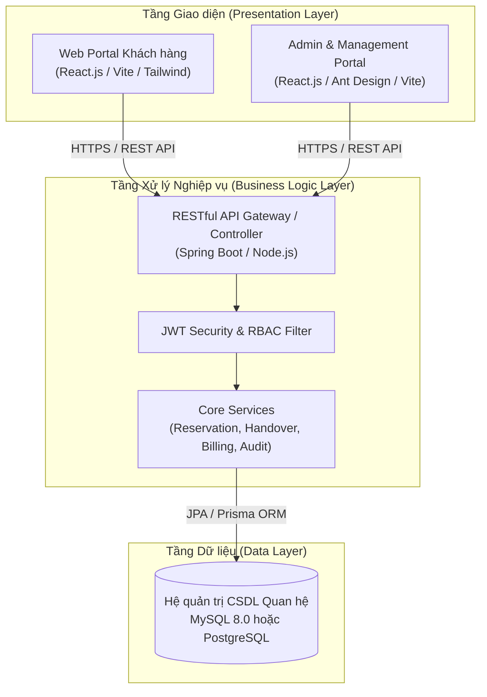

# TÀI LIỆU ĐẶC TẢ PHẠM VI DỰ ÁN (PROJECT SCOPE BASELINE)
## HỆ THỐNG QUẢN LÝ VÀ CHO THUÊ KHO LƯU TRỮ TỰ PHỤC VỤ
### Self-Storage Facility Rental and Management System

---
- **Mã môn học / Đồ án:** SWP (Software Development Project / Capstone Project - Kỳ 7)
- **Mã dự án:** SWP-SELF-STORAGE-SYSTEM
- **Phiên bản tài liệu:** 1.0 (Student-Friendly & Defense-Ready Baseline)
- **Đối tượng áp dụng:** Nhóm sinh viên 4 – 5 người (Trình độ trung bình – khá)
- **Thời lượng triển khai:** 10 – 12 Tuần (4 – 5 Sprints)

---

## 1. TỔNG QUAN DỰ ÁN & MỤC TIÊU PHẠM VI (PROJECT OVERVIEW & OBJECTIVES)

### 1.1. Bối cảnh dự án (Project Background)
Self-Storage (Kho tự quản / Kho lưu trữ tự phục vụ) là mô hình kinh doanh cho thuê mặt bằng kho mini cá nhân hóa hoặc phục vụ hộ kinh doanh nhỏ. Khách hàng chủ động chọn kích thước kho (Unit), đặt cọc, thanh toán và được cấp quyền truy cập an toàn (mã PIN điện tử / chìa khóa) để tự quản lý tài sản cá nhân trong suốt thời gian thuê.

Tại Việt Nam, mô hình này đang phát triển mạnh tại các đô thị lớn nhưng phần lớn vẫn quản lý thủ công (ghi chép Excel, chìa khóa cơ truyền thống, thiếu đối soát cọc và tỉ lệ lấp đầy kho). Dự án này xây dựng một nền tảng Web tập trung chuẩn hóa quy trình từ khâu tra cứu, đặt giữ chỗ, bàn giao mặt bằng cho đến nghiệm thu trả kho và báo cáo doanh thu chuỗi.

### 1.2. Mục tiêu phạm vi (Project Scope Goals - SMART)
1. **Chuẩn hóa quy trình nghiệp vụ chuỗi (Business Standardization):** Hỗ trợ chuỗi cơ sở (ít nhất 2–3 chi nhánh), phân định thẩm quyền rõ ràng giữa Quản lý cơ sở đơn lẻ (Facility Manager) và Quản lý vận hành toàn chuỗi (Business Operations Manager).
2. **Khép kín vòng đời thuê kho (End-to-End Rental Lifecycle):** Thực hiện đầy đủ 100% các bước: Tra cứu $\rightarrow$ Đặt chỗ $\rightarrow$ Đặt cọc $\rightarrow$ Tiếp đón Check-in $\rightarrow$ Bàn giao & Cấp mã PIN $\rightarrow$ Quản lý kho thuê $\rightarrow$ Kiểm tra nghiệm thu Check-out $\rightarrow$ Đối soát hoàn cọc.
3. **Mô phỏng thông minh & Tối ưu cho sinh viên (Student-Friendly Architecture):** Loại bỏ gánh nặng mua sắm phần cứng cơ điện tử đắt đỏ hoặc tích hợp cổng thanh toán phức tạp bằng cơ chế sinh **Mã PIN điện tử 6 số** và **Mock Payment / QR Code**, tập trung tối đa vào thiết kế CSDL, nghiệp vụ Backend (Spring Boot/NestJS) và giao diện người dùng trực quan (React/Vite).
4. **Đáp ứng chuẩn mực bảo vệ đồ án SWP:** Đạt điểm Giỏi đến Xuất sắc (8.5 – 9.5+) nhờ đáp ứng đầy đủ tiêu chí phân quyền RBAC, kiểm tra toàn vẹn dữ liệu, chống rò rỉ dữ liệu chéo (IDOR) và bảng ghi nhật ký kiểm toán (Audit Trail).

---

## 2. ĐỐI TƯỢNG NGƯỜI DÙNG & PHÂN QUYỀN TRUY CẬP (ACTORS & RBAC SCOPE)

Dự án thiết kế chuẩn xác **5 Actors** với vai trò và phạm vi dữ liệu cách ly nghiêm ngặt:

| Mã Actor | Tên Actor | Mô tả vai trò | Ranh giới dữ liệu (Data Scope Boundary) |
| :--- | :--- | :--- | :--- |
| **ACT-01** | **Storage Customer** (Khách hàng) | Tìm kiếm kho, đặt giữ chỗ trực tuyến, nộp tiền cọc, check-in nhận kho, tra cứu mã PIN mở kho, yêu cầu trả kho. | Chỉ truy cập dữ liệu của chính mình (Đơn đặt, hợp đồng, hóa đơn cá nhân). |
| **ACT-02** | **Facility Staff** (Nhân viên cơ sở) | Trực tại quầy, theo dõi danh sách công việc hàng ngày (Daily Tasks), tiếp đón khách, lập biên bản bàn giao kho, kiểm tra nghiệm thu kho khi khách trả. | Chỉ thao tác trên các đơn đặt, hợp đồng và phòng kho thuộc **chi nhánh được phân công**. |
| **ACT-03** | **Facility Manager** (Quản lý chi nhánh) | Quản lý sơ đồ mặt bằng kho tại cơ sở, gán phòng kho cụ thể cho đơn đặt, phân công ca làm việc cho nhân viên, duyệt hoàn cọc và theo dõi doanh thu chi nhánh. | Toàn quyền điều hành trong **phạm vi 01 chi nhánh phụ trách**; tuyệt đối không xem/sửa chi nhánh khác. |
| **ACT-04** | **Business Operations Manager** (Quản lý vận hành toàn chuỗi) | Quản lý danh mục toàn bộ hệ thống chi nhánh, ban hành chính sách giá, cọc, phí phạt, theo dõi tỉ lệ lấp đầy (Occupancy Rate) và báo cáo doanh thu toàn chuỗi. | Toàn quyền đọc/ghi trên danh mục chính sách, biểu phí và xem báo cáo tổng hợp **trên tất cả chi nhánh**. |
| **ACT-05** | **System Administrator** (Quản trị viên) | Quản lý tài khoản, gán vai trò người dùng (Role), phân bổ nhân sự vào từng chi nhánh, giám sát nhật ký thao tác (Audit Logs) và bảo mật hệ thống. | Quản trị hệ thống, tài khoản và kỹ thuật; không can thiệp trực tiếp vào nghiệp vụ hợp đồng của khách. |

### Ma trận phân quyền chức năng (RBAC Matrix)
*(Ghi chú: `Của mình`: Chỉ dữ liệu cá nhân; `Chi nhánh`: Chỉ trong cơ sở được phân công; `Toàn chuỗi`: Toàn hệ thống; `—`: Không có quyền)*

| Nhóm nghiệp vụ chính | Customer | Staff | Facility Mgr | Ops Mgr | Admin |
| :--- | :---: | :---: | :---: | :---: | :---: |
| **Đăng ký, Đăng nhập & Profile cá nhân** | ✓ | ✓ | ✓ | ✓ | ✓ |
| **Tra cứu danh mục cơ sở, loại kho & giá** | ✓ | ✓ | ✓ | ✓ | ✓ |
| **Đặt giữ chỗ kho (Reservation) & Nộp cọc** | Của mình | Xem | Chi nhánh | Toàn chuỗi | — |
| **Thanh toán phí thuê / Hóa đơn** | Của mình | Quầy | Chi nhánh | Toàn chuỗi | — |
| **Gán phòng kho (Assign Unit) cho đơn đặt** | — | — | Chi nhánh | — | — |
| **Phân công nhiệm vụ nhân viên (Staff Tasks)** | — | Xem cá nhân | Chi nhánh | — | — |
| **Biên bản Check-in & Bàn giao kho (Handover)** | Xác nhận | Thao tác | Giám sát | — | — |
| **Tra cứu mã PIN điện tử mở kho** | Của mình | Quầy | — | — | — |
| **Kiểm tra trả kho (Inspection) & Hoàn cọc** | Gửi yêu cầu | Thao tác | Duyệt | — | — |
| **Quản lý danh mục cơ sở & Sơ đồ kho** | — | Cập nhật kho | Chi nhánh | Toàn chuỗi | — |
| **Ban hành chính sách cọc, biểu giá & phí phạt** | — | — | — | Toàn chuỗi | — |
| **Báo cáo doanh thu & Tỉ lệ lấp đầy** | — | — | Chi nhánh | Toàn chuỗi | — |
| **Quản lý tài khoản, phân Role & Gán chi nhánh** | — | — | — | — | ✓ |
| **Giám sát Audit Logs & Lịch sử Login** | — | — | — | — | ✓ |

---

## 3. PHÂN ĐỊNH PHẠM VI TÍNH NĂNG (FUNCTIONAL SCOPE - MoSCoW)

Nhằm đảm bảo **tính khả thi cao nhất cho nhóm sinh viên trung bình môn SWP** nhưng vẫn gây ấn tượng mạnh với Hội đồng bảo vệ, các tính năng được phân định rõ ràng theo nguyên tắc MoSCoW:

```
┌──────────────────────────────────────────────────────────────────────────────┐
│                    PHẠM VI HỆ THỐNG (SYSTEM SCOPE)                           │
├──────────────────────────────────────────────────────────────────────────────┤
│ [1] MUST-HAVE (Cốt lõi - Bắt buộc hoàn thành 100% để bảo vệ và đạt điểm A)  │
│   • Module 1: Xác thực & Phân quyền chuẩn RBAC (5 Actors)                    │
│   • Module 2: Tra cứu & Đặt giữ chỗ kho trực tuyến (Flow 1)                  │
│   • Module 3: Tiếp đón, Check-in, Bàn giao & Cấp mã PIN 6 số (Flow 2)        │
│   • Module 4: Quản lý kho đang thuê, Yêu cầu trả kho & Nghiệm thu (Flow 3)   │
│   • Module 5: Quản lý chuỗi chi nhánh, Chính sách cọc & Biểu giá (Flow 4)    │
│   • Module 6: Quản lý mặt bằng kho & Phân công nhân sự tại cơ sở (Flow 5)    │
│   • Module 7: Báo cáo doanh thu & Tỉ lệ lấp đầy (Chi nhánh & Toàn chuỗi)     │
│   • Module 8: Quản trị tài khoản, Phân bổ cơ sở & Nhật ký Audit Log          │
├──────────────────────────────────────────────────────────────────────────────┤
│ [2] SHOULD-HAVE / NICE-TO-HAVE (Mở rộng lấy điểm thưởng 9.5 – 10.0)          │
│   • Module 9: Tự động gửi cảnh báo gia hạn & Xử lý nợ quá hạn (Flow 6)       │
│   • Module 10: Phiếu tiếp nhận & Xử lý sự cố tại cơ sở (Flow 7)              │
│   • Module 11: Đổi mã PIN cá nhân & Xuất báo cáo doanh thu ra file Excel     │
├──────────────────────────────────────────────────────────────────────────────┤
│ [3] OUT-OF-SCOPE (Tuyệt đối KHÔNG làm - Ranh giới bảo vệ trước Hội đồng)     │
│   • KHÔNG lắp đặt mạch điều khiển IoT / Chốt điện từ phần cứng thực tế       │
│   • KHÔNG tích hợp đầu đọc thẻ từ NFC/RFID vật lý                            │
│   • KHÔNG ký hợp đồng kết nối cổng thanh toán Visa/Mastercard live           │
│   • KHÔNG sử dụng camera nhận diện khuôn mặt sinh trắc học                    │
│   • KHÔNG lập trình phân hệ kế toán tài chính doanh nghiệp chuyên sâu        │
└──────────────────────────────────────────────────────────────────────────────┘
```

---

### 3.1. Chi tiết phân hệ MUST-HAVE (Phải hoàn thành)

#### Module 1: Quản trị Tài khoản & Phân quyền (Authentication & Authorization)
- **FR-001 (Đăng ký tài khoản):** Khách hàng tự đăng ký tài khoản với Họ tên, Email, SĐT, Số CCCD và Mật khẩu. Kiểm tra tính duy nhất của Email và CCCD.
- **FR-002 (Đăng nhập đa vai trò):** Xác thực đăng nhập qua Email/Mật khẩu. Sử dụng JWT (JSON Web Token) chứa Role và FacilityId (nếu là Staff/Manager). Điều hướng tự động về đúng trang Dashboard chuyên biệt của vai trò.
- **FR-003 (Đăng xuất):** Hủy token phía Client và vô hiệu hóa phiên.
- **FR-004 (Quản lý User & Role):** Admin tạo tài khoản nhân sự (Staff, Facility Manager, Ops Manager), khóa/mở khóa tài khoản.
- **FR-005 (Phân bổ chi nhánh):** Admin gán nhân sự (Staff, Manager) vào đúng 01 chi nhánh kho phụ trách.

#### Module 2: Tra cứu, Đặt giữ chỗ & Nộp cọc (Browse, Reservation & Deposit - Flow 1)
- **FR-006 (Xem danh mục cơ sở & Loại kho):** Khách xem danh sách chi nhánh (địa chỉ, hình ảnh, tiện ích, giờ mở cửa) và các loại kho (Kho nhỏ 1-3m², Kho vừa 4-8m², Kho lớn >9m², Kho mát).
- **FR-007 (Bộ lọc thông minh):** Lọc kho theo Chi nhánh, Kích cỡ, Khoảng giá và trạng thái khả dụng (`AVAILABLE`).
- **FR-008 (Tạo đơn Reservation):** Khách chọn Chi nhánh, Loại kho, Ngày bắt đầu thuê, Thời hạn thuê (tháng) và Giờ hẹn đến nhận kho. Hệ thống tự tính tiền cọc (mặc định 01 tháng tiền thuê). Đơn lưu ở trạng thái `PENDING_PAYMENT`.
- **FR-009 (Thanh toán cọc/thuê qua VNPay Sandbox):** Hóa đơn `DEPOSIT` dành cho đặt kho mới; hóa đơn `RENT` chỉ thanh toán sau khi kho đã được gán. Backend tạo giao dịch VNPay có chữ ký, tiếp nhận IPN và chỉ cập nhật hóa đơn/thanh toán khi chữ ký, mã giao dịch và số tiền hợp lệ. Thanh toán cọc thành công chuyển đơn sang `RESERVED`; trình duyệt quay về không tự xác nhận thanh toán.
- **FR-010 (Quản lý đơn đặt cá nhân):** Khách tra cứu danh sách đơn đã đặt, xem lịch hẹn và trạng thái đơn.
- **FR-011 (Hủy đặt giữ chỗ):** Khách được hủy trước giờ hẹn; hệ thống đối chiếu chính sách hủy để hoàn tiền cọc hoặc giải phóng trạng thái giữ chỗ.

#### Module 3: Tiếp đón, Check-in & Bàn giao kho (Check-in & Handover - Flow 2)
- **FR-012 (Tra cứu đơn khi khách tới):** Khách đến cơ sở, Staff nhập mã Reservation hoặc số CCCD để tra cứu đơn đặt hợp lệ.
- **FR-013 (Thanh toán tiền thuê tháng đầu):** Staff hỗ trợ khách hoàn tất hóa đơn tiền thuê tháng đầu tiên tại quầy (hoặc khách thanh toán online) trước khi nhận phòng.
- **FR-014 (Biên bản bàn giao kho - Handover Record):** Staff cùng khách kiểm tra thực tế phòng kho (tình trạng cửa, vách ngăn, sạch sẽ, chiếu sáng), lập biên bản bàn giao điện tử. Khách ký/xác nhận trên giao diện web.
- **FR-015 (Kích hoạt hợp đồng & Cấp mã PIN điện tử):** Hệ thống tự động:
  - Sinh Mã hợp đồng (`RENTAL_CONTRACT`) với trạng thái `ACTIVE`.
  - Tự động tạo ngẫu nhiên **Mã PIN truy cập 6 chữ số** (Access Code) bảo mật.
  - Cập nhật trạng thái Unit kho từ `RESERVED` $\rightarrow$ `OCCUPIED`.
  - Gửi mã PIN trực tiếp vào mục "Kho của tôi" trên tài khoản khách hàng.

#### Module 4: Quản lý Kho đang thuê & Trả kho hoàn cọc (Rented Units & Checkout - Flow 3)
- **FR-016 (Bảng điều khiển kho của tôi):** Khách hàng xem danh sách các kho đang thuê, xem mã phòng (VD: A-102), ngày hết hạn hợp đồng và tra cứu mã PIN 6 số để mở kho.
- **FR-017 (Yêu cầu trả kho - Checkout Request):** Khách có nhu cầu trả kho nhấn tạo yêu cầu trả kho, chọn ngày hẹn trả thực tế.
- **FR-018 (Nghiệm thu hiện trạng kho - Inspection Record):** Khi khách đến bàn giao trả kho, Staff lập biên bản kiểm tra: Đánh giá vệ sinh kho, kiểm tra có hư hại kết cấu/khóa hay không, ghi nhận phụ phí phát sinh (nếu có vi phạm).
- **FR-019 (Quyết toán hoàn cọc & Thanh lý hợp đồng):**
  - Hệ thống tính toán: $\text{Tiền hoàn trả} = \text{Tiền cọc} - \text{Phí hư hỏng/vệ sinh (nếu có)}$.
  - Facility Manager xác nhận duyệt hoàn cọc.
  - Chuyển trạng thái hợp đồng sang `TERMINATED`.
  - **Khóa/Vô hiệu hóa ngay lập tức mã PIN 6 số**.
  - Đổi trạng thái phòng kho sang `CLEANING` $\rightarrow$ `AVAILABLE` để đón khách mới.

#### Module 5: Quản lý Chuỗi, Chính sách & Biểu phí (Multi-Facility & Policies - Flow 4)
- **FR-020 (Quản lý chuỗi chi nhánh):** Ops Manager thêm mới, chỉnh sửa thông tin chi nhánh: Tên, địa chỉ, hotline, diện tích, sức chứa kho, hình ảnh đại diện.
- **FR-021 (Ban hành chính sách cho thuê chung):** Ops Manager cấu hình:
  - Tỉ lệ cọc tối thiểu (% hoặc số tháng tiền thuê).
  - Thời gian giữ chỗ reservation: 5 phút chờ tiền cọc; hết hạn thì tự hủy đơn và invoice pending.
  - Quy định hủy đơn và hoàn cọc.
  - Số ngày ân hạn nợ cước (Grace Period, VD: 3 ngày).
- **FR-022 (Quản lý khung giá & Phụ phí):** Ops Manager cấu hình đơn giá chuẩn theo từng loại kho (S/M/L/Kho mát) cho từng chi nhánh; thiết lập biểu phí phụ (phí vệ sinh, phí sửa khóa, phí phạt trễ hạn theo ngày).

#### Module 6: Quản lý Mặt bằng kho & Phân công Nhân sự chi nhánh (Flow 5)
- **FR-023 (Quản lý danh mục Unit tại cơ sở):** Facility Manager quản lý sơ đồ mặt bằng kho tại chi nhánh: Mã phòng (VD: A-101, B-202), tầng, diện tích, giá thuê, trạng thái (`AVAILABLE`, `RESERVED`, `OCCUPIED`, `MAINTENANCE`).
- **FR-024 (Gán phòng kho cho đơn đặt):** Khi có đơn đặt mới theo loại kho, Manager xem danh sách phòng trống tương ứng và gán chính xác mã phòng cụ thể (Assign Unit) trước khi khách đến nhận kho.
- **FR-025 (Phân công nhiệm vụ cho Staff - Staff Assignment):** Manager phân công nhân viên cụ thể (Staff A, Staff B) phụ trách đón khách hoặc đi nghiệm thu trả kho.
- **FR-026 (Bàn làm việc ca trực - Daily Task List của Staff):** Nhân viên mở trang Daily Tasks, thấy chính xác danh sách khách hẹn check-in hôm nay, các kho cần nghiệm thu trả và trạng thái nhiệm vụ được phân công.

#### Module 7: Báo cáo Doanh thu & Tỉ lệ Lấp đầy kho (Revenue & Occupancy Analytics)
- **FR-027 (Báo cáo tại chi nhánh):** Facility Manager xem tổng số kho trống, kho đang thuê, tỉ lệ lấp đầy tại cơ sở mình và tổng doanh thu thu được trong tháng.
- **FR-028 (Báo cáo tổng quan toàn chuỗi):** Ops Manager xem Dashboard phân tích toàn chuỗi:
  - Biểu đồ doanh thu đa chiều theo từng chi nhánh và nguồn thu (tiền cọc, tiền thuê, phụ phí).
  - Biểu đồ tỉ lệ lấp đầy (Occupancy Rate %) giữa các chi nhánh để đánh giá hiệu quả kinh doanh.

#### Module 8: Quản trị Hệ thống & Nhật ký Kiểm toán (Admin & Audit Trail)
- **FR-029 (Nhật ký hoạt động hệ thống - Audit Logs):** Ghi nhận tự động các thao tác nhạy cảm: Đổi giá, sửa chính sách, gán kho, hủy hợp đồng, hoàn cọc (kèm User ID, IP, Action, Timestamp, Old Value, New Value).
- **FR-030 (Lịch sử đăng nhập - Login History):** Theo dõi lịch sử đăng nhập để phát hiện các truy cập bất thường.

---

### 3.2. Chi tiết phân hệ SHOULD-HAVE / NICE-TO-HAVE (Làm thêm lấy điểm thưởng)

- **FR-031 (Cảnh báo & Gia hạn hợp đồng - Flow 6):**
  - Tự động sinh hóa đơn gia hạn và gửi thông báo cho khách trước ngày kết thúc hợp đồng 7 ngày.
  - Khách hàng bấm "Gia hạn kho", chọn số tháng thuê tiếp theo và thanh toán trực tuyến.
- **FR-032 (Xử lý quá hạn & Tạm khóa mã PIN - Flow 6):**
  - Nếu hết thời gian ân hạn (3 ngày) mà khách không gia hạn/trả kho, hợp đồng chuyển sang `OVERDUE`.
  - Hệ thống tự động vô hiệu hóa mã PIN mở kho và tính tiền phạt trễ hạn theo ngày cho đến khi thanh toán.
- **FR-033 (Tiếp nhận & Xử lý sự cố - Support Ticket - Flow 7):**
  - Khách gửi ticket báo cáo sự cố (quên mã PIN, kẹt cửa kho, ẩm ướt) kèm ảnh chụp.
  - Hệ thống tự động chuyển ticket về cho Staff tại cơ sở khách thuê để xử lý và cập nhật tiến độ (`OPEN` $\rightarrow$ `IN_PROGRESS` $\rightarrow$ `RESOLVED`).
- **FR-034 (Đổi mã PIN cá nhân):** Khách hàng tự đổi mã PIN 6 số cá nhân trên giao diện web.
- **FR-035 (Xuất báo cáo Excel):** Hỗ trợ Ops Manager xuất dữ liệu danh sách hợp đồng, doanh thu ra file Excel (.xlsx).

---

### 3.3. Ranh giới OUT-OF-SCOPE (Tuyệt đối KHÔNG làm & Kịch bản bảo vệ)

Để đồ án hoàn thành đúng tiến độ và không bị "vỡ trận", các hạng mục sau **nằm ngoài phạm vi thực hiện**:

| Hạng mục Out-of-Scope | Lý do loại trừ | Giải pháp thay thế trong đồ án |
| :--- | :--- | :--- |
| **1. Phần cứng khóa IoT / Chốt điện cơ vật lý** | Vượt quá thời lượng SWP, tốn kém chi phí mua sắm linh kiện, dễ lỗi kết nối vật lý khi demo trước Hội đồng. | **Mô phỏng vòng đời mã PIN điện tử 6 số (Virtual Access Code Lifecycle):** Sinh mã tự động khi Check-in, chỉ kích hoạt khi hợp đồng `ACTIVE`, tự động khóa khi `OVERDUE` hoặc `TERMINATED`. |
| **2. Đầu đọc thẻ từ RFID / NFC tại cửa** | Đòi hỏi thiết bị phần cứng chuyên dụng và giao tiếp cổng COM/Serial phức tạp. | Bàn giao thẻ từ vật lý được mô phỏng bằng cách Staff ghi nhận số thẻ vào biên bản bàn giao điện tử (Handover Record). |
| **3. Cổng thanh toán quốc tế Visa/Mastercard live** | Cần pháp nhân công ty, hợp đồng ngân hàng và chữ ký bảo mật phức tạp. | **Mock Payment Gateway & VietQR tĩnh:** Giả lập cổng thanh toán thử nghiệm với các kịch bản thành công/thất bại và tạo QR chuyển khoản kèm nội dung thanh toán tự động. |
| **4. Nhận diện khuôn mặt sinh trắc học / Camera thị giác máy tính** | Nặng về xử lý thị giác máy tính, lạc đề so với mục tiêu môn Kỹ thuật phần mềm quản trị thông tin (SWP). | Hệ thống tập trung xác thực định danh qua số CCCD/CMND khi tiếp đón tại quầy và bảo mật tài khoản JWT. |
| **5. Phân hệ kế toán chuyên sâu (Tổng tài khoản, Thuế)** | Thuộc phạm vi hệ thống ERP doanh nghiệp lớn (SAP/Oracle), không phù hợp với quy mô phần mềm đồ án sinh viên. | Quản lý sổ cái doanh thu theo dạng Đơn đặt $\rightarrow$ Hóa đơn $\rightarrow$ Thanh toán (Invoices & Payments Tracking). |

---

## 4. PHẠM VI YÊU CẦU PHI CHỨC NĂNG (NON-FUNCTIONAL SCOPE)

1. **Tính khả dụng (Usability):**
   - Giao diện tiếng Việt chuẩn mực, hỗ trợ thuật ngữ nghiệp vụ song ngữ (Check-in, Handover, Unit Code).
   - Thiết kế đồng bộ, hiện đại, có thông báo trạng thái (Toast Notification) và hộp thoại xác nhận khi thực hiện thao tác nhạy cảm (Hủy đơn, Bàn giao, Trả kho).
2. **Khả năng tương thích thiết bị (Responsiveness):**
   - Tối ưu hóa hiển thị trên trình duyệt Desktop/Laptop (độ phân giải từ 1366x768 trở lên) phục vụ thuyết trình.
   - Giao diện tra cứu kho của Customer và danh sách Daily Tasks của Staff hiển thị mượt mà trên Tablet/Mobile khi chấm điểm demo.
3. **Hiệu năng hệ thống (Performance):**
   - Tốc độ tải trang và phản hồi API tìm kiếm kho khả dụng dưới 2.0 giây.
   - Tải biểu đồ Dashboard thống kê báo cáo dưới 3.0 giây.
4. **Bảo mật & Cách ly dữ liệu (Security & Data Isolation - Chống IDOR):**
   - Mật khẩu mã hóa 1 chiều bằng thuật toán an toàn (BCrypt).
   - Kiểm tra Token JWT và vai trò (Role-based) ở cả tầng Frontend và tầng Controller/Filter của Backend.
   - **Cách ly dữ liệu chi nhánh:** Ngăn chặn tuyệt đối việc Staff hoặc Manager chi nhánh này xem/sửa dữ liệu của chi nhánh khác thông qua việc giả mạo ID trên đường dẫn URL/API.
5. **Tính toàn vẹn dữ liệu (Data Integrity):**
   - Sử dụng Database Transactions (`@Transactional`) trong các tác vụ phức tạp: Đặt chỗ $\rightarrow$ Trừ kho; Bàn giao $\rightarrow$ Kích hoạt hợp đồng $\rightarrow$ Sinh mã PIN; Trả kho $\rightarrow$ Hoàn cọc.
   - Không cho phép xóa vật lý (Hard Delete) đối với Hóa đơn và Thanh toán để phục vụ kiểm toán.
6. **Môi trường kiểm thử & Dữ liệu mẫu (Seed Data Scope):**
   - Cung cấp sẵn kịch bản CSDL mẫu (Seed Data) với ít nhất **3 Chi nhánh**, **20 Phòng kho**, **5 Tài khoản mẫu** cho 5 Actors để sẵn sàng chạy kịch bản demo trơn tru từ A đến Z.

---

## 5. RANH GIỚI CÔNG NGHỆ & KIẾN TRÚC HỆ THỐNG (TECHNICAL SCOPE)

Nhằm đảm bảo **phù hợp tuyệt đối với năng lực sinh viên trung bình**, công nghệ được lựa chọn theo tiêu chí phổ biến, tài liệu phong phú, dễ debug và được giảng viên đánh giá cao:



- **Frontend:** React.js / Vite kết hợp thư viện UI Ant Design hoặc TailwindCSS / Vanilla CSS.
- **Backend đề xuất:** 
  - *Phương án 1 (Phổ biến nhất trong SWP):* Java Spring Boot (Spring Security, Spring Data JPA, Hibernate, JWT).
  - *Phương án 2 (Thay thế linh hoạt):* Node.js / NestJS với TypeScript và Prisma ORM.
- **Cơ sở dữ liệu:** MySQL 8.0 hoặc PostgreSQL.
- **Kiến trúc mã nguồn:** Phân tầng chuẩn (Controller $\rightarrow$ Service $\rightarrow$ Repository / DAO $\rightarrow$ Entity).

---

## 6. PHÂN CHIA CÔNG VIỆC NHÓM SINH VIÊN (WBS & RACI MATRIX)

Mô hình phân công tối ưu cho nhóm **4 đến 5 sinh viên** trình độ trung bình – khá trong đồ án SWP:

### 6.1. Định vị vai trò thành viên
- **Thành viên 1 (Team Leader / Fullstack):** Phụ trách kiến trúc chung, bảo mật JWT, phân quyền RBAC, Module Admin/Audit Log và Module 5 (Chuỗi & Chính sách).
- **Thành viên 2 (Backend Dev 1):** Phụ trách CSDL, Module 2 (Tra cứu & Đặt chỗ kho) và Module 3 (Check-in, Bàn giao & Cấp mã PIN).
- **Thành viên 3 (Backend Dev 2):** Phụ trách Module 4 (Quản lý kho thuê, Nghiệm thu trả kho & Hoàn cọc), Module 6 (Sơ đồ mặt bằng & Phân công nhiệm vụ) và Module 7 (Báo cáo doanh thu/lấp đầy).
- **Thành viên 4 (Frontend Dev 1):** Phụ trách toàn bộ giao diện phía Khách hàng (Portal Customer: Trang chủ, Tra cứu kho, Đặt giữ chỗ, Bảng điều khiển kho đang thuê, Tra mã PIN).
- **Thành viên 5 (Frontend Dev 2 / QA & Document):** Phụ trách giao diện Quản trị nội bộ (Daily Tasks của Staff, Bàn làm việc của Manager/Ops Manager, Admin), viết Test Cases và hoàn thiện báo cáo SRS/Slide.
*(Nếu nhóm chỉ có 4 người: Thành viên 5 gộp chung với Thành viên 4 và cùng hỗ trợ viết tài liệu/kiểm thử).*

### 6.2. Ma trận RACI theo từng Phân hệ
*(R: Responsible - Thực hiện; A: Accountable - Chịu trách nhiệm chính; C: Consulted - Tham vấn; I: Informed - Nhận thông tin)*

| Phân hệ công việc | TV1 (Leader) | TV2 (BE 1) | TV3 (BE 2) | TV4 (FE 1) | TV5 (FE 2/QA) |
| :--- | :---: | :---: | :---: | :---: | :---: |
| **Thiết kế DB & Cấu hình Project Base** | A | R | R | I | I |
| **Xác thực JWT, RBAC & Quản lý User (M1)** | A / R | C | C | R (FE Login) | R (FE Admin) |
| **Tra cứu, Đặt giữ chỗ & Đặt cọc (M2)** | C | A / R | I | R (FE Khách) | I |
| **Tiếp đón, Check-in, Bàn giao, Cấp PIN (M3)** | C | A / R | I | I | R (FE Staff) |
| **Quản lý kho thuê & Nghiệm thu Trả kho (M4)** | I | C | A / R | R (FE Khách) | R (FE Staff) |
| **Quản lý Chuỗi, Chính sách & Khung giá (M5)** | A / R | I | C | I | R (FE Ops) |
| **Mặt bằng kho & Phân công nhân sự (M6)** | I | I | A / R | I | R (FE Mgr) |
| **Báo cáo Doanh thu & Tỉ lệ lấp đầy (M7)** | C | I | A / R | I | R (FE Dashboard) |
| **Nhật ký Audit Log & An ninh hệ thống (M8)** | A / R | I | I | I | R (FE Admin) |
| **Phân hệ mở rộng (Gia hạn & Sự cố) (M9-10)** | C | R | R | R | R |
| **Kiểm thử tích hợp, Viết kịch bản Demo** | A | R | R | R | R |

---

## 7. LỘ TRÌNH TRIỂN KHAI THEO SPRINT (12 TUẦN SWP ROADMAP)

Lộ trình được thiết kế theo mô hình Agile/Scrum phù hợp với tiến độ chấm điểm theo từng giai đoạn (Milestones / Sprints) của môn SWP:

```mermaid
gantt
    title LỘ TRÌNH 12 TUẦN PHÁT TRIỂN ĐỒ ÁN SWP
    dateFormat  YYYY-MM-DD
    section Sprint 1
    Khởi tạo dự án & DB Schema        :s1_1, 2026-09-01, 7d
    Auth JWT, RBAC, CRUD Facility     :s1_2, after s1_1, 14d
    section Sprint 2
    Flow 1: Đặt chỗ & Nộp cọc         :s2_1, 2026-09-22, 10d
    Flow 2: Check-in, Handover, PIN   :s2_2, after s2_1, 11d
    section Sprint 3
    Flow 3: Kho thuê, Trả kho, Hoàn cọc:s3_1, 2026-10-13, 11d
    Flow 5: Gán kho, Phân công Staff  :s3_2, after s3_1, 10d
    section Sprint 4
    Flow 4: Báo cáo & Chính sách giá  :s4_1, 2026-11-03, 7d
    Audit Logs & Nice-to-Have (Ticket):s4_2, after s4_1, 7d
    section Sprint 5
    Kiểm thử tích hợp & Seed Data     :s5_1, 2026-11-17, 5d
    Đóng băng mã nguồn & Luyện Demo   :s5_2, after s5_1, 5d
```

- **Sprint 1 (Tuần 1 – Tuần 3): Foundation & User Core**
  - Khởi tạo Git Repository, cấu hình Base Source Code (Frontend & Backend).
  - Thiết kế và tạo bảng CSDL (Entities, Migrations, Foreign Keys).
  - Xây dựng API Đăng ký, Đăng nhập JWT, Quản trị người dùng và Phân quyền Role theo Chi nhánh.
  - CRUD danh mục Cơ sở và Loại kho.
- **Sprint 2 (Tuần 4 – Tuần 6): Reservation & Check-in Handover**
  - Hoàn thiện luồng Đặt giữ chỗ trực tuyến (Khách tìm kiếm kho $\rightarrow$ Tạo đơn $\rightarrow$ Nộp cọc).
  - Facility Manager gán số phòng kho cho đơn đặt.
  - Staff tiếp đón, lập biên bản bàn giao kho điện tử (Handover).
  - Tự động sinh mã PIN 6 số và kích hoạt hợp đồng thuê.
- **Sprint 3 (Tuần 7 – Tuần 9): Unit Lifecycle, Checkout & Staff Tasks**
  - Khách hàng xem danh sách kho thuê và tra cứu mã PIN mở kho.
  - Khách gửi yêu cầu trả kho $\rightarrow$ Staff lập biên bản nghiệm thu (Inspection) $\rightarrow$ Manager duyệt hoàn cọc $\rightarrow$ Tự động khóa mã PIN.
  - Chức năng Phân công nhân viên của Manager và màn hình Daily Task List của Staff.
- **Sprint 4 (Tuần 10 – Tuần 11): Analytics, Policies & Extensions**
  - Ops Manager ban hành chính sách giá, cọc, biểu phí phạt.
  - Dashboard báo cáo doanh thu đa chiều và tỉ lệ lấp đầy theo chi nhánh.
  - Ghi nhận nhật ký Audit Logs cho toàn bộ các thao tác nhạy cảm.
  - Làm thêm tính năng mở rộng: Ticket hỗ trợ sự cố, Gia hạn hợp đồng.
- **Sprint 5 (Tuần 12): Hardening, Testing & Defense Preparation**
  - Kiểm thử tích hợp toàn bộ kịch bản nghiệp vụ (End-to-End Testing).
  - Nạp Seed Data hoàn chỉnh (3 chi nhánh, 20 kho, 5 tài khoản mẫu).
  - Đóng băng mã nguồn (Code Freeze).
  - Chuẩn bị Slide thuyết trình, sơ đồ kiến trúc và luyện tập kịch bản demo trước Hội đồng.

---

## 8. DANH MỤC SẢN PHẨM BÀN GIAO (PROJECT DELIVERABLES)

Cuối kỳ môn SWP, nhóm sinh viên sẽ bàn giao đầy đủ các sản phẩm sau:
1. **Bộ tài liệu kỹ thuật (Documentation):**
   - Tài liệu Đặc tả Yêu cầu Phần mềm (SRS v2.0 Hoàn chỉnh).
   - Tài liệu Thiết kế Kiến trúc & Cơ sở dữ liệu (SDD & ERD Diagram).
   - Tài liệu Đặc tả Phạm vi Dự án (Project Scope Baseline).
   - Bộ sưu tập API Documentation (Postman Collection có sẵn test scripts & Swagger UI).
   - Kịch bản kiểm thử (Test Plan & Test Cases Excel với $\ge 40$ test cases).
2. **Sản phẩm phần mềm (Software Artifacts):**
   - Kho mã nguồn hoàn chỉnh (Source Code Git: Frontend & Backend sạch, có file `.env.example`).
   - File Script khởi tạo CSDL kèm Seed Data (`schema.sql` và `seed_data.sql`).
   - Hướng dẫn cài đặt và triển khai hệ thống (Deployment & Setup Guide trong `README.md`).
3. **Sản phẩm bảo vệ đồ án (Defense Materials):**
   - Slide thuyết trình chuẩn mực (PowerPoint / PDF).
   - Video Demo kịch bản quy trình nghiệp vụ dài 5 – 7 phút dự phòng sự cố mạng khi bảo vệ trực tiếp.

---

## 9. CHIẾN LƯỢC BẢO VỆ PHẠM VI TRƯỚC HỘI ĐỒNG (SCOPE DEFENSE STRATEGY)

Trong các buổi phản biện đồ án SWP, Giảng viên Hội đồng thường đặt những câu hỏi hóc búa về phạm vi hệ thống. Dưới đây là các câu hỏi kinh điển và câu trả lời chuẩn mực giúp sinh viên ghi điểm tối đa:

### Câu hỏi 1: "Tại sao hệ thống kho tự phục vụ (Self-Storage) mà không thấy nhóm làm phần cứng khóa thông minh hay lắp đặt tủ điều khiển IoT?"
> **Cách trả lời chuẩn:**
> *"Thưa Thầy/Cô, đồ án SWP của nhóm em tập trung chuyên sâu vào **Kỹ thuật Phần mềm và Quy trình Vận hành Nghiệp vụ (Software Engineering & Business Process Management)**. Trong thực tế ngành Self-Storage, các hệ thống quản trị trung tâm (PMS - Property Management System) luôn tách biệt với thiết bị biên phần cứng. Nhóm em đã giải quyết trọn vẹn **Vòng đời Mã khóa điện tử (Virtual Access Code Lifecycle)**: Mã PIN 6 chữ số được hệ thống tự động sinh ngẫu nhiên khi khách hoàn tất bàn giao kho, tự động phân quyền theo thời gian thực, và sẽ ngay lập tức bị vô hiệu hóa khi hợp đồng kết thúc hoặc rơi vào trạng thái nợ cước quá hạn. Mô hình này hoàn toàn sẵn sàng cung cấp Webhook/API mở để kết nối với các đầu đọc khóa IoT thực tế ngoài cổng trong tương lai mà không làm thay đổi kiến trúc phần mềm cốt lõi."*

### Câu hỏi 2: "Tại sao nhóm lại tách riêng 2 vai trò Facility Manager và Business Operations Manager? Có bị trùng lặp không?"
> **Cách trả lời chuẩn:**
> *"Thưa Thầy/Cô, đây là điểm đặc sắc trong thiết kế kiến trúc phân quyền của nhóm em để giải bài toán **chuỗi chi nhánh phân tán**:*
> - *Facility Manager là quản lý tại chỗ của 01 cơ sở đơn lẻ: Chịu trách nhiệm về tài sản vật lý (mặt bằng kho, gán phòng cho khách, phân công ca làm việc cho nhân viên và duyệt hoàn cọc).*
> - *Business Operations Manager là quản lý cấp tập đoàn/toàn chuỗi: Chịu trách nhiệm về chiến lược kinh doanh (mở chi nhánh mới, ban hành chính sách giá, tỉ lệ cọc và xem báo cáo tổng hợp doanh thu/tỉ lệ lấp đầy toàn bộ các chi nhánh).*
> *Sự tách biệt này phản ánh đúng mô hình doanh nghiệp thực tế và giúp hệ thống kiểm soát cách ly dữ liệu (Data Isolation) tuyệt đối an toàn."*

### Câu hỏi 3: "Thanh toán trong hệ thống của nhóm hoạt động như thế nào? Có kết nối ngân hàng thật không?"
> **Cách trả lời chuẩn:**
> *"Thưa Thầy/Cô, để đảm bảo tính ổn định và bảo mật trong môi trường đồ án sinh viên, nhóm em sử dụng **Mock Payment Gateway kết hợp mã QR thanh toán chuẩn VietQR**:*
> - *Hệ thống tự động sinh mã QR chứa đúng số tiền, số tài khoản và cú pháp thanh toán tương ứng với mã hóa đơn (Deposit Invoice hoặc Monthly Invoice).*
> - *Hệ thống hỗ trợ cổng thanh toán mô phỏng (Mock Gateway) cho phép kiểm thử đầy đủ cả 2 trường hợp Giao dịch thành công và Giao dịch thất bại.*
> - *Về mặt nghiệp vụ kế toán, toàn bộ bản ghi hóa đơn và thanh toán sau khi đã xác nhận thành công đều được bảo vệ toàn vẹn (không cho phép sửa/xóa) và ghi nhận vào Audit Log."*

---

## 10. KẾT LUẬN & CAM KẾT PHẠM VI (SCOPE SIGN-OFF)

Tài liệu Đặc tả Phạm vi Dự án này là căn cứ duy nhất để:
1. Nhóm sinh viên phân chia nhiệm vụ và theo dõi tiến độ công việc hàng tuần.
2. Kiểm soát nguy cơ phình to phạm vi (Scope Creep) trong quá trình phát triển.
3. Làm cơ sở đối chiếu nghiệm thu sản phẩm với Giảng viên hướng dẫn và Hội đồng chấm điểm đồ án tốt nghiệp SWP.

Tất cả các tính năng thuộc danh mục **Must-Have** cam kết hoàn thành 100% trước thời điểm đóng băng mã nguồn để bảo đảm mục tiêu bảo vệ đồ án đạt kết quả xuất sắc.
