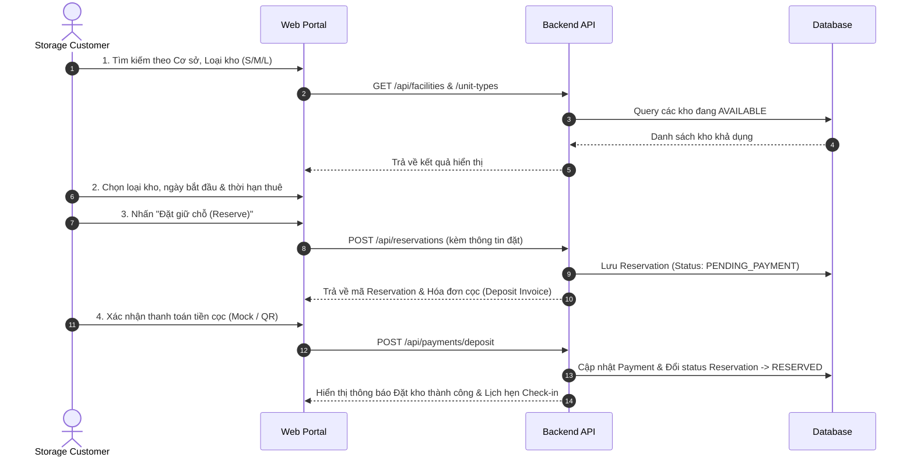
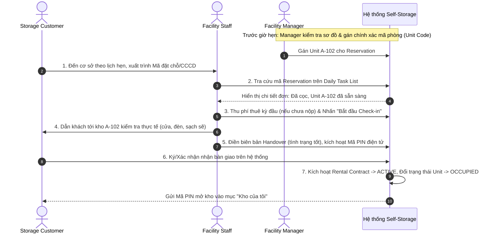
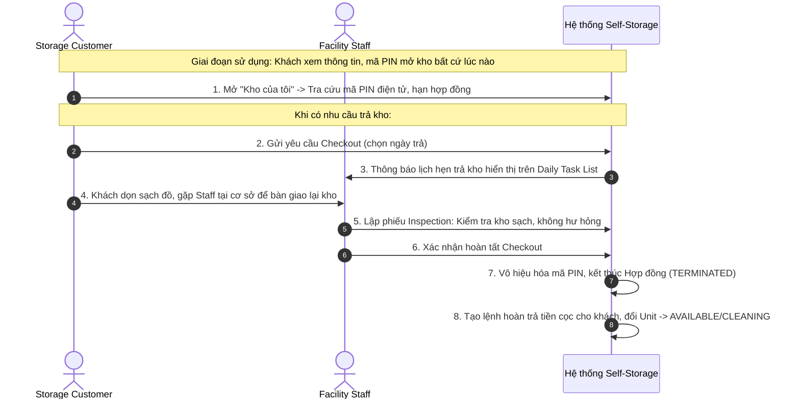
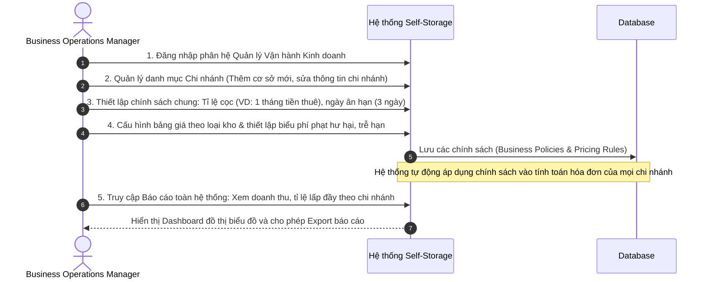
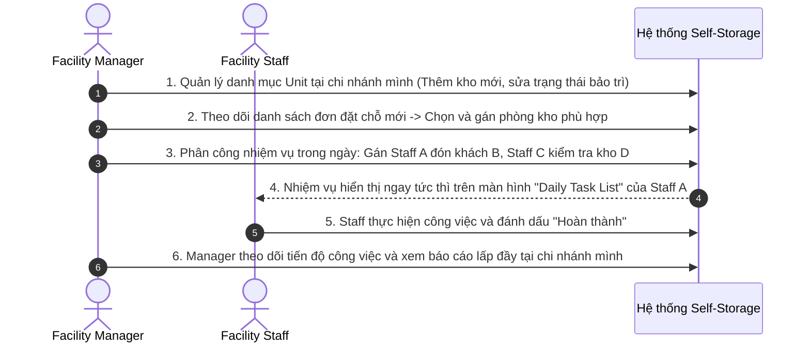
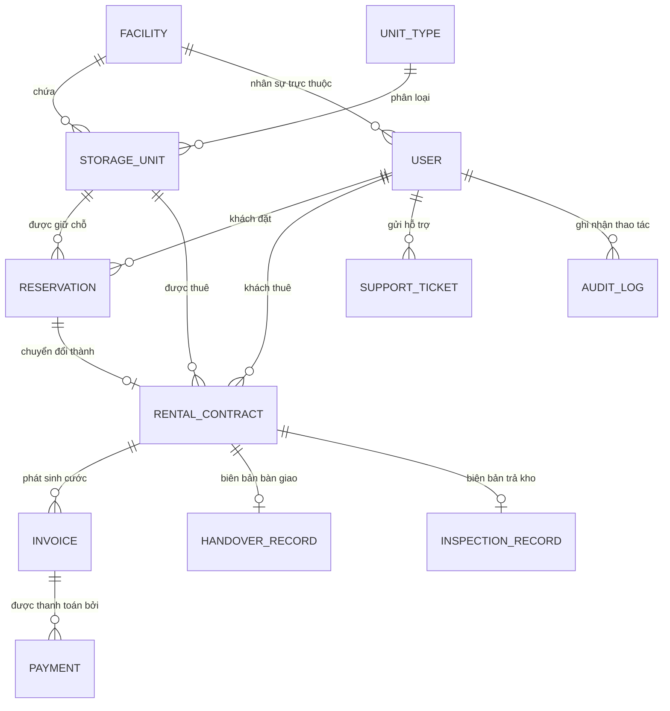

# SOFTWARE REQUIREMENTS SPECIFICATION (SRS v2.0)
## Hệ thống Quản lý và Cho thuê Kho Lưu trữ Tự phục vụ
### Self-Storage Facility Rental and Management System

**Mã đồ án:** SWP-PROJECT-SELF-STORAGE  
**Phiên bản tài liệu:** 2.0 (Comprehensive Student & Presentation Baseline)  
**Đối tượng sử dụng:** Đồ án Kỹ thuật Phần mềm (Software Project / Capstone Project - Kỳ 7)  
**Mục tiêu bảo vệ:** Trình bày đồ án, bảo vệ SRS & Thuyết trình Hội đồng chấm điểm  

---

## MỤC LỤC
1. [Tổng quan dự án (Project Overview)](#1-tổng-quan-dự-án-project-overview)
2. [Actors & Ma trận phân quyền (Actors & RBAC Matrix)](#2-actors--ma-trận-phân-quyền-actors--rbac-matrix)
3. [Danh mục tính năng chính (Main Features)](#3-danh-mục-tính-năng-chính-main-features)
4. [Yêu cầu chức năng chi tiết (Detailed Functional Requirements - FR)](#4-yêu-cầu-chức-năng-chi-tiết-detailed-functional-requirements---fr)
5. [Quy trình nghiệp vụ cốt lõi (Core Business Flows)](#5-quy-trình-nghiệp-vụ-cốt-lõi-core-business-flows)
6. [Quy tắc nghiệp vụ hệ thống (Business Rules - BR)](#6-quy-tắc-nghiệp-vụ-hệ-thống-business-rules---br)
7. [Mô hình dữ liệu & Thực thể (Data Entities & Relationships)](#7-mô-hình-dữ-liệu--thực-thể-data-entities--relationships)
8. [Danh mục màn hình giao diện tối thiểu (Minimum Screen Catalog - SCR)](#8-danh-mục-màn-hình-giao-diện-tối-thiểu-minimum-screen-catalog---scr)
9. [Yêu cầu phi chức năng (Non-Functional Requirements - NFR)](#9-yêu-cầu-phi-chức-năng-non-functional-requirements---nfr)
10. [Tiêu chí nghiệm thu (Acceptance Criteria cho Must-Have - AC)](#10-tiêu-chí-nghiệm-thu-acceptance-criteria-cho-must-have---ac)
11. [Phân định phạm vi phát triển (Must-Have vs Nice-to-Have vs Out-of-Scope)](#11-phân-định-phạm-vi-phát-triển-must-have-vs-nice-to-have-vs-out-of-scope)
12. [Ma trận truy vết yêu cầu (Requirement Traceability Matrix - RTM)](#12-ma-trận-truy-vết-yêu-cầu-requirement-traceability-matrix---rtm)

---

## 1. Tổng quan dự án (Project Overview)

### 1.1. Bối cảnh & Tên dự án
- **Tên tiếng Việt:** Hệ thống Quản lý và Cho thuê Kho Lưu trữ Tự phục vụ
- **Tên tiếng Anh:** Self-Storage Facility Rental and Management System
- **Khái niệm Self-Storage:** Mô hình cho thuê kho bãi mini cá nhân hóa hoặc cho doanh nghiệp nhỏ. Khách hàng chủ động chọn kích thước kho (unit), đặt cọc, thanh toán và được cấp quyền truy cập (chìa khóa / thẻ từ / mã PIN điện tử) để tự quản lý hàng hóa/vật dụng cá nhân trong suốt thời hạn thuê.

### 1.2. Mục tiêu hệ thống
- Cung cấp nền tảng Web tập trung hỗ trợ toàn diện chuỗi cung ứng dịch vụ kho tự phục vụ:
  - **Khách hàng (Customer):** Dễ dàng tìm kiếm cơ sở kho, kích cỡ kho, tính toán chi phí, đặt chỗ trực tuyến, thanh toán phí và theo dõi tình trạng kho đang thuê.
  - **Nhân viên cơ sở (Facility Staff):** Quản lý lịch hẹn check-in đón khách, kiểm tra đơn đặt chỗ, lập biên bản bàn giao bàn giao kho/mã truy cập, kiểm tra hiện trạng kho khi trả và tiếp nhận hỗ trợ sự cố tại chỗ.
  - **Quản lý cơ sở (Facility Manager):** Giám sát tình trạng mặt bằng kho tại chi nhánh, gán kho cụ thể cho khách, phân công nhiệm vụ cho nhân viên, quản lý hợp đồng và theo dõi doanh thu chi nhánh.
  - **Quản lý vận hành kinh doanh (Business Operations Manager):** Quản lý danh mục toàn bộ chuỗi chi nhánh, ban hành chính sách giá, cọc, phí phạt, theo dõi tỉ lệ lấp đầy kho (occupancy rate) và doanh thu tổng thể trên toàn hệ thống.
  - **Quản trị viên (System Administrator):** Kiểm soát tài khoản, phân quyền theo vai trò (RBAC) và theo chi nhánh cơ sở, ghi nhận nhật ký thao tác (Audit Logs).

### 1.3. Định hướng công nghệ & Khả thi cho sinh viên (Student-Friendly Baseline)
- **Kiến trúc:** Web Client-Server (RESTful API).
- **Frontend đề xuất:** React.js / Next.js / Vite với HTML5, Vanilla CSS / TailwindCSS.
- **Backend đề xuất:** Spring Boot (Java) hoặc NestJS / Node.js.
- **Cơ sở dữ liệu:** PostgreSQL hoặc MySQL.
- **Mô phỏng phần cứng/Thanh toán:**
  - *Mã khóa truy cập (Access Code/PIN):* Tự động sinh mã điện tử an toàn 6 chữ số lưu trên hệ thống hiển thị trên giao diện của khách và nhân viên, không yêu cầu thiết bị khóa IoT cơ điện tử vật lý.
  - *Thanh toán:* Triển khai Mock Payment (xác nhận giao dịch thử nghiệm) kết hợp tạo mã QR chuyển khoản tĩnh mô phỏng; tách cổng thanh toán production sang Nice-to-Have.

---

## 2. Actors & Ma trận phân quyền (Actors & RBAC Matrix)

### 2.1. Định nghĩa 5 Actors chính & Vai trò, Trách nhiệm chi tiết (Song ngữ Việt - Anh)
| Mã Actor | Tên Actor | Tên tiếng Việt | Vai trò & Trách nhiệm chi tiết theo yêu cầu |
| :--- | :--- | :--- | :--- |
| **ACT-01** | **Storage Customer** | Khách hàng thuê kho | • **Xem danh mục kho & bảng giá:** Xem danh sách cơ sở lưu trữ, loại kho, kích thước, giá thuê và các phòng kho khả dụng *(View storage facilities, unit types, unit sizes, rental prices, and available units)*.<br>• **Đặt giữ chỗ kho trực tuyến:** Tạo đơn đặt giữ chỗ bằng cách chọn chi nhánh, loại kho, ngày bắt đầu và thời hạn thuê *(Reserve a storage unit by choosing the facility, unit type, start date, and rental period)*.<br>• **Thanh toán các khoản phí:** Thanh toán tiền đặt cọc, tiền thuê định kỳ, phí gia hạn hoặc các khoản phụ phí phát sinh *(Pay the deposit, rental fee, renewal fee, or extra charges)*.<br>• **Check-in nhận bàn giao kho:** Thực hiện thủ tục check-in để nhận phòng kho được bàn giao theo lịch hẹn đã đăng ký *(Check in to receive the assigned storage unit based on the scheduled appointment)*.<br>• **Quản lý kho đang thuê:** Quản lý một hoặc nhiều phòng kho đang thuê trong suốt thời hạn hợp đồng *(Manage one or more rented storage units)*.<br>• **Gửi yêu cầu hỗ trợ sự cố:** Gửi yêu cầu hỗ trợ cho các vấn đề liên quan đến phòng kho, ổ khóa, mã truy cập, thanh toán hoặc hàng hóa lưu trữ *(Send support requests for problems related to the unit, lock, access code, payment, or stored items)*. |
| **ACT-02** | **Facility Staff** | Nhân viên cơ sở | • **Kiểm tra đơn đặt chỗ của khách:** Kiểm tra và xác thực đơn đặt giữ chỗ của khách hàng khi khách đến cơ sở nhận kho *(Check the customer’s reservation when the customer arrives to receive the unit)*.<br>• **Hỗ trợ check-in & Bàn giao kho:** Hỗ trợ thủ tục check-in và bàn giao phòng kho, ổ khóa, thẻ từ hoặc mã truy cập PIN điện tử *(Support check-in and hand over the storage unit, lock, access card, or access code)*.<br>• **Cập nhật trạng thái phòng kho:** Cập nhật trạng thái kho sau khi bàn giao, trong quá trình sử dụng, sau khi khách trả hoặc khi cần kiểm tra/bảo trì *(Update the unit status after handover, during use, after return, or when inspection/maintenance is needed)*.<br>• **Kiểm tra & Nghiệm thu khi trả kho:** Kiểm tra và xác nhận tình trạng thực tế của phòng kho khi khách hàng làm thủ tục trả kho *(Check and confirm the unit condition when the customer returns the unit)*.<br>• **Xử lý sự cố phát sinh tại chỗ:** Tiếp nhận và xử lý các vấn đề tại quầy/thực địa như mất chìa khóa, lỗi mã truy cập, kho bị hư hại hoặc các yêu cầu hỗ trợ từ khách *(Receive and handle on-site problems such as lost keys, access code issues, damaged units, or customer support requests)*.<br>• **Theo dõi lịch công việc hàng ngày:** Theo dõi danh sách công việc hàng ngày gồm khách hẹn nhận kho, khách hẹn trả kho hoặc các trường hợp cần hỗ trợ *(Track the daily list of customers who need to receive units, return units, or receive support)*. |
| **ACT-03** | **Facility Manager** | Quản lý cơ sở | • **Quản lý kho tại chi nhánh:** Quản lý danh mục phòng kho tại cơ sở phụ trách, bao gồm loại kho, kích thước, vị trí, giá thuê và trạng thái kho *(Manage storage units at the assigned facility, including unit type, size, location, rental price, and unit status)*.<br>• **Gán phòng kho phù hợp:** Gán phòng kho trống phù hợp cho khách hàng dựa trên loại kho, thời hạn thuê và tính khả dụng của mặt bằng *(Assign suitable storage units to customers based on unit type, rental period, and availability)*.<br>• **Giám sát khách hàng & Hợp đồng:** Giám sát khách hàng hiện tại, hợp đồng cho thuê, thời hạn hợp đồng và tình trạng thanh toán tại chi nhánh *(Monitor current customers, rental contracts, rental periods, and payment status)*.<br>• **Quản lý quy trình vận hành cơ sở:** Quản lý toàn diện quy trình bàn giao kho, trả kho, gia hạn hợp đồng và xử lý quá hạn nợ cước tại chi nhánh *(Manage the process of unit handover, unit return, rental renewal, and overdue handling at the facility)*.<br>• **Phân công nhân viên thực hiện nhiệm vụ:** Phân công nhân viên cơ sở thực hiện hỗ trợ bàn giao, kiểm tra nghiệm thu kho hoặc xử lý sự cố *(Assign facility staff to support handover, unit inspection, or problem handling)*.<br>• **Xem báo cáo vận hành chi nhánh:** Xem báo cáo chi nhánh về số kho trống, kho đang thuê, doanh thu thực tế, tỷ lệ sử dụng kho và các trường hợp quá hạn *(View facility reports on available units, rented units, revenue, usage rate, and overdue cases)*. |
| **ACT-04** | **Business Operations Manager** | Quản lý vận hành toàn hệ thống | • **Quản lý chuỗi chi nhánh toàn hệ thống:** Quản lý danh mục tất cả các chi nhánh cơ sở kho trong toàn bộ hệ thống *(Manage the list of all storage facilities in the whole system)*.<br>• **Ban hành chính sách cho thuê chung:** Thiết lập các chính sách cho thuê chung như tiền cọc, gia hạn, hủy đơn, trả kho và xử lý quá hạn nợ cước *(Set general rental policies, such as deposit, renewal, cancellation, unit return, and overdue handling)*.<br>• **Quản lý khung giá & Phụ phí:** Quản lý các khung giá thuê, biểu phí phụ, phí phạt quá hạn và chính sách chiết khấu, miễn giảm phí *(Manage rental price ranges, extra fees, overdue fees, and discount or fee-waiver policies)*.<br>• **Giám sát hiệu suất vận hành toàn chuỗi:** Giám sát doanh thu, tỷ lệ sử dụng kho và hiệu quả vận hành của từng cơ sở chi nhánh *(Monitor revenue, storage usage rate, and operating performance of each facility)*.<br>• **Xem & Xuất báo cáo toàn hệ thống:** Xem và xuất các báo cáo cấp hệ thống theo chi nhánh, theo phân loại kho, doanh thu và tình trạng cho thuê *(View and export system-wide reports by facility, unit type, revenue, and rental status)*. |
| **ACT-05** | **System Administrator** | Quản trị hệ thống | • **Quản trị tài khoản người dùng:** Quản lý danh sách tài khoản người dùng trong hệ thống: tạo mới, phân quyền, khóa/mở khóa tài khoản *(Manage user accounts in the system)*.<br>• **Phân vai trò người dùng (Roles):** Gán vai trò cho Storage Customer, Facility Staff, Facility Manager và Business Operations Manager *(Assign roles to Storage Customer, Facility Staff, Facility Manager, and Business Operations Manager)*.<br>• **Cấu hình quyền truy cập dữ liệu:** Cấu hình quyền truy cập dữ liệu dựa trên vai trò người dùng và chi nhánh cơ sở được phân công *(Configure data access permissions based on user role and assigned facility)*.<br>• **Giám sát nhật ký hoạt động & Đăng nhập:** Theo dõi lịch sử đăng nhập và nhật ký hoạt động của người dùng trong hệ thống *(Track login history and user activity logs)*. |

---

### 2.2. Ma trận phân quyền chức năng (Role-Based Access Control - RBAC)
*(Ký hiệu: `✓` Toàn quyền truy cập/thao tác; `Của mình` Chỉ dữ liệu cá nhân sở hữu; `Chi nhánh` Chỉ trong phạm vi cơ sở được phân công; `Xem` Chỉ xem thông tin; `—` Không có quyền)*

| Nhóm chức năng nghiệp vụ | Customer | Facility Staff | Facility Mgr | Business Ops Mgr | System Admin |
| :--- | :---: | :---: | :---: | :---: | :---: |
| **Đăng ký, Đăng nhập, Profile cá nhân** | ✓ | ✓ | ✓ | ✓ | ✓ |
| **Tìm kiếm cơ sở, loại kho, bảng giá** | ✓ | ✓ | ✓ | ✓ | ✓ |
| **Tạo & quản lý đơn đặt trước (Reservation)** | Của mình | Xem | Chi nhánh | Xem toàn chuỗi | — |
| **Thanh toán tiền cọc, phí thuê (Payment)** | Của mình | Ghi nhận tại quầy | Xem (Chi nhánh) | Xem toàn chuỗi | — |
| **Thực hiện Check-in & Bàn giao (Handover)** | Nhận bàn giao | ✓ | Giám sát | — | — |
| **Quản lý kho đang thuê (Rented Units)** | Của mình | Xem | Chi nhánh | Xem toàn chuỗi | — |
| **Kiểm tra kho & Hoàn tất Check-out** | Gửi yêu cầu | ✓ | Duyệt hoàn cọc | — | — |
| **Lịch công việc trong ngày (Daily Task List)** | — | ✓ (Cá nhân) | ✓ (Toàn chi nhánh) | — | — |
| **Quản lý kho/unit tại chi nhánh** | — | Cập nhật trạng thái | ✓ (CRUD Unit) | Xem | — |
| **Gán kho phù hợp cho khách hàng** | — | — | ✓ | — | — |
| **Phân công nhiệm vụ cho nhân viên** | — | Nhận phân công | ✓ | — | — |
| **Quản lý danh sách toàn bộ chi nhánh cơ sở** | — | — | Xem cơ sở mình | ✓ (CRUD Facility) | — |
| **Thiết lập chính sách cọc, biểu phí, phạt** | — | — | Đề xuất | ✓ (Toàn quyền) | — |
| **Báo cáo doanh thu & tỉ lệ lấp đầy** | — | — | Chi nhánh | Toàn hệ thống | — |
| **Gửi & Xử lý yêu cầu hỗ trợ (Support)** | Của mình | Xử lý | Giám sát | Xem thống kê | — |
| **Quản lý tài khoản, phân quyền Role, gán cơ sở** | — | — | — | — | ✓ |
| **Xem nhật ký hệ thống (Audit Logs, Login Logs)** | — | — | — | — | ✓ |

---

## 3. Danh mục tính năng chính (Main Features)

### Phân rã tính năng theo từng Actor

```mermaid
graph TD
    System[Hệ thống Quản lý & Cho thuê Kho Self-Storage]
    
    System --> Customer[1. Storage Customer]
    Customer --> C1[Xem danh mục kho & bảng giá]
    Customer --> C2[Đặt giữ chỗ kho trực tuyến]
    Customer --> C3[Thanh toán cọc & phí thuê]
    Customer --> C4[Check-in nhận kho & mã PIN]
    Customer --> C5[Quản lý kho thuê & yêu cầu trả kho]
    Customer --> C6[Gửi ticket hỗ trợ sự cố]

    System --> Staff[2. Facility Staff]
    Staff --> S1[Theo dõi Daily Task List]
    Staff --> S2[Kiểm tra Reservation khi khách tới]
    Staff --> S3[Thực hiện Check-in & Bàn giao]
    Staff --> S4[Cập nhật trạng thái kho & bảo trì]
    Staff --> S5[Kiểm tra kho trả & biên bản Check-out]
    Staff --> S6[Xử lý sự cố tại quầy]

    System --> FMgr[3. Facility Manager]
    FMgr --> M1[CRUD mặt bằng kho/unit tại cơ sở]
    FMgr --> M2[Gán kho cho đơn đặt chỗ]
    FMgr --> M3[Phân công công việc cho Staff]
    FMgr --> M4[Giám sát hợp đồng & quá hạn]
    FMgr --> M5[Báo cáo doanh thu & lấp đầy cơ sở]

    System --> OpsMgr[4. Business Operations Manager]
    OpsMgr --> O1[Quản lý danh mục toàn bộ chi nhánh]
    OpsMgr --> O2[Cấu hình chính sách cọc/hủy/trả/phạt]
    OpsMgr --> O3[Quản lý khung giá & phụ phí]
    OpsMgr --> O4[Báo cáo tổng quan toàn chuỗi]

    System --> Admin[5. System Administrator]
    Admin --> A1[Quản lý tài khoản & phân vai trò]
    Admin --> A2[Phân quyền dữ liệu theo cơ sở]
    Admin --> A3[Giám sát Audit Log & Login History]
```


---

## 4. Yêu cầu chức năng chi tiết (Detailed Functional Requirements - FR)

### Module 1: Quản trị Tài khoản & Phân quyền (Authentication & Authorization)
| ID | Tên chức năng | Actor | Trigger | Xử lý (Processing) | Ngoại lệ (Exception) | Kết quả mong đợi |
| :--- | :--- | :--- | :--- | :--- | :--- | :--- |
| **FR-001** | Đăng ký tài khoản khách hàng | Guest / Customer | Người dùng chọn "Đăng ký" | Nhập họ tên, email, SĐT, CCCD/CMND, mật khẩu. Hệ thống validate và tạo tài khoản role `CUSTOMER`. | Email/SĐT đã tồn tại; mật khẩu yếu. | Tạo tài khoản thành công, tự động chuyển đến đăng nhập. |
| **FR-002** | Đăng nhập hệ thống | Toàn bộ Actor | Người dùng nhập thông tin đăng nhập | Hệ thống xác thực email/tên đăng nhập và mật khẩu, kiểm tra vai trò (Role) và chi nhánh được gán. | Sai mật khẩu; tài khoản bị khóa (`DISABLED`). | Cấp JWT Token, điều hướng người dùng tới Dashboard tương ứng với vai trò. |
| **FR-003** | Đăng xuất | Authenticated User | Chọn "Đăng xuất" | Thu hồi phiên đăng nhập / hủy token ở phía Client và Server. | Phiên hết hạn từ trước. | Chuyển về trang đăng nhập công khai. |
| **FR-004** | Quản lý tài khoản người dùng | System Admin | Admin truy cập Quản lý tài khoản | Hiển thị danh sách người dùng, lọc theo role, trạng thái. Admin có thể tạo tài khoản nhân sự (Staff/Manager/Ops). | Trùng thông tin định danh. | Danh sách người dùng được cập nhật. |
| **FR-005** | Phân quyền vai trò & Gán cơ sở | System Admin | Admin chọn tài khoản cần cấu hình | Admin gán Role (`STAFF`, `FACILITY_MANAGER`, `OPS_MANAGER`, `ADMIN`) và chọn Cơ sở (Facility) phụ trách (nếu là Staff/Manager). | Thiếu chi nhánh khi gán vai trò quản lý/nhân viên. | Tài khoản được cập nhật quyền hạn và phạm vi chi nhánh. |
| **FR-006** | Xem nhật ký hoạt động & Đăng nhập | System Admin | Admin vào trang Audit Log | Hệ thống hiển thị bảng ghi lại các thao tác quan trọng (thay đổi giá, gán kho, xóa unit, đổi trạng thái) và lịch sử login. | Không tìm thấy bộ lọc hợp lệ. | Bảng lịch sử thao tác minh bạch, đầy đủ thời gian và IP. |

---

### Module 2: Tìm kiếm & Đặt giữ chỗ kho (Browse & Reservation - Flow 1)
| ID | Tên chức năng | Actor | Trigger | Xử lý (Processing) | Ngoại lệ (Exception) | Kết quả mong đợi |
| :--- | :--- | :--- | :--- | :--- | :--- | :--- |
| **FR-007** | Xem danh sách cơ sở & loại kho | Customer / Guest | Mở trang chủ / Tìm kiếm kho | Hiển thị danh sách các chi nhánh kho (địa chỉ, hình ảnh, tiện ích) và các phân loại kho (nhỏ 1-3m², vừa 4-8m², lớn >9m², kho lạnh). | Không có dữ liệu phù hợp. | Danh sách cơ sở và kho trực quan, có bộ lọc. |
| **FR-008** | Lọc và tra cứu kho khả dụng | Customer | Nhập tiêu chí tìm kiếm | Lọc theo vị trí cơ sở, diện tích, khoảng giá, trạng thái còn trống (`AVAILABLE`). | Không có kho phù hợp tiêu chí. | Hiển thị danh sách các loại kho/unit có thể thuê kèm giá minh bạch. |
| **FR-009** | Tạo đơn đặt giữ chỗ (Create Reservation) | Customer | Chọn kho và nhấn "Đặt giữ chỗ" | Khách chọn: Cơ sở, Loại kho, Ngày bắt đầu thuê dự kiến, Thời hạn thuê (tháng), Giờ hẹn đến check-in. Hệ thống tính toán tiền cọc (Deposit) và tạm giữ trạng thái. | Thời hạn thuê nhỏ hơn tối thiểu; ngày bắt đầu không hợp lệ. | Đơn đặt giữ chỗ được tạo ở trạng thái `PENDING_PAYMENT` (Chờ đặt cọc). |
| **FR-010** | Thanh toán hóa đơn đặt chỗ/thuê | Customer | Nhấn "Thanh toán" trên hóa đơn | Hóa đơn `DEPOSIT` áp dụng cho đơn đặt kho mới; `RENT` chỉ thanh toán sau khi kho được gán. Backend xác minh VNPay/IPN trước khi ghi nhận `PAID`. Khách xem được lịch sử hóa đơn theo từng đơn và hạn thanh toán. | Giao dịch thất bại, sai chữ ký/số tiền, hoặc quá 5 phút chờ cọc. | Deposit đã xác minh chuyển reservation sang `RESERVED`; pending quá 5 phút tự chuyển `EXPIRED`, hóa đơn pending `CANCELLED`, kho được giải phóng. |
| **FR-011** | Tra cứu lịch sử đặt chỗ của tôi | Customer | Vào mục "Đơn đặt của tôi" | Hiển thị danh sách các đơn đặt chỗ kèm trạng thái: `PENDING_PAYMENT`, `RESERVED`, `CHECKED_IN`, `CANCELLED`, `EXPIRED`. | Không có dữ liệu. | Xem được chi tiết đơn đặt, mã đặt chỗ, thời gian hẹn và hóa đơn cọc. |
| **FR-012** | Hủy đơn đặt trước hạn check-in | Customer | Nhấn "Hủy đặt chỗ" | Hệ thống đối chiếu chính sách hủy (Cancellation Policy của Ops Manager). Nếu hủy trước hạn quy định, xử lý giải phóng kho và tạo yêu cầu hoàn cọc. | Đã quá giờ hẹn hoặc đơn đã check-in. | Đơn chuyển sang `CANCELLED`, kho được giải phóng. |

---

### Module 3: Tiếp đón, Check-in & Bàn giao kho (Check-in & Handover - Flow 2)
| ID | Tên chức năng | Actor | Trigger | Xử lý (Processing) | Ngoại lệ (Exception) | Kết quả mong đợi |
| :--- | :--- | :--- | :--- | :--- | :--- | :--- |
| **FR-013** | Theo dõi lịch công việc trong ngày (Daily Task List) | Facility Staff | Staff mở Dashboard ca làm việc | Hiển thị danh sách công việc trong ngày tại cơ sở: Danh sách khách hẹn check-in hôm nay, danh sách kho đến hạn trả/check-out, sự cố cần xử lý. | Không có lịch hẹn trong ngày. | Bảng công việc rõ ràng giúp nhân viên chủ động tiếp đón. |
| **FR-014** | Tra cứu & Kiểm tra Reservation khi khách tới | Facility Staff | Khách đến quầy xuất trình mã đặt chỗ/CCCD | Staff nhập mã Reservation hoặc CCCD/SĐT khách để tra cứu. Hệ thống kiểm tra tính hợp lệ và hiển thị thông tin kho đã được Manager gán sẵn. | Đơn không tồn tại; sai cơ sở; đơn đã bị hủy. | Hiển thị đầy đủ thông tin đơn đặt hợp lệ để tiến hành nhận kho. |
| **FR-015** | Thanh toán phí thuê kỳ đầu | Customer / Staff | Staff kích hoạt bước thanh toán | Nếu khách chưa trả trước tiền thuê tháng đầu, Staff hỗ trợ khách thanh toán tại quầy hoặc khách thanh toán online. | Số tiền không khớp. | Hóa đơn kỳ đầu được ghi nhận đã thanh toán (`PAID`). |
| **FR-016** | Lập biên bản kiểm tra & Bàn giao kho (Handover) | Facility Staff | Staff cùng khách kiểm tra thực tế kho | Staff tạo biên bản Handover: ghi nhận tình trạng cửa, vách kho, đèn chiếu sáng, cấp ổ khóa vật lý / thẻ từ hoặc kích hoạt Mã PIN điện tử (Access Code). Khách ký xác nhận (hoặc tick xác nhận trên điện thoại). | Kho bị lỗi hỏng đột xuất cần đổi kho khác. | Biên bản bàn giao được lưu; Hợp đồng thuê (`RENTAL_CONTRACT`) chính thức có hiệu lực (`ACTIVE`). |
| **FR-017** | Cập nhật trạng thái Unit sang đang thuê | Facility Staff | Sau khi hoàn tất bàn giao | Hệ thống tự động chuyển trạng thái của Unit kho từ `RESERVED` / `ASSIGNED` sang `OCCUPIED` (Đang sử dụng). | Lỗi đồng bộ dữ liệu. | Kho không còn xuất hiện trong danh sách có thể đặt. |

---

### Module 4: Quản lý Kho đang thuê & Trả kho (Rented Unit Management - Flow 3)
| ID | Tên chức năng | Actor | Trigger | Xử lý (Processing) | Ngoại lệ (Exception) | Kết quả mong đợi |
| :--- | :--- | :--- | :--- | :--- | :--- | :--- |
| **FR-018** | Xem danh sách kho đang thuê (My Rentals) | Customer | Vào mục "Kho của tôi" | Hiển thị toàn bộ các kho khách đang thuê: Tên cơ sở, mã số kho (Unit Code), ngày bắt đầu, ngày kết thúc dự kiến, trạng thái hợp đồng, mã PIN truy cập. | Khách chưa thuê kho nào. | Khách xem được toàn bộ quyền lợi và thông tin kho của mình. |
| **FR-019** | Tra cứu mã truy cập điện tử (Access Code) | Customer | Chọn vào chi tiết kho đang thuê | Hệ thống hiển thị mã PIN 6 số dùng để mở khóa kho/cửa ra vào cơ sở, kèm hướng dẫn an ninh và nút "Đổi mã PIN cá nhân". | Kho đang trong trạng thái tạm khóa nợ cước. | Khách xem và sử dụng được mã mở kho một cách thuận tiện. |
| **FR-020** | Gửi yêu cầu trả kho (Checkout Request) | Customer | Khách có nhu cầu kết thúc hợp đồng thuê | Khách chọn kho cần trả, chọn ngày hẹn trả kho thực tế, nhập lý do kết thúc thuê và gửi yêu cầu. | Kho đang có công nợ chưa thanh toán. | Yêu cầu trả kho được tạo ở trạng thái `CHECKOUT_REQUESTED`. |
| **FR-021** | Kiểm tra hiện trạng khi trả kho (Inspection) | Facility Staff | Khách đến bàn giao lại kho | Staff mở yêu cầu trả kho, cùng khách kiểm tra: Hàng hóa đã dọn sạch chưa, vách/cửa có hư hại không, thu hồi thẻ/ổ khóa. Staff lập phiếu nghiệm thu bàn giao trả. | Kho bị hư hại hoặc đồ đạc chưa dọn hết. | Phiếu nghiệm thu được ghi nhận; ghi nhận phụ phí sửa chữa/vệ sinh nếu có vi phạm. |
| **FR-022** | Hoàn tất Check-out & Thanh lý hợp đồng | Facility Staff / Manager | Nghiệm thu trả kho đạt yêu cầu | Hệ thống tính toán hoàn trả tiền cọc (sau khi trừ các chi phí phạt/hư hỏng nếu có). Xác nhận kết thúc hợp đồng (`TERMINATED`). Mã PIN bị vô hiệu hóa. | Tranh chấp tiền cọc. | Hợp đồng hoàn tất, chuyển trạng thái kho sang `CLEANING` / `AVAILABLE`. |

---

### Module 5: Quản lý Chính sách, Biểu phí & Doanh thu (Fee & Revenue Monitoring - Flow 4)
| ID | Tên chức năng | Actor | Trigger | Xử lý (Processing) | Ngoại lệ (Exception) | Kết quả mong đợi |
| :--- | :--- | :--- | :--- | :--- | :--- | :--- |
| **FR-023** | Quản lý danh mục cơ sở toàn hệ thống | Business Ops Mgr | Ops Mgr mở trang Quản lý cơ sở | Thêm mới, chỉnh sửa thông tin chi nhánh: Tên cơ sở, địa chỉ, tổng diện tích, giờ mở cửa, số hotline, ảnh đại diện, trạng thái hoạt động. | Trùng tên cơ sở hoặc thiếu thông tin bắt buộc. | Danh mục chi nhánh toàn hệ thống được cập nhật. |
| **FR-024** | Cấu hình chính sách cho thuê chung (Rental Policies) | Business Ops Mgr | Ops Mgr vào cài đặt chính sách | Thiết lập: Tỉ lệ tiền cọc tối thiểu (% hoặc số tháng), số ngày giữ chỗ reservation tối đa, quy định hoàn tiền khi hủy, quy định gia hạn và thời gian ân hạn quá hạn (Grace Period). | Nhập thông số không hợp lệ (ví dụ cọc âm). | Chính sách toàn hệ thống được áp dụng tự động cho các đơn mới. |
| **FR-025** | Cấu hình khung giá thuê & Phụ phí | Business Ops Mgr | Ops Mgr mở bảng giá | Thiết lập khung giá cơ chuẩn theo loại kho (S/M/L) và cơ sở; thiết lập biểu phí phụ: Phí khóa thay thế, phí vệ sinh dọn kho, phí phạt trễ hạn theo ngày. | Khung giá không hợp lệ. | Bảng giá hệ thống cập nhật và áp dụng cho tính toán hóa đơn. |
| **FR-026** | Báo cáo doanh thu toàn hệ thống | Business Ops Mgr | Ops Mgr mở báo cáo doanh thu | Tổng hợp doanh thu theo thời gian (ngày/tháng/quý), theo từng chi nhánh, theo phân loại nguồn thu (tiền thuê, tiền cọc, phụ phí phạt). Có biểu đồ trực quan. | Chưa có dữ liệu phát sinh. | Báo cáo tài chính rõ ràng, hỗ trợ lọc và xuất file Excel/CSV. |
| **FR-027** | Báo cáo tỉ lệ lấp đầy kho (Occupancy Rate) | Business Ops Mgr | Ops Mgr mở báo cáo vận hành | Thống kê tỉ lệ kho đã thuê / tổng số kho theo từng chi nhánh, nhận diện cơ sở có tỉ lệ trống cao để tối ưu kinh doanh. | Không có dữ liệu. | Biểu đồ tỉ lệ lấp đầy trực quan toàn hệ thống. |

---

### Module 6: Quản lý Kho & Phân công Nhân sự tại Cơ sở (Facility & Staff Management - Flow 5)
| ID | Tên chức năng | Actor | Trigger | Xử lý (Processing) | Ngoại lệ (Exception) | Kết quả mong đợi |
| :--- | :--- | :--- | :--- | :--- | :--- | :--- |
| **FR-028** | Quản lý danh sách Unit kho tại chi nhánh | Facility Manager | Manager mở Quản lý kho chi nhánh | Thêm, sửa, xem danh sách các phòng kho thuộc cơ sở mình: Mã kho (VD: A-101), tầng, diện tích, loại kho, giá thuê thực tế, trạng thái (`AVAILABLE`, `RESERVED`, `OCCUPIED`, `MAINTENANCE`). | Trùng mã kho trong cùng cơ sở. | Danh mục mặt bằng kho chi nhánh được quản lý chuẩn xác. |
| **FR-029** | Gán kho cụ thể cho đơn đặt chỗ (Assign Unit) | Facility Manager | Manager xem đơn Reservation mới | Khi khách đặt theo Loại kho, Manager kiểm tra sơ đồ mặt bằng và chọn chính xác Unit còn trống để gán cho khách trước giờ hẹn check-in. | Loại kho được chọn đã hết phòng trống. | Đơn đặt được liên kết với số phòng cụ thể, sẵn sàng cho Staff đón tiếp. |
| **FR-030** | Phân công công việc cho nhân viên (Assign Staff) | Facility Manager | Manager xem lịch hẹn đón khách/trả kho | Manager phân công Staff cụ thể (ví dụ: Staff Nguyễn Văn A) phụ trách ca tiếp đón khách hàng X hoặc kiểm tra kho phòng Y. | Nhân viên đang bận ca khác hoặc không thuộc chi nhánh. | Công việc hiển thị ngay lập tức trên Daily Task List của nhân viên được phân công. |
| **FR-031** | Giám sát hợp đồng & Tình trạng thanh toán chi nhánh | Facility Manager | Manager mở Quản lý hợp đồng cơ sở | Xem toàn bộ các hợp đồng đang thuê tại cơ sở, lọc các hợp đồng sắp đến hạn, hợp đồng nợ tiền, duyệt quyết định hoàn cọc khi trả kho. | Không có dữ liệu. | Nắm bắt sát sao tình hình hoạt động kinh doanh tại cơ sở. |
| **FR-032** | Báo cáo vận hành & Doanh thu tại cơ sở | Facility Manager | Manager mở trang Thống kê cơ sở | Xem thống kê số lượng kho trống, kho đang thuê, tổng doanh thu thực thu trong tháng tại cơ sở của mình. | Không có quyền xem cơ sở khác. | Báo cáo phục vụ họp giao ban chi nhánh. |

---

### Module 7: Gia hạn & Xử lý Quá hạn (Renewal & Overdue Handling - Nice to Have - Flow 6)
| ID | Tên chức năng | Actor | Trigger | Xử lý (Processing) | Ngoại lệ (Exception) | Kết quả mong đợi |
| :--- | :--- | :--- | :--- | :--- | :--- | :--- |
| **FR-033** | Thông báo sắp hết hạn hợp đồng | Storage Customer | Đến hạn trước ngày kết thúc 7 ngày | Hệ thống tự động gửi thông báo trên giao diện / email nhắc khách hạn kết thúc hợp đồng thuê và tạo hóa đơn gia hạn. | Không gửi được thông báo. | Khách nhận được thông tin nhắc nhở kịp thời. |
| **FR-034** | Gia hạn thời gian thuê (Renew Rental) | Customer | Khách chọn "Gia hạn hợp đồng" | Khách chọn số tháng muốn thuê tiếp, hệ thống tính tiền thuê theo đơn giá hiện hành và xuất hóa đơn gia hạn. Khách thanh toán hoàn tất. | Hợp đồng đang bị tranh chấp hoặc đã bị hủy. | Ngày kết thúc hợp đồng được cộng dồn, hợp đồng tiếp tục duy trì. |
| **FR-035** | Xử lý khóa kho khi quá hạn (Overdue Lockout) | Facility Manager / Staff | Hết hạn thuê mà khách không gia hạn/trả kho | Sau khi hết thời gian ân hạn (Grace Period), hệ thống chuyển hợp đồng sang `OVERDUE`, tính phí phạt trễ hạn theo ngày và tạm thời vô hiệu hóa mã PIN truy cập. | Khách có lý do đặc biệt được Manager hoãn khóa. | Kho bị khóa an ninh, nhắc nhở khách liên hệ cơ sở để xử lý công nợ. |

---

### Module 8: Tiếp nhận & Xử lý Hỗ trợ Sự cố (Support Ticket - Nice to Have - Flow 7)
| ID | Tên chức năng | Actor | Trigger | Xử lý (Processing) | Ngoại lệ (Exception) | Kết quả mong đợi |
| :--- | :--- | :--- | :--- | :--- | :--- | :--- |
| **FR-036** | Gửi yêu cầu hỗ trợ sự cố (Create Ticket) | Customer | Chọn "Gửi hỗ trợ" | Khách chọn kho đang thuê, chọn phân loại (Quên mã PIN, khóa kẹt, ẩm mốc, thắc mắc cước phí), nhập mô tả chi tiết kèm hình ảnh minh chứng. | Thiếu mô tả sự cố. | Phiếu hỗ trợ được tạo với trạng thái `OPEN`. |
| **FR-037** | Tiếp nhận & Xử lý sự cố tại quầy | Facility Staff | Staff mở danh sách yêu cầu hỗ trợ | Staff xem chi tiết sự cố, liên hệ hỗ trợ khách (cấp lại mã PIN, điều kỹ thuật sửa khóa), cập nhật tiến độ và ghi chú kết quả giải quyết. | Phiếu không thuộc cơ sở phụ trách. | Phiếu được cập nhật trạng thái `IN_PROGRESS` -> `RESOLVED`. |
| **FR-038** | Đánh giá & Đóng yêu cầu hỗ trợ | Customer | Sau khi sự cố được xử lý | Khách hàng kiểm tra kết quả, để lại đánh giá (sao/nhận xét) và nhấn đóng ticket (`CLOSED`). | Quá hạn không phản hồi -> Tự động đóng. | Ticket hoàn tất lưu lại lịch sử chất lượng dịch vụ. |

---

## 5. Quy trình nghiệp vụ cốt lõi (Core Business Flows)

### 5.1. MUST HAVE FLOWS (Bắt buộc hoàn thành cho đồ án)

#### Flow 1: Storage Unit Reservation Flow (Quy trình Đặt giữ chỗ kho)


---

#### Flow 2: Storage Check-in and Handover Flow (Quy trình Tiếp đón, Check-in & Bàn giao)


---

#### Flow 3: Rented Storage Unit Management Flow (Quy trình Quản lý kho thuê & Trả kho)


---

#### Flow 4: Business Rules, Fee Management, and Revenue Monitoring Flow (Quản lý Chính sách, Phí & Doanh thu)


---

#### Flow 5: Facility Storage and Staff Management Flow (Quản lý Mặt bằng kho & Phân công Nhân sự chi nhánh)


---

### 5.2. NICE TO HAVE FLOWS (Mở rộng nâng cao)

#### Flow 6: Storage Renewal and Overdue Handling Flow (Gia hạn & Xử lý Quá hạn)
1. **Nhắc hạn:** Trước ngày hết hạn hợp đồng 7 ngày, hệ thống tự động sinh hóa đơn gia hạn tháng tiếp theo và gửi thông báo cho khách.
2. **Gia hạn:** Khách vào "Kho của tôi", xác nhận gia hạn và thanh toán. Hợp đồng tự động gia hạn thêm thời gian tương ứng.
3. **Quá hạn:** Nếu đến hạn mà khách không thanh toán, hệ thống cho phép ân hạn (Grace Period ví dụ: 3 ngày). Hết 3 ngày, trạng thái đổi thành `OVERDUE`, mã PIN mở kho tự động bị tạm khóa, áp dụng phụ phí phạt trễ hạn theo ngày cho đến khi khách thanh toán hết nợ cước.

#### Flow 7: Support Request and Issue Handling Flow (Xử lý Sự cố & Hỗ trợ)
1. Khách gặp sự cố (quên mã, cửa kho kẹt, nghi ngờ rò rỉ ẩm) -> Tạo ticket hỗ trợ kèm ảnh chụp thực tế.
2. Ticket được định tuyến tự động đến bộ phận Staff tại chính cơ sở khách đang thuê.
3. Staff tiếp nhận, đến kiểm tra xử lý hiện trường, cập nhật giải pháp lên hệ thống.
4. Khách hàng nhận được kết quả giải quyết, nghiệm thu và đánh giá mức độ hài lòng.

---

## 6. Quy tắc nghiệp vụ hệ thống (Business Rules - BR)

| Mã quy tắc | Lĩnh vực | Nội dung quy tắc nghiệp vụ |
| :--- | :--- | :--- |
| **BR-001** | Xác thực & Phiên | Chỉ tài khoản có trạng thái `ACTIVE` mới được đăng nhập. Phiên đăng nhập sử dụng JWT Token, tự động hết hạn sau 24 giờ. |
| **BR-002** | Phân định phạm vi dữ liệu | - **Customer:** Chỉ được xem và thao tác trên dữ liệu đơn đặt, hợp đồng, hóa đơn của chính mình.<br>- **Staff & Facility Manager:** Chỉ được truy cập dữ liệu kho, đơn đặt, hợp đồng thuộc chi nhánh cơ sở mà mình được Admin phân công.<br>- **Business Ops Manager & Admin:** Có quyền xem dữ liệu tổng hợp trên toàn chuỗi hệ thống. |
| **BR-003** | Khả dụng của kho | Chỉ những Unit kho có trạng thái `AVAILABLE` mới được hiển thị cho khách đặt hoặc cho Manager gán phòng. Kho đang `RESERVED`, `OCCUPIED` hoặc `MAINTENANCE` tuyệt đối không được cho thuê trùng. |
| **BR-004** | Quy định tiền cọc | Mọi đơn đặt giữ chỗ (Reservation) bắt buộc phải thanh toán tiền cọc tối thiểu theo tỉ lệ chính sách hiện hành (mặc định tương đương 01 tháng tiền thuê) trong vòng 5 phút kể từ khi tạo đơn. Quá 5 phút không nộp cọc, đơn tự động hủy (`EXPIRED`), hóa đơn pending chuyển `CANCELLED` và kho giữ tạm được giải phóng. |
| **BR-005** | Quy tắc Bàn giao kho | Việc bàn giao kho (Handover) chỉ được phép hoàn tất khi: (1) Đơn đặt hợp lệ; (2) Kho đã được gán số phòng cụ thể; (3) Tiền thuê kỳ đầu đã được thanh toán đầy đủ; (4) Khách hàng đã kiểm tra thực tế và xác nhận biên bản. |
| **BR-006** | Quy tắc Mã truy cập điện tử | Mã PIN điện tử chỉ có hiệu lực khi Hợp đồng ở trạng thái `ACTIVE`. Khi hợp đồng chuyển sang `OVERDUE` (quá hạn nợ cước) hoặc `TERMINATED` (đã trả kho), mã PIN phải ngay lập tức bị vô hiệu hóa. |
| **BR-007** | Quy tắc Hoàn trả tiền cọc | Khi khách làm thủ tục Check-out trả kho, tiền cọc chỉ được duyệt hoàn trả sau khi Staff đã nghiệm thu hiện trạng kho đạt tiêu chuẩn (không hư hại kết cấu, đã dọn sạch rác/đồ đạc). Nếu có chi phí phát sinh, hệ thống sẽ khấu trừ trực tiếp vào tiền cọc trước khi hoàn trả số dư còn lại. |
| **BR-008** | Tính nhất quán trạng thái | Khi một sự kiện nghiệp vụ xảy ra, toàn bộ trạng thái liên quan phải được cập nhật đồng bộ (Ví dụ: Hoàn tất Handover -> Reservation chuyển `CHECKED_IN`, Contract chuyển `ACTIVE`, Unit chuyển `OCCUPIED`). |
| **BR-009** | Thẩm quyền ban hành chính sách | Chỉ duy nhất vai trò `BUSINESS_OPERATIONS_MANAGER` mới có quyền ban hành/sửa đổi chính sách giá, tỉ lệ cọc, phí phạt và cấu hình chi nhánh. Facility Manager chỉ được áp dụng theo khung giá này. |
| **BR-010** | Tính toàn vẹn dữ liệu kế toán | Hóa đơn (Invoice) và bản ghi thanh toán (Payment) sau khi đã chuyển trạng thái `PAID` tuyệt đối không được phép chỉnh sửa số tiền hoặc xóa bỏ khỏi cơ sở dữ liệu để bảo đảm tính toàn vẹn kiểm toán (Audit Trail). |

---

## 7. Mô hình dữ liệu & Thực thể (Data Entities & Relationships)



### Danh mục các thực thể dữ liệu chính:
1. **User:** `id`, `email`, `password_hash`, `full_name`, `phone`, `id_card_number`, `role` (`CUSTOMER`, `STAFF`, `FACILITY_MANAGER`, `OPS_MANAGER`, `ADMIN`), `facility_id` (FK - nullable nếu là Admin/Ops), `status` (`ACTIVE`, `DISABLED`), `created_at`.
2. **Facility:** `id`, `facility_code`, `name`, `address`, `city`, `phone`, `total_units`, `operating_hours`, `image_url`, `status`.
3. **UnitType:** `id`, `type_name` (Small, Medium, Large, Climate-controlled), `description`, `min_size`, `max_size`, `base_price_month`.
4. **StorageUnit:** `id`, `facility_id` (FK), `unit_type_id` (FK), `unit_code` (VD: A-101), `floor`, `size_sqm`, `actual_rental_price`, `status` (`AVAILABLE`, `RESERVED`, `OCCUPIED`, `MAINTENANCE`).
5. **Reservation:** `id`, `customer_id` (FK), `facility_id` (FK), `unit_type_id` (FK), `assigned_unit_id` (FK - nullable lúc mới đặt), `start_date`, `duration_months`, `deposit_amount`, `appointment_time`, `status` (`PENDING_PAYMENT`, `RESERVED`, `CHECKED_IN`, `CANCELLED`, `EXPIRED`), `created_at`.
6. **RentalContract:** `id`, `contract_code`, `reservation_id` (FK), `customer_id` (FK), `storage_unit_id` (FK), `start_date`, `end_date`, `monthly_rent`, `deposit_held`, `access_code` (Mã PIN 6 số), `status` (`ACTIVE`, `OVERDUE`, `CHECKOUT_REQUESTED`, `TERMINATED`).
7. **HandoverRecord:** `id`, `contract_id` (FK), `staff_id` (FK), `handover_date`, `lock_type`, `unit_condition_notes`, `customer_signature_confirmed`.
8. **InspectionRecord:** `id`, `contract_id` (FK), `staff_id` (FK), `inspection_date`, `cleanliness_status`, `damage_notes`, `penalty_fee`, `deposit_refund_amount`, `is_cleared`.
9. **Invoice:** `id`, `contract_id` (FK), `invoice_type` (`DEPOSIT`, `FIRST_MONTH_RENT`, `MONTHLY_RENEWAL`, `PENALTY`), `amount`, `due_date`, `status` (`UNPAID`, `PAID`, `CANCELLED`).
10. **Payment:** `id`, `invoice_id` (FK), `amount_paid`, `payment_date`, `payment_method` (`MOCK_CARD`, `BANK_TRANSFER_QR`, `CASH_AT_COUNTER`), `transaction_reference`, `payment_status` (`SUCCESS`, `FAILED`).
11. **BusinessPolicy:** `id`, `policy_key`, `policy_name`, `policy_value`, `description`, `updated_by` (FK Ops Mgr), `updated_at`.
12. **StaffAssignment:** `id`, `facility_manager_id` (FK), `staff_id` (FK), `task_type` (`HANDOVER`, `INSPECTION`, `MAINTENANCE`), `reference_id` (Reservation ID hoặc Contract ID), `scheduled_date`, `status` (`ASSIGNED`, `DONE`).
13. **SupportTicket:** `id`, `customer_id` (FK), `facility_id` (FK), `contract_id` (FK), `subject`, `category`, `description`, `image_url`, `assigned_staff_id` (FK), `status` (`OPEN`, `IN_PROGRESS`, `RESOLVED`, `CLOSED`).
14. **AuditLog:** `id`, `user_id` (FK), `action`, `entity_name`, `entity_id`, `old_value`, `new_value`, `ip_address`, `timestamp`.

---

## 8. Danh mục màn hình giao diện tối thiểu (Minimum Screen Catalog - SCR)

| Mã màn hình | Tên màn hình giao diện | Đối tượng sử dụng | Mục đích nghiệp vụ chính |
| :--- | :--- | :--- | :--- |
| **SCR-01** | Trang chủ & Giới thiệu dịch vụ | Guest / All | Giới thiệu mô hình kho, bảng giá mẫu, hình ảnh cơ sở |
| **SCR-02** | Đăng nhập & Đăng ký | Guest / All | Form xác thực người dùng |
| **SCR-03** | Tìm kiếm & Lọc cơ sở/loại kho | Customer | Bản đồ/bộ lọc tìm kiếm kho theo vị trí và kích thước |
| **SCR-04** | Chi tiết loại kho & Đặt giữ chỗ | Customer | Form chọn thời gian thuê, tính toán tiền cọc và xác nhận đặt |
| **SCR-05** | Thanh toán tiền cọc (Deposit Checkout) | Customer | Hiển thị mã QR / cổng thanh toán thử nghiệm hóa đơn cọc |
| **SCR-06** | Quản lý đơn đặt (My Reservations) | Customer | Danh sách các đơn đặt chỗ và lịch hẹn nhận kho |
| **SCR-07** | Bảng điều khiển kho đang thuê (My Rentals) | Customer | Quản lý danh sách kho đang thuê, tra cứu mã PIN điện tử |
| **SCR-08** | Yêu cầu trả kho & Gia hạn hợp đồng | Customer | Form nộp yêu cầu trả kho hoặc thanh toán gia hạn |
| **SCR-09** | Gửi ticket hỗ trợ sự cố | Customer | Form báo cáo sự cố (quên mã, hỏng khóa, cước phí) |
| **SCR-10** | Bàn làm việc công việc trong ngày (Daily Tasks) | Facility Staff | Danh sách khách hẹn check-in, kho cần trả và sự cố trong ngày |
| **SCR-11** | Tra cứu & Kiểm tra Reservation | Facility Staff | Nhập mã đơn đặt chỗ, đối chiếu thông tin khách khi đến quầy |
| **SCR-12** | Biên bản Check-in & Bàn giao kho | Facility Staff | Form kiểm tra tình trạng kho, xác nhận bàn giao và cấp mã PIN |
| **SCR-13** | Biên bản nghiệm thu trả kho (Check-out) | Facility Staff | Kiểm tra kho khi trả, ghi nhận hư hỏng, tính phí hoàn cọc |
| **SCR-14** | Xử lý yêu cầu hỗ trợ sự cố tại cơ sở | Facility Staff | Xem danh sách ticket sự cố và cập nhật tiến độ xử lý |
| **SCR-15** | Bảng điều khiển quản lý cơ sở (Facility Dashboard) | Facility Manager | Tổng quan tỉ lệ kho trống, kho đang thuê, doanh thu cơ sở |
| **SCR-16** | Quản lý sơ đồ mặt bằng kho chi nhánh | Facility Manager | Danh sách/sơ đồ phòng kho, CRUD thông tin kho, đổi trạng thái |
| **SCR-17** | Gán phòng kho cho đơn đặt chỗ | Facility Manager | Danh sách đơn chờ gán và danh sách phòng trống tương ứng |
| **SCR-18** | Phân công nhiệm vụ nhân viên (Staff Assignment) | Facility Manager | Giao ca, giao đơn tiếp đón/kiểm tra cho nhân viên |
| **SCR-19** | Giám sát hợp đồng & Duyệt thanh lý kho | Facility Manager | Xem toàn bộ hợp đồng tại cơ sở, duyệt hoàn cọc cho khách |
| **SCR-20** | Báo cáo chi nhánh (Facility Reports) | Facility Manager | Báo cáo doanh thu và tỉ lệ lấp đầy tại chi nhánh |
| **SCR-21** | Bảng điều khiển vận hành chuỗi (Ops Dashboard) | Business Ops Mgr | Tổng quan toàn bộ hệ thống chi nhánh, doanh thu toàn chuỗi |
| **SCR-22** | Quản lý danh mục toàn bộ chi nhánh (Facilities) | Business Ops Mgr | Thêm/sửa cơ sở mới, cấu hình thông tin chi nhánh |
| **SCR-23** | Cấu hình chính sách cho thuê & Khung giá | Business Ops Mgr | Thiết lập tỉ lệ cọc, phí phạt, ngày ân hạn, khung giá loại kho |
| **SCR-24** | Báo cáo tài chính & Tỉ lệ lấp đầy toàn chuỗi | Business Ops Mgr | Biểu đồ doanh thu đa chiều, tỉ lệ sử dụng kho, xuất Excel |
| **SCR-25** | Quản lý tài khoản người dùng (User Management) | System Admin | CRUD tài khoản, khóa/mở tài khoản, phân vai trò (Role) |
| **SCR-26** | Phân quyền chi nhánh cho nhân sự | System Admin | Gán cơ sở phụ trách cho Staff và Facility Manager |
| **SCR-27** | Nhật ký hoạt động hệ thống (Audit Logs) | System Admin | Bảng tra cứu toàn bộ lịch sử thay đổi dữ liệu quan trọng |
| **SCR-28** | Lịch sử đăng nhập (Login History) | System Admin | Theo dõi các lượt đăng nhập, IP và thiết bị |

---

## 9. Yêu cầu phi chức năng (Non-Functional Requirements - NFR)

| Mã NFR | Tiêu chí (Category) | Đặc tả chi tiết |
| :--- | :--- | :--- |
| **NFR-001** | **Tính khả dụng (Usability)** | Giao diện trực quan, rõ ràng; ngôn ngữ tiếng Việt nhất quán kèm thuật ngữ tiếng Anh chuẩn; có thông báo lỗi (Error message) và hướng dẫn cụ thể khi thao tác sai form. |
| **NFR-002** | **Đáp ứng thiết bị (Responsiveness)** | Giao diện tối ưu hóa cho màn hình máy tính để bàn (Desktop / Laptop độ phân giải từ 1366x768 trở lên); màn hình tra cứu của Customer và Staff hiển thị tốt trên máy tính bảng/mobile phục vụ demo. |
| **NFR-003** | **Hiệu năng (Performance)** | Các truy vấn tìm kiếm kho, danh sách bảng biểu phản hồi dưới 2.0 giây trong môi trường mạng thông thường; Dashboard tải dữ liệu thống kê dưới 3.0 giây. |
| **NFR-004** | **Bảo mật (Security)** | Mật khẩu người dùng bắt buộc được mã hóa bằng thuật toán an toàn (BCrypt / Argon2); API được bảo vệ bằng JWT Token; kiểm tra phân quyền chặt chẽ theo vai trò (Role-based) ở cả Frontend và Backend. |
| **NFR-005** | **Cách ly dữ liệu (Data Isolation)** | Tuyệt đối ngăn chặn hiện tượng rò rỉ dữ liệu chéo (IDOR): Khách hàng không thể xem đơn đặt/hợp đồng của khách khác; Staff/Manager chi nhánh này không thể sửa dữ liệu chi nhánh khác. |
| **NFR-006** | **Kiểm tra hợp lệ dữ liệu (Validation)** | Xác thực 2 đầu (Client-side & Server-side) cho toàn bộ dữ liệu đầu vào: định dạng email, số điện thoại Việt Nam, ngày bắt đầu thuê không được ở quá khứ, tiền cọc/tiền thuê không âm. |
| **NFR-007** | **Bảo trì & Mở rộng (Maintainability)** | Mã nguồn được tổ chức theo kiến trúc phân tầng rõ ràng (Controller - Service - Repository / Clean Architecture); quy ước đặt tên file và API RESTful chuẩn mực. |
| **NFR-008** | **Tính toàn vẹn CSDL (Data Integrity)** | Sử dụng các ràng buộc khóa ngoại (Foreign Key Constraints), giao dịch (Database Transactions - `@Transactional`) để bảo đảm khi hủy/thanh toán không bị lỗi dữ liệu mồ côi hoặc sai lệch trạng thái. |
| **NFR-009** | **Khả năng kiểm thử (Testability)** | Dữ liệu mẫu (Seed Data) đầy đủ gồm ít nhất 3 chi nhánh, 20 phòng kho các kích cỡ, 5 tài khoản mẫu cho 5 Actors để sẵn sàng trình diễn kịch bản kiểm thử trực tiếp cho giảng viên. |
| **NFR-010** | **Kiểm toán (Auditability)** | Mọi thao tác thay đổi trạng thái nhạy cảm (đổi giá, gán kho, hủy đơn, hoàn cọc) đều được ghi nhận vào bảng `AuditLog` kèm User ID và dấu thời gian. |

---

## 10. Tiêu chí nghiệm thu (Acceptance Criteria cho Must-Have - AC)

| Mã AC | Nghiệp vụ nghiệm thu | Kịch bản kiểm thử đạt chuẩn (Pass Criteria) |
| :--- | :--- | :--- |
| **AC-01** | Đăng ký & Đăng nhập phân quyền | Đăng nhập đúng 5 tài khoản với 5 role khác nhau -> Hệ thống điều hướng chính xác vào đúng giao diện chuyên biệt của từng vai trò; role này không thể gõ URL để vào trang của role kia. |
| **AC-02** | Tìm kiếm kho trực quan | Khách hàng chọn chi nhánh Hà Nội -> Hệ thống chỉ hiển thị các loại kho thuộc chi nhánh Hà Nội có trạng thái `AVAILABLE`. |
| **AC-03** | Tạo Reservation & Nộp cọc | Khách chọn loại kho, chọn thời gian thuê 3 tháng -> Hệ thống tính chính xác tiền cọc; thực hiện xác nhận thanh toán -> Đơn chuyển trạng thái `RESERVED`. |
| **AC-04** | Gán phòng kho của Manager | Facility Manager nhìn thấy đơn đặt mới thuộc cơ sở mình -> Chọn chính xác phòng trống (VD: A-101) để gán cho đơn -> Đơn cập nhật số phòng đã gán. |
| **AC-05** | Phân công nhiệm vụ cho Staff | Facility Manager phân công Staff Nguyễn Văn A phụ trách đón khách -> Đơn xuất hiện trong danh sách `Daily Tasks` của tài khoản Staff Nguyễn Văn A. |
| **AC-06** | Check-in & Biên bản bàn giao | Staff mở đơn trên Daily Task, nhấn Check-in -> Nhập tình trạng phòng tốt -> Bấm xác nhận bàn giao -> Hợp đồng chuyển sang `ACTIVE`, hệ thống tự động sinh Mã PIN 6 số. |
| **AC-07** | Khách xem kho & Mã PIN | Khách hàng vào mục "Kho của tôi" -> Thấy hợp đồng đang hoạt động, thấy mã phòng A-101 và thấy chính xác mã PIN 6 số vừa được cấp. |
| **AC-08** | Yêu cầu trả kho & Nghiệm thu | Khách nhấn "Yêu cầu trả kho" -> Đơn hiển thị trên Daily Tasks của Staff -> Staff lập biên bản kiểm tra đạt yêu cầu -> Xác nhận hoàn tất -> Hợp đồng chuyển `TERMINATED`, mã PIN bị khóa. |
| **AC-09** | Cấu hình chính sách của Ops Manager | Ops Manager sửa tỉ lệ tiền cọc hoặc khung giá phòng loại Lớn -> Khách hàng vào đặt phòng mới thấy giá và tiền cọc mới được áp dụng ngay lập tức. |
| **AC-10** | Báo cáo doanh thu & Lấp đầy | Ops Manager xem báo cáo -> Biểu đồ hiển thị chính xác tổng doanh thu các khoản cọc/tiền thuê đã thanh toán và tỉ lệ phần trăm kho đã cho thuê trên toàn chuỗi. |
| **AC-11** | Bảo mật cách ly chi nhánh | Manager của Cơ sở 1 đăng nhập -> Tuyệt đối không nhìn thấy danh sách phòng kho và không thể gán đơn đặt của Cơ sở 2. |
| **AC-12** | Nhật ký Audit Log | Admin mở trang Audit Log -> Thấy đầy đủ dòng lịch sử ghi lại việc Manager vừa gán phòng A-101 hoặc Ops Manager vừa sửa bảng giá. |

---

## 11. Phân định phạm vi phát triển (Must-Have vs Nice-to-Have vs Out-of-Scope)

### Bảng phân loại phạm vi giúp sinh viên tự tin bảo vệ trước Hội đồng:
```
+-------------------------------------------------------------------------------+
|                               TOÀN BỘ DỰ ÁN                                   |
+-------------------------------------------------------------------------------+
| [1] MUST-HAVE (Cốt lõi - Bắt buộc hoàn thành 100% để qua môn và đạt điểm A)  |
| - Phân quyền 5 Actors & RBAC bảo mật                                         |
| - Flow 1: Tìm kiếm & Đặt giữ chỗ kho (Reservation & Deposit)                  |
| - Flow 2: Đón tiếp, Check-in & Biên bản bàn giao (Handover & cấp PIN)         |
| - Flow 3: Quản lý kho đang thuê & Quy trình trả kho (Rented Units & Checkout)  |
| - Flow 4: Quản lý chi nhánh, chính sách cọc/phí & Báo cáo doanh thu/lấp đầy   |
| - Flow 5: Quản lý mặt bằng kho chi nhánh & Phân công nhân viên (Staff Assign) |
| - Ghi nhận thanh toán Mock Payment & QR chuyển khoản mô phỏng                 |
| - Nhật ký hệ thống (Audit Log & Login History)                                |
+-------------------------------------------------------------------------------+
| [2] NICE-TO-HAVE (Mở rộng - Làm thêm nếu còn thời gian để lấy điểm cộng)     |
| - Flow 6: Tự động gửi thông báo gia hạn hợp đồng & xử lý khóa kho quá hạn     |
| - Flow 7: Quản lý phiếu hỗ trợ sự cố (Support Ticket & Rating)                |
| - Xuất báo cáo doanh thu ra file Excel/PDF định dạng chuẩn                   |
| - Đổi mã PIN cá nhân cho khách hàng                                           |
+-------------------------------------------------------------------------------+
| [3] OUT-OF-SCOPE (Tuyệt đối KHÔNG làm trong đồ án sinh viên)                  |
| - KHÔNG lắp đặt thiết bị phần cứng khóa IoT cơ điện tử thực tế                |
| - KHÔNG tích hợp đầu đọc thẻ từ NFC phần cứng vật lý tại cửa                  |
| - KHÔNG kết nối cổng thanh toán Visa/Mastercard quốc tế môi trường thật       |
| - KHÔNG áp dụng thuật toán nhận diện khuôn mặt sinh trắc học                  |
| - KHÔNG xây dựng phân hệ kế toán tài chính doanh nghiệp chuyên sâu            |
+-------------------------------------------------------------------------------+
```

---

## 12. Ma trận truy vết yêu cầu (Requirement Traceability Matrix - RTM)

| Feature Code | Mô tả tính năng | Functional Requirements (FR) | Core Business Flow | Màn hình liên quan (SCR) |
| :--- | :--- | :--- | :--- | :--- |
| **MF-01** | Xác thực & Quản trị tài khoản | FR-001, FR-002, FR-003, FR-004 | Authentication | SCR-02, SCR-25 |
| **MF-02** | Phân quyền RBAC & Gán cơ sở | FR-005, FR-006 | Admin Authorization | SCR-25, SCR-26, SCR-27, SCR-28 |
| **MF-03** | Tra cứu & Xem danh mục kho | FR-007, FR-008 | Flow 1 (Reservation) | SCR-01, SCR-03 |
| **MF-04** | Đặt giữ chỗ & Nộp tiền cọc | FR-009, FR-010, FR-011, FR-012 | Flow 1 (Reservation) | SCR-04, SCR-05, SCR-06 |
| **MF-05** | Tiếp đón & Bàn giao kho | FR-013, FR-014, FR-015, FR-016, FR-017 | Flow 2 (Check-in & Handover) | SCR-10, SCR-11, SCR-12 |
| **MF-06** | Quản lý kho thuê & Mã PIN | FR-018, FR-019 | Flow 3 (Rented Unit Mgt) | SCR-07 |
| **MF-07** | Trả kho & Nghiệm thu hoàn cọc | FR-020, FR-021, FR-022 | Flow 3 (Rented Unit Mgt) | SCR-08, SCR-13 |
| **MF-08** | Quản lý chuỗi cơ sở & Chính sách | FR-023, FR-024, FR-025 | Flow 4 (Fee & Policy Mgt) | SCR-21, SCR-22, SCR-23 |
| **MF-09** | Báo cáo tài chính & Tỉ lệ lấp đầy | FR-026, FR-027 | Flow 4 (Revenue & Occupancy) | SCR-24 |
| **MF-10** | Quản lý mặt bằng kho chi nhánh | FR-028, FR-029 | Flow 5 (Facility & Staff Mgt) | SCR-15, SCR-16, SCR-17 |
| **MF-11** | Phân công nhân viên & Giám sát | FR-030, FR-031, FR-032 | Flow 5 (Facility & Staff Mgt) | SCR-18, SCR-19, SCR-20 |
| **MF-12** | Gia hạn, Quá hạn & Hỗ trợ | FR-033 -> FR-038 | Flow 6 & Flow 7 (Nice to Have) | SCR-09, SCR-14 |

---

> **GHI CHÚ HƯỚNG DẪN DÀNH CHO SINH VIÊN KHI THUYẾT TRÌNH:**
> 1. Khi trình bày với Giảng viên, hãy mở đầu bằng việc giới thiệu **5 Actors** và **5 Must-Have Flows**. Nhấn mạnh rằng nhóm đã phân định rõ ranh giới giữa Quản lý cơ sở đơn lẻ (Facility Manager) và Quản lý vận hành toàn chuỗi (Business Operations Manager).
> 2. Đối với câu hỏi về phần cứng / IoT: Hãy chỉ rõ mục **[11. Out of Scope]**, khẳng định đồ án tập trung vào **Nghiệp vụ phần mềm quản lý và Quy trình vận hành (Software Business Process & Access Code Lifecycle)**, mô phỏng sinh mã PIN điện tử tự động trên web portal thay vì triển khai phần cứng vật lý tốn kém.
> 3. Kịch bản Demo mượt nhất: Đi theo thứ tự từ Admin cấu hình -> Ops Manager ban hành biểu giá -> Facility Manager gán kho -> Customer đặt kho & nộp cọc -> Staff đón tiếp, check-in và cấp mã PIN -> Khách dùng mã mở kho -> Staff làm biên bản trả kho hoàn tất.
