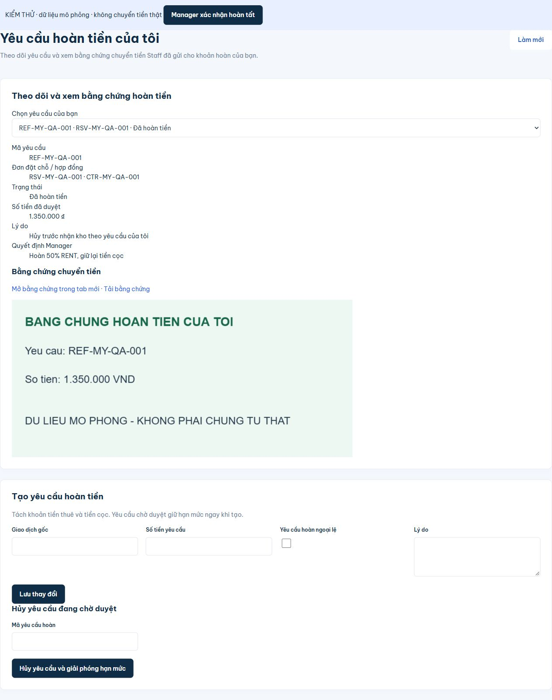
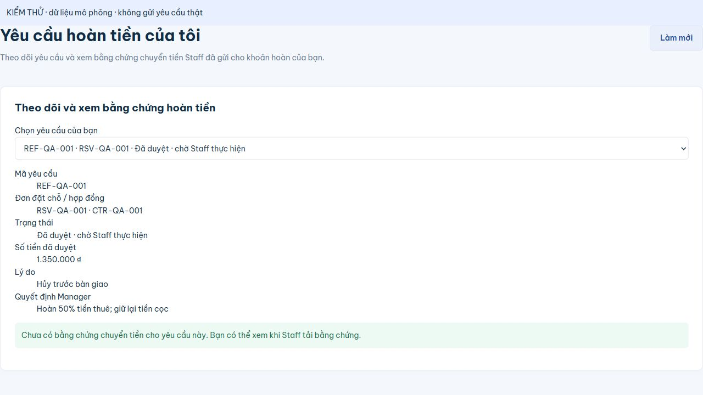

# Khách xem bằng chứng hoàn tiền của mình — 26/10/2026

## Kết quả

Khách có mục **Hoàn tiền của tôi** trong menu. Trang dùng danh sách yêu cầu theo quyền backend, cho chọn hồ sơ và xem lý do, quyết định, số tiền và trạng thái. Khi EVIDENCE_SUBMITTED hoặc COMPLETED, hiển thị `RefundEvidencePanel` để xem ảnh/PDF, mở tab hoặc tải về. Nếu chưa có file, hiển thị chờ Staff tải bằng chứng; không hiển thị nút tải file chưa tồn tại.

Khoản hoàn do hủy trước nhận kho cũng có phần xem bằng chứng ngay trong **Yêu cầu bàn giao → Xem hồ sơ → Theo dõi hoàn tiền**. Dùng lại component và endpoint có JWT, không thêm đường dẫn truy cập file công khai hoặc thay quy tắc phê duyệt/hoàn tiền.

File sửa: `CustomerRefundRequestsPage.jsx`, `HandoverReviewPage.jsx`, `AppShell.jsx`; cập nhật hướng dẫn và assertion kiểm thử quyền sở hữu. Theo yêu cầu tiếp theo của người dùng, form tạo yêu cầu hoàn tiền/ngoại lệ và form hủy yêu cầu đã được bỏ khỏi trang khách. Trang chỉ theo dõi và xem bằng chứng; thay đổi này không sửa API hoàn tiền dùng bởi các luồng hiện có.

## Kiểm tra

| Kiểm tra | Lệnh / cách thực hiện | Kết quả |
| --- | --- | --- |
| Frontend | `& 'C:\Program Files\nodejs\npm.cmd' run check` | PASS: build, 12/12 Vitest, contract 92 operations/45 schemas/80 adapter calls |
| Backend | `mvn -o -B "-Dmaven.repo.local=C:\Users\phuct\.m2\repository" -f backend/pom.xml verify "-Dspring.config.import="` | PASS: 76 tests H2, 0 failure/error; 28 mục live/migration/setup opt-in không bật |
| Chủ sở hữu file | `HandoverReviewChecks.approvedRentRefundUsesExistingStaffEvidenceThenManagerConfirmation` trong full verify | PASS: khách chủ hồ sơ lấy đúng byte bằng chứng trước Manager confirm và tiếp tục 200 sau COMPLETED; khách khác 404; anonymous 401 |
| Giao diện | Component thực + API adapter mô phỏng | PASS: chọn hồ sơ APPROVED chưa có file thấy thông báo chờ; chọn EVIDENCE_SUBMITTED mở đúng ảnh; đổi COMPLETED rồi làm mới vẫn giữ ảnh và có link mở/tải |
| Diff | `git diff --check` | PASS |

Trang fixture đã được xóa sau kiểm thử; fetch thật bị chặn. Không gửi yêu cầu hoàn, upload chứng từ thật hoặc xác nhận hoàn tiền trên Supabase trong task này. UI ảnh đã kiểm trực tiếp; PDF dùng lại viewer và endpoint đã có, không kiểm riêng browser PDF rendering trong lượt này. API sở hữu file đã có từ backend; không cần migration hoặc sửa quyền database.

## Bỏ form tạo/ngoại lệ và hủy yêu cầu

Theo yêu cầu tiếp theo ngày 26/10/2026, đã bỏ toàn bộ hai form khỏi `CustomerRefundRequestsPage.jsx`, đồng thời bỏ import Form/ReloadContext không còn dùng. Giữ nguyên danh sách, trạng thái, số tiền, quyết định, xem/tải bằng chứng và Làm mới. API backend không thay đổi trong lần chỉnh giao diện này.

VERIFIED trong trình duyệt với component thực và dữ liệu mô phỏng: sau khi chọn hồ sơ, số thẻ form bằng 0, không còn tiêu đề tạo/hủy, vẫn hiển thị đúng yêu cầu và trạng thái. Trang preview đã xóa. `npm run check` PASS (build, 12 tests frontend, contract); `mvn verify` H2 PASS 76 tests, 28 mục live/migration/setup opt-in không bật; `git diff --check` PASS.

