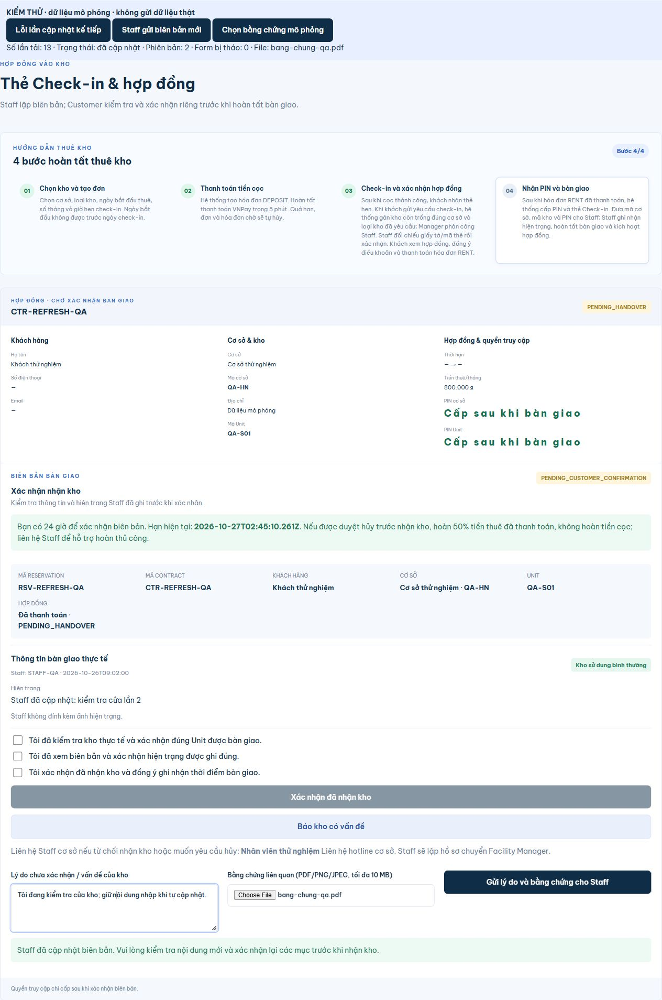

# Sửa tải lại làm mất thao tác xác nhận bàn giao — 26/10/2026

## Nguyên nhân và thay đổi

VERIFIED: `CheckinPassPage` gọi `contracts.reload` mỗi 10 giây. `useRemote` đặt `busy=true` cho mọi lần tải; trang trả về màn hình “Đang tải thẻ Check-in…” khi busy nên unmount `HandoverConfirmationPanel`. State checkbox/lý do/file mất theo mỗi lần unmount.

- `CheckinPassPage.jsx`: chỉ thay toàn trang bằng loading/error khi chưa có dữ liệu lần đầu. Lần cập nhật sau giữ nguyên cây component/khóa Contract, hiển thị lỗi tải nền trong trang và nút thử lại nếu cần. Không sửa hành vi `useRemote` dùng chung cho các màn hình khác.
- `HandoverConfirmationPanel.jsx`: cập nhật chi tiết khi metadata biên bản thay đổi, giữ state nhập liệu trong các lần tải danh sách thường. Khi Staff gửi biên bản có ngày/nội dung mới, bỏ các tick xác nhận cũ và thông báo đọc lại; vẫn giữ lý do/file đang soạn. Dọn object URL ảnh theo effect khi bản ghi thay đổi/unmount.

## Kiểm chứng hành vi

PASS trên trình duyệt với component source thực, chu kỳ 10 giây thực và độ trễ response 1,8 giây. API adapter dùng dữ liệu tổng hợp; fetch thật bị chặn, không ghi database hoặc xác nhận nhận kho của khách thật.

| Ca | Kết quả thực tế |
| --- | --- |
| Chọn checkbox, nhập lý do rồi qua nhiều lần poll | Checkbox giữ nguyên, textarea giữ nguyên, không hiện loading toàn trang |
| Chọn file PDF mô phỏng rồi poll | Input vẫn giữ `bang-chung-qa.pdf`; bộ đo cuối thấy 13 lần tải và 0 lần tháo form |
| Lần cập nhật nền lỗi mạng | Hiện cảnh báo + Thử lại trong trang, form/nội dung/file giữ nguyên |
| Focus textarea trong lúc cập nhật | Con trỏ vẫn ở textarea sau lỗi và sau lần tải tiếp theo |
| Staff gửi nội dung/ngày biên bản mới | Hiện nội dung mới, checkbox được bỏ chọn và có thông báo xem lại; lý do/file và focus còn nguyên |

Trang fixture tạm đã xóa sau khi dùng. Lỗi từ thao tác selector trong quá trình kiểm thử đã được kiểm tra lại bằng state mới; không coi thao tác thất bại là PASS.

## Kiểm tra repository

- `& 'C:\Program Files\nodejs\npm.cmd' run check`: PASS build, 12/12 Vitest, contract 92 operations/45 schemas/80 adapter calls.
- `mvn -o -B "-Dmaven.repo.local=C:\Users\phuct\.m2\repository" -f backend/pom.xml verify "-Dspring.config.import="`: PASS 76 tests H2, 0 failure/error, 28 mục live/migration/setup opt-in không bật; BUILD SUCCESS. Không thay backend trong task này.
- `git diff --check`: PASS.

Giới hạn: kiểm tra trình duyệt dùng dữ liệu mô phỏng và chính component thực; chưa đăng nhập khách thật hoặc gửi xác nhận bàn giao trên Supabase trong lượt này. Không lưu nháp vào localStorage; đóng tab hoặc reload trình duyệt thủ công vẫn xóa state tạm theo hành vi hiện có. Các thay đổi catalog/hủy bàn giao/dữ liệu kiểm thử từ task trước được giữ nguyên.

Đề xuất AGENTS.md, chưa sửa: **Trang có form và polling phải giữ component khi refresh nền; kiểm tra nội dung nhập/file/focus qua cả response thành công và lỗi.**
