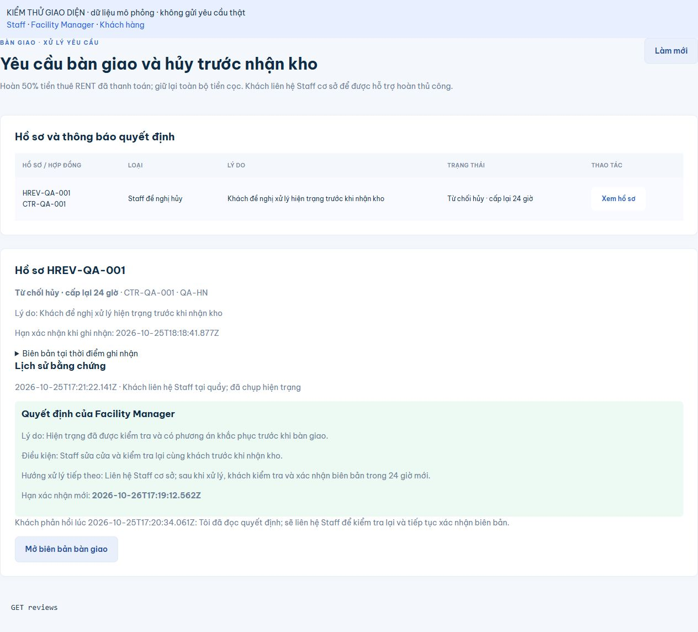

# Kiểm chứng xác nhận bàn giao và hủy trước nhận kho

> Cập nhật 26/10/2026: migration 015 đã rehearsal rollback, COMMIT và đọc kiểm lại trên Supabase staging. 17 ca live đã PASS (16 luồng + 1 bổ sung lý do dài); bằng chứng và giới hạn tại [execution report](handover-migration-015-execution.md). Phần H2/giao diện bên dưới là kết quả kiểm tra trước apply.

## Kết quả so với yêu cầu

VERIFIED trên source và H2: biên bản mới có hạn 24 giờ; job quá hạn tạo một yêu cầu hủy chờ Manager, không giải phóng kho. Staff ghi lý do/căn cứ/bằng chứng; Manager duyệt hoặc từ chối với lý do, điều kiện và hướng xử lý bắt buộc. Từ chối cấp lại 24 giờ; khách xem thông báo trong ứng dụng và gửi phản hồi. Duyệt hủy cập nhật trạng thái/Unit/task và tạo hoàn 50% RENT thực thu; không hoàn DEPOSIT.

Chính sách đã chốt: [requirements](../requirements/handover-confirmation-and-cancellation.md). Hướng dẫn vai trò và rollback: [handover-cancellation.md](../guides/handover-cancellation.md).

## Thành phần thay đổi

- `HandoverConfirmationPolicy`, deadline của `HandoverRecord`, `HandoverDeadlineJob`: dùng chung biên đúng 24 giờ giữa xác nhận và giám sát.
- `HandoverReview`/`HandoverReviewEvidence`, repository, controller và `HandoverReviewWorkflow`: hồ sơ riêng, bản chụp biên bản, bằng chứng thêm mới, quyết định và phản hồi khách. Không ghi đè lịch sử khi Staff gửi lại biên bản.
- `HandoverWorkflow`, `CancelReservationWorkflow`, `RefundRequestService`: chặn hủy vượt quyền/nhận kho khi yêu cầu đang chờ; chỉ tạo khoản hoàn theo hồ sơ Manager đã duyệt; chặn yêu cầu hoàn cọc hoặc khoản bổ sung trái chính sách.
- `RefundRequest.handoverReviewId`: liên kết khoản hoàn với quyết định, tiếp tục dùng chuỗi Staff tải bằng chứng → Manager xác nhận COMPLETED hiện có.
- Giao diện mới **Yêu cầu bàn giao** cho Customer/Staff/Facility Manager; biên bản khách có hạn, lý do/file và thông báo quyết định. Thẻ hẹn và task hủy hiển thị đúng trạng thái.
- OpenAPI/route inventory/hướng dẫn/Postman README cập nhật. Không thay dependency hoặc thay đổi các test có sẵn.

## Kiểm tra thực thi

Windows, Java 21, Maven 3.9.16 offline và Node 24.15.0. Maven dùng cache ngoài workspace với quyền thực thi ngoài sandbox; `spring.config.import` bị tắt cho H2, không nạp cấu hình riêng hoặc kết nối Supabase.

| Kiểm tra | Lệnh | Kết quả |
| --- | --- | --- |
| Frontend build/tests/contract | `& 'C:\Program Files\nodejs\npm.cmd' run check` | PASS: build, 12/12 frontend tests, 92 operations/45 schemas/80 adapter calls |
| Toàn bộ backend | `mvn -o -B "-Dmaven.repo.local=C:\Users\phuct\.m2\repository" -f backend/pom.xml verify "-Dspring.config.import="` | PASS: 83 mục, 75 tests thực thi, 0 failure/error; 8 mục Supabase opt-in không bật. BUILD SUCCESS |
| Integration mới | `mvn -o -B "-Dmaven.repo.local=C:\Users\phuct\.m2\repository" -f backend/pom.xml test "-Dtest=HandoverReviewIntegrationTest" "-Dspring.config.import="` | PASS: 16/16; nằm trong full verify cuối cùng |
| Chính sách mới | `HandoverConfirmationPolicyTest` trong full verify | PASS: 4/4 |
| Ánh xạ migration | Đối chiếu các `@Column` của hai entity mới với migration | PASS: đủ 25 + 7 cột. Đây chỉ là kiểm tra khai báo, không chứng minh SQL chạy được trên PostgreSQL |
| Diff | `git diff --check` | PASS |

16 ca integration xác minh: job trước/đúng hạn và chống tạo trùng; xác nhận ngay trước hạn; từ chối xác nhận đúng hạn dù job chưa chạy; chặn hủy trực tiếp cả Customer/Staff/Manager; duyệt hủy nguyên tử/đúng 50% RENT/không hoàn cọc; retry duyệt không tạo thêm hoàn; từ chối có lý do và hạn mới; khách phản hồi đúng chủ sở hữu; tái quá hạn sau từ chối; phân quyền/chi nhánh/anonymous; thiếu xác nhận chính sách/Unit không khớp không hủy; Payment/Invoice sai tổng rollback cả khoản hoàn; lưu lý do/file bất biến khi gửi lại biên bản; chặn file sai và quyền tải file; hai Manager duyệt đồng thời chỉ có một hoàn; xác nhận khách chạy đua với duyệt hủy; biên bản legacy không tự sinh hạn; chuỗi hoàn thủ công Staff evidence → Manager confirm; hồ sơ hoàn cọc đã tồn tại chặn quyết định trái chính sách. Một ca có thể kiểm tra nhiều điều kiện.

Các request MockMvc dùng tài khoản tổng hợp và cơ chế `user(...)` của Spring Security Test; đây không phải kiểm thử đăng nhập/JWT thật. Truy vấn, transaction, khóa và lưu trữ H2 là thực. File minh chứng giả được lưu dưới `backend/target/handover-review-test-evidence`, không phải chứng từ chuyển tiền thật; không gửi email hoặc gọi ngân hàng.

## Giao diện

VERIFIED bằng trình duyệt với component source thực và API adapter mô phỏng: Manager nhập lý do/điều kiện/hướng xử lý rồi từ chối; khách nhận quyết định mới, thấy hạn 24 giờ mới và gửi phản hồi; phản hồi không tự xác nhận nhận kho. Trang fixture chặn network thật, đã được xóa sau kiểm thử.

## Chưa xác minh / bước môi trường còn lại

- PASS sau authorization của người dùng: rehearsal rollback/apply migration 015 trên Supabase staging; Hibernate validate 18 Entity, constraint/partial index/ACL, đọc kiểm sau COMMIT và luồng nghiệp vụ qua MockMvc + PostgreSQL. Xem execution report để phân biệt với H2 và đăng nhập/JWT thật.
- Không có PostgreSQL/Docker cục bộ trong PATH; rehearsal được phép đã chạy trực tiếp trên staging trong transaction rollback.
- Backend đang phục vụ giao diện chưa được nạp bản mới; chưa bật job mới trên database dùng chung. Khi triển khai phải kiểm tra `app.scheduling.enabled`: bật scheduling cũng chạy các job reservation/rental hiện có, nên cần cấu hình và review môi trường trước khi bật.
- Migration bổ sung cột deadline, hai bảng, chỉ mục và liên kết hoàn; không sửa giá trị Invoice/Payment PAID và không backfill deadline lịch sử. Biên bản cũ cần Staff gửi lại.
- Phải backup/snapshot và rehearsal được phép trước apply, validate lại mapping/quyền, kiểm tra fixture tổng hợp và rollback sạch sau kiểm thử. Không DROP bảng/cột hoặc xóa giao dịch để rollback ứng dụng.

Không còn điểm OPEN về tỷ lệ hoàn hoặc xử lý khi từ chối. Schema staging đã áp dụng; ứng dụng đang phục vụ giao diện và scheduler chưa được restart/bật trong thao tác migration/kiểm thử này.
