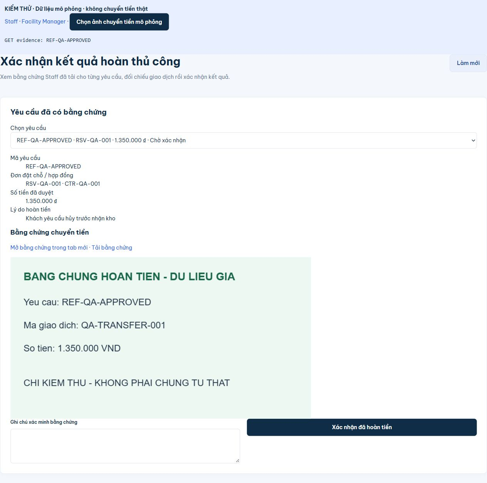

# Staff tải bằng chứng theo yêu cầu hoàn và Manager xem bằng chứng

## Thay đổi

- `RefundExecutionPage.jsx`: bỏ form tạo yêu cầu hoàn thay khách khỏi trang **Thực hiện hoàn tiền**. Staff chọn hồ sơ từ danh sách yêu cầu đã được Manager duyệt (APPROVED), xem đơn/hợp đồng, lý do và số tiền đã duyệt rồi tải file với mã chuyển tiền. Không nhập tay mã yêu cầu để gắn nhầm. Hồ sơ EVIDENCE_SUBMITTED/COMPLETED chỉ cho xem lại, không tải đè bằng chứng.
- `RefundConfirmationPage.jsx`: Manager chọn hồ sơ EVIDENCE_SUBMITTED hoặc COMPLETED trong cơ sở, xem bằng chứng và đối chiếu số tiền trước khi ghi chú/xác nhận kết quả. Bằng chứng vẫn được xem sau COMPLETED.
- `RefundEvidencePanel.jsx` và `billing.api.js`: tải file qua endpoint có JWT hiện có, hiển thị ảnh hoặc iframe PDF, có liên kết mở tab mới/tải về và thu hồi object URL khi không dùng. Không hiển thị đường dẫn lưu file riêng của backend.
- Cập nhật hướng dẫn quy trình. Không sửa nghiệp vụ phê duyệt/hủy/hoàn tiền backend, không chạy migration và không thay dữ liệu Supabase trong lượt này. Khách phản hồi không tự làm một hồ sơ chưa duyệt đủ điều kiện hoàn: bước upload vẫn bắt buộc APPROVED.

## Kiểm chứng

VERIFIED qua source và regression backend: endpoint upload chỉ cho STAFF đúng cơ sở trên RefundRequest APPROVED; endpoint xem file cho chủ sở hữu hoặc Staff/Manager đúng cơ sở. Endpoint confirm chỉ cho FMANAGER; tải file/upload không đồng nghĩa hoàn tất.

| Kiểm tra | Lệnh / thao tác | Kết quả |
| --- | --- | --- |
| Frontend | `& 'C:\Program Files\nodejs\npm.cmd' run check` | PASS: build, 12/12 tests; contract 92 operations, 45 schemas, 80 adapter calls |
| Backend | `mvn -o -B "-Dmaven.repo.local=C:\Users\phuct\.m2\repository" -f backend/pom.xml verify "-Dspring.config.import="` | PASS: 76 tests H2 thực thi, 0 failure/error; 28 mục live/migration/setup opt-in không bật |
| Quyền xem file | Bổ sung assertion vào `HandoverReviewChecks.approvedRentRefundUsesExistingStaffEvidenceThenManagerConfirmation` | PASS: Manager đúng cơ sở tải đúng byte PDF/content-type trước và sau COMPLETED; Manager khác cơ sở/khách khác nhận 404, anonymous 401, chưa upload 404 |
| Giao diện Staff | Component thực + adapter mô phỏng: một hồ sơ APPROVED, một PENDING | PASS: chỉ hồ sơ APPROVED được chọn; không còn form “Tạo thay khách”; tải ảnh vào đúng REF với reference; chuyển sang chỉ xem sau gửi |
| Giao diện Manager | Mở hồ sơ Staff vừa gửi, bấm Xem bằng chứng rồi ghi chú/xác nhận | PASS: ảnh hiển thị đúng REF/số tiền/reference, có link mở tab/tải; xác nhận chuyển COMPLETED, bằng chứng vẫn hiện |
| Diff | `git diff --check` | PASS |

Các thao tác trình duyệt dùng trang fixture riêng, chặn fetch thật; ảnh có nhãn dữ liệu giả, không là chứng từ ngân hàng. Trang fixture đã xóa sau kiểm thử. Không gửi xác nhận hoàn tiền của khách thật hoặc chuyển tiền thật. UI ảnh đã được kiểm trực tiếp; PDF backend/content-type/bytes đã được kiểm bằng H2, iframe PDF phụ thuộc hỗ trợ trình duyệt và có link mở/tải dự phòng. Chưa thực thi lượt này qua UI đăng nhập thật/Supabase.

Mã mới thuộc frontend, Vite dev nhận qua HMR; production cần dùng bundle frontend mới. Backend download/authorization dùng endpoint hiện có, không cần thay schema. Giữ nguyên toàn bộ thay đổi trước đó trong workspace.
